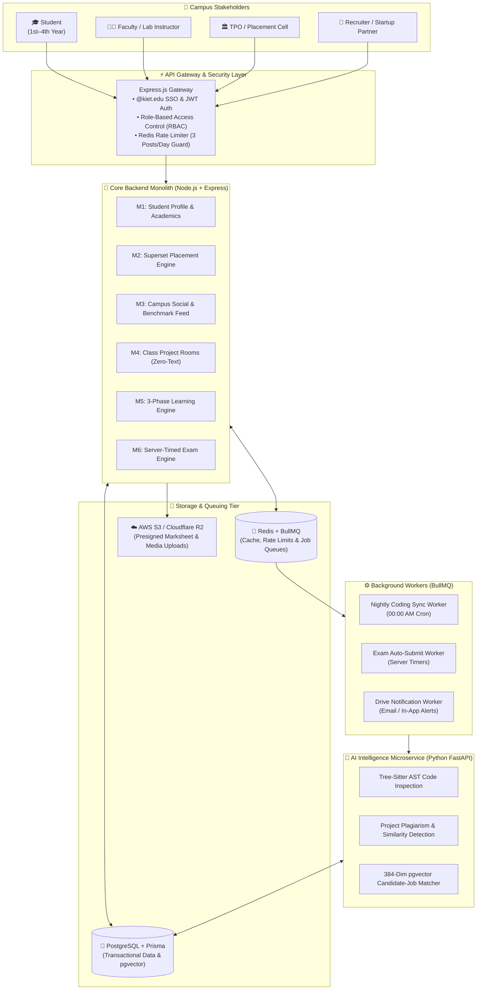
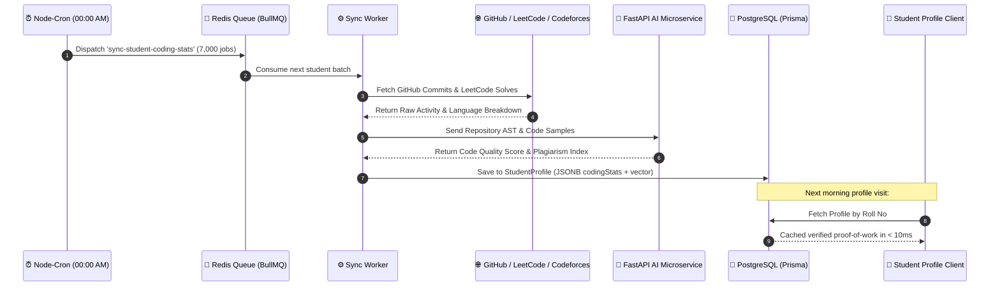
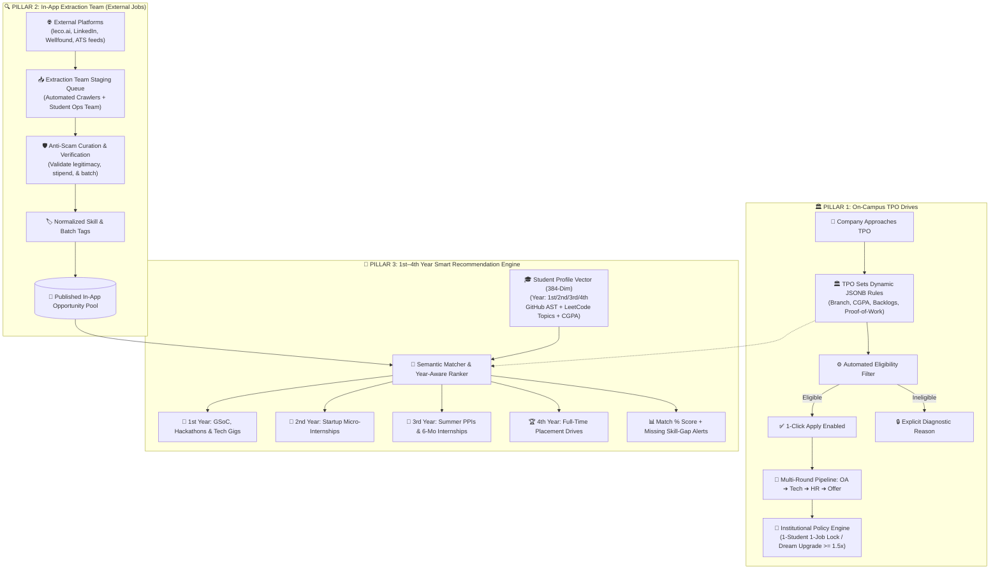

# 🎓 KIET Campus Talent & Career Development Platform
> **Codename:** `Only_Jobs` • **Target Scale:** KIET Group of Institutions (~8,000+ Students)  
> **Mission:** Replacing resume fraud, unorganized WhatsApp placement groups, and static portals with **verifiable proof of work**, continuous peer motivation, institutional placement policies, and deep AI-driven skill intelligence.

---

## 📌 Executive Summary: Why This Platform?

Current campus placement systems and generic social networks fail Indian engineering institutions in two fundamental ways:
1. **Resume Inflation & Zero Proof:** Students copy-paste projects and self-claim marks. Recruiters and TPOs waste hundreds of hours manually screening unverified claims.
2. **Operational Chaos for TPO:** Managing 1-student-1-job rules, dream company upgrades, branch eligibility filters, and backlog policies across Google Sheets and WhatsApp is error-prone and stressful.

**Only_Jobs** solves this with an institutional, proof-first ecosystem:
* **Students:** 1st-to-4th-year growth ladders, automated nightly GitHub/LeetCode sync, AI code-quality scoring, and verified academic credentials.
* **Faculty:** Noise-free lab project rooms with zero conversational clutter, automated AST code similarity checks, and 1-click evaluations.
* **TPO (Placement Cell):** Superset-grade automated placement drives, dynamic JSONB eligibility filters, automated 1-student-1-job policy locks, and instant recruiter talent extraction.
* **Leadership (Deans & HODs):** Real-time department skill heatmaps, verified student benchmark matrices, and data-backed placement analytics.

---

## 🏗️ High-Level System Architecture

The platform is designed as a **high-throughput Modular Monolith** (Node.js/Express) coupled with an **asynchronous Worker Queue** (Redis + BullMQ) and a specialized **AI Code Intelligence Microservice** (Python + FastAPI).



---

## ⚡ Core Operational Workflows

### 1. Verified Proof-of-Work & Nightly Sync Pipeline
Instead of querying third-party APIs during page loads (which causes latency and rate limits), student activity is synchronized asynchronously every night and enriched with AI code analysis.



---

### 2. The Triple-Pillar Placement & Opportunity Engine
Unlike traditional portals that only serve 4th-year students during placement season, **Only_Jobs** operates as a continuous, 3-pillar opportunity ecosystem:



---

### 3. Faculty Class Project Room & Zero-Text Anti-Plagiarism Flow
Lab submissions are kept noise-free: conversational chit-chat is blocked, requiring clean repository links and screenshots reviewed with 1-click teacher grading and automated AST analysis.

```mermaid
flowchart LR
    Student["🎓 Student"] -->|"Submits Repo + Screenshot<br/>(Zero Text Allowed)"| Guard["🛡️ Zod Validation Guard"]
    Guard -->|"Valid Submission"| Room["📂 Class Project Room"]
    Room -->|"Dispatches Job"| AI["🧠 AST Plagiarism Checker"]
    AI -->|"Computes Similarity"| Score["📊 Code Authenticity Score"]
    Score --> Teacher["👨‍🏫 Faculty Dashboard"]
    Teacher -->|"1-Click Action"| Action["✅ Approve / Verified Badge<br/>⚠️ Request Resubmission<br/>🚩 Flag Academic Fraud"]
```



---

## 🛠️ Technology Stack

| Layer | Technologies | Key Architectural Role |
| :--- | :--- | :--- |
| **Backend Monolith** | **Node.js • Express** | High-concurrency modular monolith with strict domain boundaries |
| **Database & ORM** | **PostgreSQL • Prisma • pgvector** | ACID compliance, JSONB eligibility queries, and 384-dim skill embeddings |
| **Caching & Queues** | **Redis • BullMQ** | Atomic rate limiting (3 posts/day), nightly coding sync, and delayed auto-submits |
| **AI Microservice** | **Python • FastAPI • Tree-Sitter** | AST code parsing, semantic project deduplication, and talent matchmaking |
| **Storage & Media** | **AWS S3 / Cloudflare R2** | Presigned direct uploads for marksheet PDFs, project screenshots, and avatars |
| **Client UI** | **Next.js (App Router) • Tailwind CSS** | Fast server-side rendering, role-tailored dashboards, and dark-mode styling |
| **Infra & DevOps** | **Docker • GitHub Actions** | Multi-container compose (API + Worker + Redis + Postgres + AI Service) |

---

## 📂 Repository Architecture & Documentation Map

Detailed engineering specifications, database schemas, and architectural blueprints are organized into two key directories:

```
Only_jobs/
├── README.md                                    # Master platform guide & architecture
├── plan/                                        # 🏛️ Core Platform Specifications
│   ├── system_design_hdd.md                     # Complete High-Level Design Document (HDD)
│   ├── plan.md                                  # 10-Day Dean roadmap & 6-month development sprints
│   ├── student_profile_architecture.md          # Profile sub-modules, database models & sync
│   ├── superset_placement_engine.md             # Placement drive automation & policy rules
│   ├── campus_feed_architecture.md              # Social motivation feed & Redis rate limiting
│   ├── class_project_rooms_architecture.md      # Zero-text lab submissions & grading
│   ├── learning_and_certification_engine.md     # 3-phase progression & verifiable certificates
│   ├── exam_and_mock_test_engine.md             # Server-timed tests & anti-cheat telemetry
│   ├── alumni_directory_architecture.md         # Alumni graduation transition & privacy toggles
│   └── helper_mentor_support_engine.md          # Load-balanced peer mentor ticket queues
└── ai/                                          # 🧠 AI-Enhanced Feature Specifications
    ├── student-profile-system.md                # AI AST depth, topic matrix & vector embeddings
    ├── superset_placement_engine.md             # Semantic candidate matching & recruiter dossiers
    ├── class_project_rooms_architecture.md      # Tree-sitter code similarity & quality grading
    ├── exam_and_mock_test_engine.md             # AI anomaly detection & anti-cheating telemetry
    ├── learning_and_certification_engine.md     # AI skill-gap analysis & path recommendations
    └── helper_mentor_support_engine.md          # AI first-response doubt bot & smart routing
```

---

## 🎯 Master Functional Modules Overview

| # | Module | Core Functionality | Primary Stakeholders |
|:---|:---|:---|:---|
| **M1** | **[Student Profile System](plan/student_profile_architecture.md)** | Admin-locked college meta (`@kiet.edu`), nightly coding sync (GitHub/LeetCode), self-declared marks with S3 presigned marksheets, fraud audit trail. | Student, TPO, Dean |
| **M2** | **[Triple-Pillar Placement Engine](plan/superset_placement_engine.md)** | (1) On-Campus TPO Drives with 1-student 1-job policy, (2) In-App Team off-campus job curation (leco.ai, Wellfound), and (3) 1st-to-4th-year smart recommendation engine. | TPO, Student, In-App Team, Recruiter |
| **M3** | **[Campus Feed](plan/campus_feed_architecture.md)** | Achievement & peer motivation hub with Redis atomic 3-posts-per-day rate limits, cursor pagination, and anti-spam controls. | Student, Faculty, Dean |
| **M4** | **[Class Project Rooms](plan/class_project_rooms_architecture.md)** | Zero-text submission drop box (screenshots + repository URL only) with automated AST plagiarism checks and 1-click teacher review. | Student, Faculty |
| **M5** | **[Learning & Certification](plan/learning_and_certification_engine.md)** | Navigation slider entry, smart course recommender, open exploration freedom (no learning locks), 3-phase pipelines, 20 project + 80 exam split, end-of-sem test windows (max 3 attempts), top 15–20 capstones & career outcomes. | Student, Faculty, Recruiters |
| **M6** | **[Exam & Mock Test Engine](plan/exam_and_mock_test_engine.md)** | Server-enforced test windows, BullMQ delayed auto-submit workers, and anti-cheating telemetry (disqualification on 3 tab switches). | Student, Faculty |
| **M7** | **[Alumni Network](plan/alumni_directory_architecture.md)** | Automated graduation transition, package privacy toggles (`isPackagePublic`), and multi-dimensional company/role search. | Student, Alumni |
| **M8** | **[Mentor Support Engine](plan/helper_mentor_support_engine.md)** | Structured doubt ticketing, round-robin routing to least-busy peer mentors/TAs, and AI-assisted instant answers. | Student, TA/Mentors |
| **M9** | **[AI Code Intelligence](ai/student-profile-system.md)** | AST code parsing, cross-repository plagiarism analysis, and semantic candidate-to-job matching using vector embeddings. | TPO, Recruiters |

---

## 📅 Roadmap & Milestones

* **Phase 1: Architectural Design & Dean Pitch (Current - October 2026)**
  * Finalize High-Level Design Document (`system_design_hdd.md`).
  * Target Pitch Date: **25 October 2026** — Presentation to Dean, KIET Group of Institutions.
  * Controlled Pilot Approval: 100 students across the CSE / IT department.
* **Phase 2: Core Platform & Sync Pipeline (Nov 2026 – Jan 2027)**
  * Core Express Monolith, PostgreSQL Prisma models, Redis BullMQ nightly sync.
  * Student Profile & Class Project Rooms rollout.
* **Phase 3: Superset Placement ATS & Exams (Feb 2027 – Mar 2027)**
  * Placement drive engine with dynamic JSONB rules and 1-student-1-job enforcement.
  * Server-timed mock test engine with anti-cheat telemetry.
* **Phase 4: AI Microservice & Campus-Wide Launch (April 2027 onwards)**
  * FastAPI AST inspection service and semantic candidate matchmaking.
  * Scale platform to all 7,000+ students across all engineering branches.

---

## 👥 Core Project Team

* **Arpit Prajapati** — *Backend Architecture, Database Design, System Blueprinting & DevOps Lead*
* **Frontend Lead** — *Next.js Client Architecture, UI/UX Design System & Micro-Interactions*
* **AI & Data Specialist** — *Python FastAPI Microservice, AST Code Analysis & External APIs*
* **Product & Institutional Liaison** — *Institutional Workflows, Dean Presentation & Pilot Management*

---
*Maintained under strict engineering discipline. Designed for KIET Group of Institutions.*
