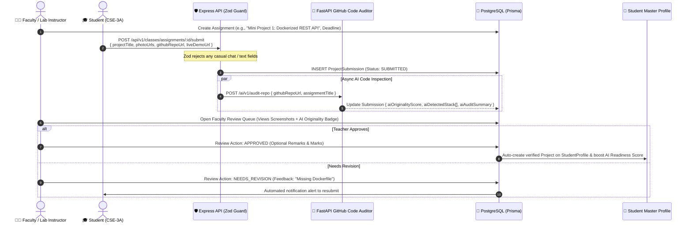

# Class Project Rooms: Zero-Text Verification, AI Code Audit & Faculty Review Engine

---

## 📌 Executive Summary

The **Class Project Room** module is **NOT** a casual WhatsApp, Discord, or Slack group.
Traditional college WhatsApp groups suffer from conversational clutter ("Good morning sir", "Sir check my project", lost assignment links), placing an unbearable administrative burden on professors.

This module is engineered as a **Strict Project Submission, AI Pre-Verification & Faculty Review Room**:

1. **Zero-Text Policy:** Conversational text chatting is disabled via strict Zod validation.
2. **Proof-Only Submissions:** Restricted to 1–4 UI/circuit screenshots, a mandatory GitHub repository URL, and an optional live demo link.
3. **🧠 Automated AI Pre-Review Audit:** As soon as a student submits a repository, our Python AI Code Analyzer inspects the commit history, checks for cloned boilerplate, verifies required files (e.g., `Dockerfile`), and generates an **Originality & Tech Stack Badge** *before* the teacher even opens the queue.
4. **1-Click Faculty Review Queue:** Teachers see the AI verification report alongside the screenshots and approve/grade in 1 click.

---

## 🔄 1. The Zero-Clutter Project Submission & AI Pre-Audit Lifecycle



---

## 🗄️ 2. Database Schema (`schema.prisma`)

```prisma
enum SubmissionStatus {
  SUBMITTED
  APPROVED
  NEEDS_REVISION
  REJECTED
}

model ProjectSubmission {
  id             String           @id @default(uuid())
  assignmentId   String
  assignment     ClassAssignment  @relation(fields: [assignmentId], references: [id], onDelete: Cascade)

  studentId      String
  student        User             @relation(fields: [studentId], references: [id], onDelete: Cascade)

  // STRICT ZERO-TEXT CONTENT: Only Proof Artifacts
  projectTitle   String           @db.VarChar(120)
  photoUrls      String[]         // 1 to 4 screenshots / circuit diagrams (S3/R2 direct links)
  githubRepoUrl  String           // Mandatory GitHub repository link
  liveDemoUrl    String?          // Optional Vercel / Render / AWS deployment link

  // 🧠 Automated AI Code Auditor Pre-Check (Saves Faculty Evaluation Time)
  aiOriginalityScore Float?       // 0 to 100% (Based on commit velocity & AST comparison)
  aiDetectedStack    String[]     // Auto-extracted from package.json / requirements.txt / Dockerfile
  aiAuditSummary     String?      @db.VarChar(300) // e.g., "✅ 28 commits over 12 days | Dockerfile & Redis verified"
  aiFlaggedClone     Boolean      @default(false)  // True if single-commit dump or copied repo inside batch

  // Faculty Evaluation Section
  status         SubmissionStatus @default(SUBMITTED)
  facultyRemarks String?          @db.VarChar(500)
  gradeOrMarks   Float?
  evaluatedAt    DateTime?

  createdAt      DateTime         @default(now())
  updatedAt      DateTime         @updatedAt

  @@unique([assignmentId, studentId])
  @@index([assignmentId, status])
}
```

---

## 👨‍🏫 3. AI-Augmented Faculty Review Queue Wireframe

When a professor opens the classroom queue, they don't have to manually click into 60 GitHub links to check if students copied each other's code—the AI Auditor surfaces the telemetry right on the review card:

```text
┌────────────────────────────────────────────────────────────────────────┐
│ 📚 Cloud Computing Lab (KCS-601) • Section 3A • Prof. V. Sharma        │
│ Assignment: "Mini Project 1: Dockerized REST API" (Deadline: 20 Oct)  │
├────────────────────────────────────────────────────────────────────────┤
│ 👤 Rahul Sharma (Roll: 2100290120045)                 Status: SUBMITTED│
│ 📌 Project Title: "Distributed Task Queue with Redis"                  │
│                                                                        │
│ 🧠 AI CODE AUDIT: [ 🟢 94% Original ] [ ✅ Dockerfile Found ]          │
│    • Stack Detected: Node.js, Express, BullMQ, Redis, Docker           │
│    • Commit Telemetry: 24 commits across 9 days (No batch clone match) │
│                                                                        │
│ [ 🖼️ Screenshot 1 ]  [ 🖼️ Architecture ]  [ 🖼️ Terminal Logs ]          │
│ 🔗 GitHub: https://github.com/rahul/distributed-task-queue             │
│ 🌐 Live Demo: https://taskqueue.render.com                             │
│                                                                        │
│ Faculty Remarks: [ Excellent multi-stage Docker setup...            ]  │
│ Grade: [ 9.5 ] / 10                                                    │
│                                                                        │
│ [ ✔️ Approve & Mark Verified ]   [ 🔄 Request Revision ]   [ ❌ Reject ] │
└────────────────────────────────────────────────────────────────────────┘
```

---

## 🏛️ 4. Dean Pitch Angle (Why Faculty & Administration Will Welcome This)

| Common Administrative Fear | How Class Project Rooms + AI Auditor Solves It |
|---|---|
| "Teachers will resist another portal that creates extra work." | **Saves 80% evaluation time.** Our AI Code Auditor pre-checks every GitHub repo for originality, commit history, and required tech stack before the teacher even clicks it. |
| "Students copy projects from GitHub or seniors." | **AST & Commit Graph Plagiarism Detection.** Single-commit dumps and cross-batch duplicate repositories are automatically flagged (`aiFlaggedClone: true`) in red on the teacher's screen. |
| "How does this help placements?" | **Verified code pipeline.** Approved lab projects automatically sync to the student's `StudentProfile` with both AI and Faculty verification badges. |
