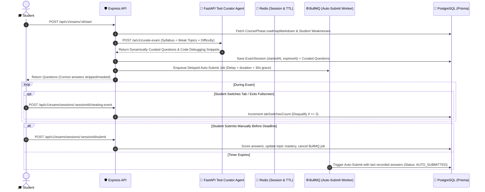

# Exams & Mock Tests Engine: AI Adaptive Test Curation, Server Timers & Anti-Cheating

---

## 📌 Executive Summary

The **Exams & Mock Tests Engine** is the evaluation core that powers phase gatekeeping, placement readiness tests, and campus drive screening.

In traditional college web portals, exams fail due to three glaring flaws:

1. **Static Question Banks (WhatsApp Leaks):** Fixed MCQ sets get photographed and shared across hostels within 10 minutes.
2. **Client-Side Timer Vulnerability:** Timers running strictly in JavaScript (`setInterval`) can be manipulated by pausing devtools.
3. **Rampant Tab Switching & Cheating:** Students open new tabs or Google answers without any server-side detection.

Our engine solves all three through an **AI Adaptive Test Curation Agent** (which dynamically generates questions from the platform's course syllabus and student weaknesses), **Server-Side Expiration Authority**, **Redis Delayed Auto-Submission**, and a **Real-Time Anti-Cheating Telemetry Layer**.

---

## 🔄 1. End-to-End AI-Curated Exam Session Lifecycle



---

## 🗄️ 2. Database Schema (`schema.prisma`)

```prisma
enum ExamStatus {
  SCHEDULED
  IN_PROGRESS
  COMPLETED
  AUTO_SUBMITTED
  DISQUALIFIED
}

enum QuestionType {
  SINGLE_CHOICE
  MULTIPLE_CHOICE
  BOOLEAN
}

model Exam {
  id              String        @id @default(uuid())
  tenantId        String        @default("kiet-main")
  title           String        // e.g. "DevOps Phase 1: Linux & Docker Assessment"
  description     String?
  durationMinutes Int           // e.g. 45 minutes
  totalMarks      Float         @default(100.0)
  passingPercent  Float         @default(70.0)
  maxAttempts     Int           @default(2)

  // 🧠 AI Curation Toggle: Dynamically curates fresh questions from CoursePhase syllabus
  isAiCurated     Boolean       @default(true)
  difficultyDistribution Json?  // { "easy": 30, "medium": 50, "hard": 20 }

  // Associated Course Phase or Placement Drive
  phaseId         String?       @unique
  jobDriveId      String?

  questions       ExamQuestion[]
  sessions        ExamSession[]

  createdAt       DateTime      @default(now())
  updatedAt       DateTime      @updatedAt

  @@index([tenantId])
}

model ExamQuestion {
  id              String        @id @default(uuid())
  examId          String
  exam            Exam          @relation(fields: [examId], references: [id], onDelete: Cascade)

  topicTag        String?       // e.g. "Docker Networking", "Linux cgroups"
  questionText    String        @db.Text
  codeSnippet     String?       @db.Text // AI-generated debugging block
  questionType    QuestionType  @default(SINGLE_CHOICE)
  options         String[]      // Array of 4 option strings

  // NEVER send correctIndices to frontend during exam!
  correctIndices  Int[]
  marks           Float         @default(2.0)
  explanation     String?       @db.Text // Revealed only after exam submission
  isAiGenerated   Boolean       @default(false)

  answers         StudentExamAnswer[]

  @@index([examId, topicTag])
}

model ExamSession {
  id               String        @id @default(uuid())
  examId           String
  exam             Exam          @relation(fields: [examId], references: [id], onDelete: Cascade)
  userId           String
  user             User          @relation(fields: [userId], references: [id], onDelete: Cascade)

  startedAt        DateTime      @default(now())
  expiresAt        DateTime
  submittedAt      DateTime?

  status           ExamStatus    @default(IN_PROGRESS)
  tabSwitchesCount Int           @default(0)
  fullscreenExits  Int           @default(0)
  disqualifyReason String?

  obtainedMarks    Float         @default(0.0)
  isPassed         Boolean       @default(false)
  aiTopicFeedback  Json?         // Post-exam breakdown of weak topics for Roadmap Agent

  answers          StudentExamAnswer[]

  @@unique([examId, userId, startedAt])
  @@index([userId, status])
}

model StudentExamAnswer {
  id              String        @id @default(uuid())
  sessionId       String
  session         ExamSession   @relation(fields: [sessionId], references: [id], onDelete: Cascade)
  questionId      String
  question        ExamQuestion  @relation(fields: [questionId], references: [id], onDelete: Cascade)

  selectedIndices Int[]
  isCorrect       Boolean       @default(false)
  marksAwarded    Float         @default(0.0)

  @@unique([sessionId, questionId])
}
```

---

## 🧠 3. AI Adaptive Test Curation Agent (`ai-service/app/agents/test_curator.py`)

When a student starts a Practice Mock or Phase Exam, the AI Test Curator reads `CoursePhase.roadmapMarkdown` and the student's `aiProfileAnalysis.weakDsaTopics` to curate a unique, leak-proof test paper:

```python
from fastapi import APIRouter
from pydantic import BaseModel

router = APIRouter(prefix="/ai/v1", tags=["AI Adaptive Test Curation"])

class ExamCurationRequest(BaseModel):
    course_title: str
    phase_level: str                 # BEGINNER | INTERMEDIATE | ADVANCE
    roadmap_markdown: str            # Syllabus & lab topics from CoursePhase
    student_weak_topics: list[str]   # From StudentProfile.aiProfileAnalysis
    num_questions: int = 20

class GeneratedQuestion(BaseModel):
    topicTag: str
    questionText: str
    codeSnippet: str | None
    questionType: str                # SINGLE_CHOICE | MULTIPLE_CHOICE
    options: list[str]
    correctIndices: list[int]
    marks: float
    explanation: str

@router.post("/curate-exam", response_model=list[GeneratedQuestion])
async def curate_course_exam(req: ExamCurationRequest):
    """
    LangGraph Test Curation Pipeline:
    1. Parses CoursePhase.roadmapMarkdown to extract core technical concepts.
    2. Allocates 60% weight to syllabus core and 40% weight to student_weak_topics.
    3. Mutates code snippets, port numbers, and constraints so no two students get identical questions.
    4. Runs a self-verification node to ensure correctIndices match the explanation.
    """
    # Returns structured list of GeneratedQuestion objects ready for Prisma createMany()
    return curated_questions
```

---

## ⏰ 4. Server-Side Timer, Anti-Cheating & Auto-Submission (Node.js)

- **Answer Key Stripping:** `correctIndices` and `explanation` are excluded at the Prisma `select` level during `startExam`.
- **BullMQ Delayed Auto-Submit:** Scheduled at `(exam.durationMinutes * 60 + 30) * 1000` ms so closing the browser cannot bypass evaluation.
- **3-Strike Tab Switch Disqualification:** `recordCheatingEvent` increments `tabSwitchesCount` on every `visibilitychange` ping and automatically sets `status: 'DISQUALIFIED'` on the 3rd violation.
