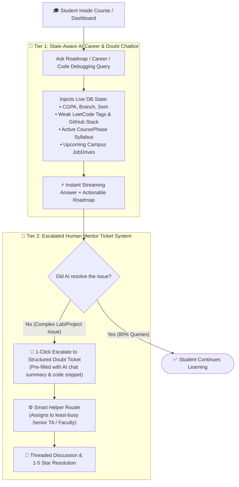

# Helper, AI Career Copilot & Mentor Support Engine: Architecture & Smart Routing

---

## 📌 Executive Summary

The **Helper, AI Copilot & Mentor Support Engine** solves three critical product experience problems for 7,000+ KIET students:

1. **🤖 24/7 State-Aware AI Career & Roadmap Chatbot:** Students get an intelligent copilot aware of their live CGPA, weak LeetCode topics, active course phase, and upcoming campus drives—capable of answering general career queries, generating personalized roadmaps, and debugging code instantly.
2. **L1 AI Ticket Deflection + Spam-Proof Mentor Escalation:** Before overwhelming human TAs/Faculty with repetitive syntax or Docker setup errors, the AI Chatbot provides an instant resolution. If the student still needs human help, a **Structured Doubt Ticket** is auto-routed to the least-busy mentor.
3. **Embedded In-Course Testing:** Practice Mocks and Official Phase Exams live directly inside the course workspace.

---

## 🔄 1. The AI-First Support & Escalation Lifecycle



---

## 🗄️ 2. Database Schema (`schema.prisma`)

```prisma
enum TicketStatus {
  OPEN
  AI_ANSWERED
  ASSIGNED
  IN_PROGRESS
  RESOLVED
  CLOSED
}

enum Priority {
  LOW
  MEDIUM
  HIGH
  URGENT
}

// 🤖 Stores multi-turn conversation threads for the Roadmap & General Chatbot
model AiChatSession {
  id          String          @id @default(uuid())
  userId      String
  user        User            @relation(fields: [userId], references: [id], onDelete: Cascade)
  title       String          @default("Career & Roadmap Chat")
  contextType String          @default("GENERAL_ROADMAP") // "GENERAL_ROADMAP", "COURSE_DOUBT", "DRIVE_PREP"
  messages    AiChatMessage[]
  createdAt   DateTime        @default(now())
  updatedAt   DateTime        @updatedAt

  @@index([userId, updatedAt(sort: Desc)])
}

model AiChatMessage {
  id          String        @id @default(uuid())
  sessionId   String
  session     AiChatSession @relation(fields: [sessionId], references: [id], onDelete: Cascade)
  role        String        // "user" | "assistant" | "system"
  content     String        @db.Text
  createdAt   DateTime      @default(now())

  @@index([sessionId, createdAt(sort: Asc)])
}

model SupportTicket {
  id              String          @id @default(uuid())
  tenantId        String          @default("kiet-main")

  studentId       String
  student         User            @relation("StudentTickets", fields: [studentId], references: [id], onDelete: Cascade)

  helperId        String?
  helper          User?           @relation("HelperTickets", fields: [helperId], references: [id])

  category        String          // "COURSE_DOUBT", "LAB_PROJECT_HELP", "BUG_REPORT"
  courseContext   String          // e.g. "DevOps - Phase 1: Docker Containerization"

  title           String          @db.VarChar(120)
  description     String          @db.Text
  codeSnippet     String?         @db.Text
  aiSuggestedFix  String?         @db.Text // Pre-populated by AI Chatbot to save Mentor time
  attachmentUrls  String[]

  status          TicketStatus    @default(OPEN)
  priority        Priority        @default(MEDIUM)

  rating          Int?
  feedback        String?         @db.VarChar(300)
  resolvedAt      DateTime?

  messages        TicketMessage[]

  createdAt       DateTime        @default(now())
  updatedAt       DateTime        @updatedAt

  @@index([tenantId, status])
  @@index([helperId, status])
}
```

---

## 🧠 3. State-Injected Roadmap & General Chatbot (`ai-service/app/agents/roadmap_chat.py`)

Built with LangGraph, the chatbot binds tools to query upcoming campus drives, course syllabi, and alumni mentors:

```python
from fastapi import APIRouter
from fastapi.responses import StreamingResponse
from pydantic import BaseModel

router = APIRouter(prefix="/ai/v1/chat", tags=["Roadmap & General Career Chatbot"])

class ChatRequest(BaseModel):
    session_id: str
    user_id: str
    message: str
    student_context: dict  # Injected by Node.js: { branch, sem, cgpa, weakTopics, verifiedSkills, activePhase }

@router.post("/roadmap")
async def chat_with_career_copilot(req: ChatRequest):
    """
    LangGraph Agent Capabilities:
    1. Personalized Roadmaps: Builds week-by-week study plans based on student_context.weakTopics.
    2. Course & Code Debugging: Answers technical doubts using CoursePhase.roadmapMarkdown via RAG.
    3. Drive Eligibility & Prep: Tells the student which upcoming campus drives they qualify for.
    4. Ticket Escalation Summary: If unresolved, packages the error log into a structured SupportTicket payload.
    """
    return StreamingResponse(stream_langgraph_response(req), media_type="text/event-stream")
```

---

## ⚙️ 4. Smart Helper Routing & Load Balancing Engine (Node.js)

When a query is escalated from the AI Chatbot to a human mentor, `createSupportTicket` automatically finds the least-busy `TEACHER` or `HELPER_MENTOR` and attaches `aiSuggestedFix` so the mentor has full context immediately.
