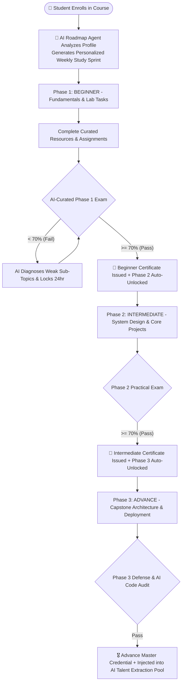

# Skill Verification & 3-Phase Learning Engine: AI Roadmaps & Talent Extraction Blueprint

---

## 📌 Executive Summary

The **Skill Verification & 3-Phase Learning Engine** is the talent production pipeline of the **KIET Campus Platform**.
Traditional placement cells suffer because student resumes are filled with unverified self-claims ("Proficient in MERN", "Experienced in Kubernetes").

This module converts passive learning into **institution-verified talent pipelines**:

1. **Curated 3-Phase Roadmaps:** Beginner → Intermediate → Advance.
2. **🤖 AI Personalized Study Sprint Generator:** Dynamically adapts the phase roadmap to a student's current semester, daily available hours, and upcoming campus drives.
3. **Strict Gatekeeping & Cryptographic Auto-Certification:** Students must score ≥ 70% on AI-curated phase assessments to unlock the next tier and mint tamper-proof certificate hashes.
4. **🧠 AI-Ranked Talent Extraction Engine:** Deans and TPOs can query, rank, and export pre-vetted candidate pools using semantic Proof-of-Work matching in 1-click.

---

## 🔄 1. The 3-Phase Progression & AI Personalization Lifecycle



---

## 🗄️ 2. Database Schema (`schema.prisma`)

```prisma
enum PhaseLevel {
  BEGINNER
  INTERMEDIATE
  ADVANCE
}

enum ProgressStatus {
  LOCKED
  IN_PROGRESS
  TEST_ELIGIBLE
  PASSED
}

model Course {
  id          String        @id @default(uuid())
  tenantId    String?
  title       String        // e.g. "Cloud Native DevOps Engineering"
  description String        @db.Text
  thumbnail   String?
  category    String        // "DEVOPS", "WEB_DEV", "AI_ML", "SYSTEMS"
  isPublished Boolean       @default(true)

  phases      CoursePhase[]
  mentors     CourseMentor[]

  createdAt   DateTime      @default(now())
  updatedAt   DateTime      @updatedAt

  @@index([category, isPublished])
}

model CoursePhase {
  id              String              @id @default(uuid())
  courseId        String
  course          Course              @relation(fields: [courseId], references: [id], onDelete: Cascade)

  level           PhaseLevel          // BEGINNER, INTERMEDIATE, ADVANCE
  title           String              // e.g. "Phase 1: Linux Kernel & Container Runtimes"
  roadmapMarkdown String              @db.Text // Indexed into pgvector for AI Test Curator & Chatbot

  resources       PhaseResource[]
  userProgress    UserPhaseProgress[]

  @@unique([courseId, level])
  @@index([courseId])
}

model UserPhaseProgress {
  id                  String         @id @default(uuid())
  userId              String
  user                User           @relation(fields: [userId], references: [id], onDelete: Cascade)
  phaseId             String
  phase               CoursePhase    @relation(fields: [phaseId], references: [id], onDelete: Cascade)

  status              ProgressStatus @default(LOCKED)
  completedItems      String[]

  // 🤖 AI Personalized Study Plan for this specific student & phase
  aiCustomSprintPlan  Json?          // { "week1": ["Linux namespaces", "Dockerfile lab"], "weakAreaFocus": "Networking" }

  testAttempts        Int            @default(0)
  testScore           Float?
  passedAt            DateTime?

  certificateId       String?        @unique
  certificateUrl      String?

  updatedAt           DateTime       @updatedAt

  @@unique([userId, phaseId])
  @@index([userId, status])
}
```

---

## 🎯 3. Dean & TPO AI-Ranked Talent Extraction Engine (`extractVettedTalent`)

When a startup or MNC visits KIET asking: *"We need 15 students who know Docker, Kubernetes, and FastAPI with strong problem-solving skills"*, the TPO runs a hybrid SQL + AI Readiness Score query:

```javascript
import { prisma } from '../lib/prisma.js';
import axios from 'axios';

export async function extractVettedTalent(req, res) {
  const { tenantId = 'kiet-main' } = req.user;
  const { category = 'DEVOPS', minPhase = 'ADVANCE', minCgpa = 7.0, naturalLanguageQuery } = req.query;

  try {
    // 1. Hard SQL Filter: Verified Phase Pass + Account Active
    const vettedStudents = await prisma.studentProfile.findMany({
      where: {
        tenantId,
        isAccountFrozen: false,
        user: {
          phaseProgress: {
            some: {
              status: 'PASSED',
              phase: {
                level: minPhase,
                course: { category }
              }
            }
          }
        }
      },
      select: {
        id: true,
        rollNumber: true,
        branch: true,
        currentSemester: true,
        aiProfileAnalysis: true, // Includes overallReadinessScore & oaSurvivalProbability
        user: { select: { name: true, email: true } },
        githubHandle: true,
        leetcodeHandle: true,
        codingStats: true,
        projects: {
          where: { isTeacherApproved: true },
          select: { title: true, githubRepoUrl: true, techStack: true, aiEngineeringScore: true }
        },
        certifications: {
          where: { isInternalCourse: true },
          select: { title: true, certificateHash: true, issueDate: true }
        }
      }
    });

    // 2. Optional AI Semantic Re-Ranking if TPO/Recruiter typed a custom prompt
    if (naturalLanguageQuery && vettedStudents.length > 0) {
      const aiRanked = await axios.post(`${process.env.AI_SERVICE_URL}/ai/v1/rank-candidates`, {
        query: naturalLanguageQuery,
        candidateIds: vettedStudents.map(s => s.id)
      });
      return res.json({ count: vettedStudents.length, students: aiRanked.data.rankedCandidates });
    }

    return res.json({
      count: vettedStudents.length,
      category,
      minPhase,
      students: vettedStudents
    });
  } catch (error) {
    console.error('[TalentExtraction Error]', error);
    return res.status(500).json({ error: "Failed to extract vetted talent." });
  }
}
```
