# Learning & Certification Engine: AI-Powered Recommendation & Evaluation Architecture
> **AI Roadmap Guidance, Capstone Code Analysis & End-Term Certification for KIET Group of Institutions**

---

## 📌 Executive Summary

The **AI Layer for the Learning & Certification Engine** automates three critical, high-friction tasks:
1. **Smart Course Recommendation Engine:** Powers the **"Recommend Course"** button in the course catalog. It evaluates completed courses (e.g., student finished Full-Stack $\rightarrow$ recommend DevOps/Cloud), student GitHub repo ASTs, LeetCode topics, and student aspirations to suggest the best next step.
2. **AI Capstone Project Evaluator (20 Marks):** Automatically audits submitted GitHub repositories for AST complexity, architecture structure, commit hygiene, and plagiarism before faculty review.
3. **Adaptive End-Term Exam Intelligence (80 Marks):** Curates balanced, proctored questions tailored to semester learning objectives and flags suspicious cheating telemetry.

---

## 🔄 1. AI Recommendation & Evaluation Pipeline

```mermaid
flowchart TD
    subgraph S1["✨ Smart Course Recommendation Pipeline"]
        StudentProfile["🎓 Student Profile<br/>• Completed Courses (e.g. Full-Stack Web Dev)<br/>• Verified Repos (AST, languages)<br/>• LeetCode Topics & Current Sem"]
        UserGoal["💬 Student Pulse Input<br/>('Want to get into Cloud / SRE Startups')"]
        
        StudentProfile & UserGoal --> RecAPI["🧠 FastAPI: /recommend-course"]
        RecAPI --> VectorCheck["Vector & Rule Matcher<br/>• Prerequisite Graph: Full-Stack ➔ DevOps<br/>• Cosine Similarity over Course Embeddings"]
        VectorCheck --> RecResult["🎯 Personalized Suggestion:<br/>1. Specialization Next Step (DevOps / Cloud)<br/>2. Expected CTC Uplift & Missing Skill Gaps"]
    end

    subgraph S2["⚖️ Phase Assessment Evaluation (100 Marks)"]
        ProjSubmit["🛠️ Student Submits Capstone Repo<br/>(20 Marks Project)"] --> AI_AST["🧠 Tree-Sitter AST Audit<br/>• Code Quality Score (0–20)<br/>• Plagiarism / Template Check"]
        AI_AST --> ProjScore["Project Score (out of 20)"]

        ExamSubmit["⏱️ End-Term Proctored Exam<br/>(80 Marks Exam)"] --> AutoGrade["⚡ Exam Evaluation Engine<br/>• Anti-Cheat Telemetry Audit<br/>• Score (out of 80)"]

        ProjScore & AutoGrade --> FinalScore{"Total >= 60/100?<br/>(Max 3 Attempts Limit)"}
        FinalScore -- Pass --> MintCert["📜 Mint Cryptographic KIET Certificate<br/>(Beginner / Intermediate / Advanced)"]
        FinalScore -- Fail --> Feedback["💡 Diagnostic Feedback<br/>(Student retains 100% open learning access)"]
    end
```



---

## 🧠 2. FastAPI AI Service Implementation

### A. Smart Course Recommendation Endpoint (`/recommend-course`)

```python
# app/routers/course_recommendation.py
from fastapi import APIRouter, Depends
from pydantic import BaseModel
from sqlalchemy.orm import Session
from app.db import get_db

router = APIRouter(prefix="/learning", tags=["Learning & Certification"])

class CourseRecommendationResponse(BaseModel):
    recommended_course_slug: str
    recommended_course_title: str
    match_score: float
    recommendation_type: str  # "SPECIALIZATION_CONTINUATION" or "NEW_FOUNDATION"
    rationale: str
    target_job_roles: list[str]

# Domain Prerequisite & Natural Progression Graph
PROGRESSION_GRAPH = {
    "full-stack-web": ["cloud-devops", "cloud-native-systems"],
    "cloud-devops": ["site-reliability-engineering", "cyber-security"],
    "dsa-fundamentals": ["full-stack-web", "competitive-programming"],
    "python-data-science": ["ai-ml-systems", "data-engineering"]
}

@router.post("/recommend-course", response_model=CourseRecommendationResponse)
async def recommend_course(user_id: str, career_goal: str = None, db: Session = Depends(get_db)):
    student = db.query(Student).filter(Student.id == user_id).first()
    completed_courses = [c.slug for c in student.completed_courses]
    
    # 1. Check Natural Progression Graph first
    for comp in completed_courses:
        if comp in PROGRESSION_GRAPH:
            next_step_slug = PROGRESSION_GRAPH[comp][0]
            if next_step_slug not in completed_courses:
                course = db.query(Course).filter(Course.slug == next_step_slug).first()
                return CourseRecommendationResponse(
                    recommended_course_slug=course.slug,
                    recommended_course_title=course.title,
                    match_score=0.95,
                    recommendation_type="SPECIALIZATION_CONTINUATION",
                    rationale=f"Because you completed {comp.replace('-', ' ').title()}, {course.title} is the industry-standard next step to unlock higher CTC roles.",
                    target_job_roles=course.target_roles
                )
                
    # 2. Profile Proof-of-Work Fallback (inspect languages and LeetCode)
    if "python" in student.top_languages:
        return CourseRecommendationResponse(
            recommended_course_slug="ai-ml-systems",
            recommended_course_title="AI/ML & Deep Learning Systems",
            match_score=0.88,
            recommendation_type="NEW_FOUNDATION",
            rationale="Based on your strong Python repository history on GitHub, diving into AI/ML is your fastest path to high-impact projects.",
            target_job_roles=["AI Engineer", "MLOps Intern"]
        )
        
    # Default to Cloud Native DevOps
    return CourseRecommendationResponse(
        recommended_course_slug="cloud-devops",
        recommended_course_title="Cloud Native DevOps Engineering",
        match_score=0.85,
        recommendation_type="NEW_FOUNDATION",
        rationale="DevOps has the highest fresher placement demand across top product startups this season.",
        target_job_roles=["DevOps Engineer", "Cloud Associate"]
    )
```

---

### B. Capstone Project AST Evaluator (20 Marks)

```python
# app/services/capstone_evaluator.py
import tree_sitter
from pydantic import BaseModel

class ProjectAuditResult(BaseModel):
    score_out_of_20: int
    ast_complexity: str  # "HIGH", "MODERATE", "LOW"
    plagiarism_detected: bool
    suggestions: list[str]

async def audit_capstone_project(repo_url: str, phase_level: str) -> ProjectAuditResult:
    # 1. Clone ephemeral repo to scratch workspace
    # 2. Run Tree-Sitter AST inspection across Dockerfile, YAML, and application code
    # 3. Check for boilerplate clones
    
    # Simulated scoring logic based on AST metrics:
    score = 18
    suggestions = [
        "Include non-root user execution in Dockerfile",
        "Add automated healthcheck probe in Kubernetes deployment YAML"
    ]
    
    return ProjectAuditResult(
        score_out_of_20=score,
        ast_complexity="HIGH",
        plagiarism_detected=False,
        suggestions=suggestions
    )
```

---

## 🎯 Key Architectural Outcomes

1. **Student Personalization:** The "Recommend Course" button removes choice paralysis and prevents students from taking disconnected courses.
2. **Academic Freedom:** Students can explore any phase or project without forced prerequisites, promoting self-driven learning.
3. **Rigorous Credentialing:** End-of-semester proctored exams with a max limit of 3 attempts ensure that **KIET Certificates** are trusted by recruiters.
4. **Portfolio Depth:** 15–20 real-world production projects give students high-leverage code artifacts for their resumes.

---
*Maintained by Arpit Prajapati & The KIET Campus Platform Engineering Team.*
