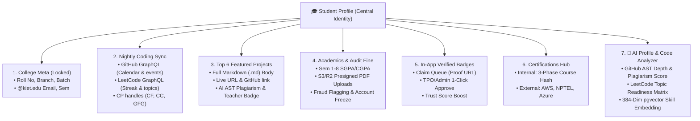
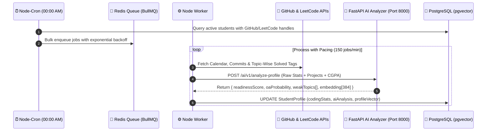

# Student Profile System: Architecture, Data Models, Nightly Sync & AI Code Intelligence

---

## 📌 Executive Summary

The **Student Profile** is the core backbone of the entire **KIET Campus Platform**.
It powers the Training & Placement Office (TPO) filtering engine, feeds the AI talent discovery algorithm, provides recruiters with verified proof of work, and establishes peer benchmark visibility across 7,000+ students.

To guarantee zero fraud, sub-10ms profile loads, zero third-party API rate-limiting blocks, and deep technical verification, this module is partitioned into **7 robust sub-modules** backed by an asynchronous BullMQ queue sync engine and a **FastAPI AI Profile & Code Analyzer**.

---

## 🏗️ The 7 Core Sub-Modules



---

## 🔒 1. Basic Info & Verified College Meta (Admin-Locked)

To prevent falsification of Roll Numbers, Branches, or Academic batches:

| Field | Managed By | Permissions | Description |
|---|---|---|---|
| Full Name | College Admin / TPO | Read-Only | Official college records |
| Roll Number / PRN | College Admin / TPO | Read-Only | University registration ID |
| Official Email | College SSO | Read-Only | Must be domain `@kiet.edu` |
| Department / Branch | College Admin / TPO | Read-Only | E.g., CSE, IT, CS-AI, ECE |
| Current Sem & Batch | College Admin / TPO | Read-Only | E.g., Sem 5, Batch 2023–2027 |
| Bio & Avatar | Student | Read/Write | Custom self-introduction and photo |
| Social Handles | Student | Read/Write | LinkedIn URL, X (Twitter) URL |
| Coding Handles | Student | Read/Write | GitHub, LeetCode, Codeforces, CodeChef |

---

## ⚡ 2. GitHub & LeetCode Activity Engine + AI Deep Telemetry

> 💡 **Production Architecture: DB Caching + Nightly BullMQ Sync + AI Scoring**
>
> Profiles read cached stats from PostgreSQL `StudentProfile.codingStats` JSONB in **< 10ms**.
> A background BullMQ queue triggers every night at 00:00 AM, fetching GitHub/LeetCode graphs and forwarding the payload to the Python FastAPI AI Microservice (Port 8000) to compute deep profile intelligence.



---

## 🗄️ 3. Consolidated Production Prisma Schema (With AI Extensions)

```prisma
datasource db {
  provider   = "postgresql"
  url        = env("DATABASE_URL")
  extensions = [vector] // pgvector for AI profile & job matching
}

generator client {
  provider        = "prisma-client-js"
  previewFeatures = ["postgresqlExtensions"]
}

model StudentProfile {
  id               String          @id @default(uuid())
  userId           String          @unique
  user             User            @relation(fields: [userId], references: [id], onDelete: Cascade)
  tenantId         String          @default("kiet-main")

  // College-Locked Academic Meta
  rollNumber       String          @unique
  branch           String          // E.g., "CSE", "IT", "CS-AI"
  currentSemester  Int             // 1 to 8
  batchYear        String          // E.g., "2023-2027"

  // Editable Social & Dev Handles
  avatarUrl        String?
  bio              String?         @db.VarChar(300)
  linkedinUrl      String?
  xUrl             String?
  githubHandle     String?
  leetcodeHandle   String?
  codeforcesHandle String?

  // Nightly Cached Coding Statistics & AI Profile Telemetry (JSONB)
  codingStats      Json?

  // AI Analysis JSONB Structure:
  // {
  //   "readinessTier": "DREAM_READY",   // MASS_READY | DREAM_READY | MARQUEE_READY
  //   "overallReadinessScore": 84.5,
  //   "oaSurvivalProbability": 78.0,
  //   "strongDomains": ["Backend", "FastAPI", "PostgreSQL", "Sliding Window"],
  //   "weakDsaTopics": ["Dynamic Programming", "Graphs"],
  //   "actionableSummary": "Strong backend project depth; solve 25+ Medium DP problems to unlock 12+ LPA drives."
  // }
  aiProfileAnalysis Json?
  profileEmbedding  Unsupported("vector(384)")? // BAAI/bge-small-en-v1.5 vector for semantic matching
  lastStatsSync     DateTime?

  // Trust, Audit & Penalty Enforcement
  isAccountFrozen  Boolean         @default(false)
  pendingFine      Float           @default(0.0)
  fraudRemarks     String?

  // Relations
  academics        AcademicSemester[]
  projects         Project[]
  certifications   Certification[]
  badges           StudentBadge[]

  createdAt        DateTime        @default(now())
  updatedAt        DateTime        @updatedAt

  @@index([tenantId, branch, currentSemester])
  @@index([rollNumber])
}

model Project {
  id                String         @id @default(uuid())
  studentProfileId  String
  studentProfile    StudentProfile @relation(fields: [studentProfileId], references: [id], onDelete: Cascade)

  title             String         @db.VarChar(120)
  shortTagline      String         @db.VarChar(200)
  markdownContent   String         @db.Text
  githubRepoUrl     String?
  liveDemoUrl       String?
  techStack         String[]

  // 🧠 AI Code Auditor & Verification Flags
  aiPlagScore        Float?        // 0 to 100 (Lower = More Original, computed via AST & Commit Graph)
  aiEngineeringScore Float?        // 0 to 100 (Evaluates modularity, error handling, tests, Docker)
  aiAuditReport      Json?         // { "isSingleCommitClone": false, "verifiedDependencies": ["redis", "prisma"] }
  isTeacherApproved  Boolean       @default(false)
  teacherRemarks     String?

  createdAt         DateTime       @default(now())
  updatedAt         DateTime       @updatedAt

  @@index([studentProfileId])
}
```

---

## 🧠 4. AI Microservice Implementation (`ai-service` — Python / FastAPI)

### A. GitHub AST & Commit Graph Code Auditor (`app/agents/code_auditor.py`)

Inspects student repositories when they pin a project or submit a lab assignment:

- **Commit Velocity Check:** Flags repositories where 5,000+ lines of code were pushed in a single commit (copied/cloned project).
- **Dependency & Manifest Verification:** Parses `package.json`, `requirements.txt`, or `Dockerfile` to verify if claimed resume skills actually exist in the codebase.
- **AST Complexity Scoring:** Uses `tree-sitter` and Qwen-2.5-Coder / Llama-3.3-70B to score modularity, middleware usage, and error handling (`aiEngineeringScore`).

```python
from fastapi import APIRouter, HTTPException
from pydantic import BaseModel
import httpx

router = APIRouter(prefix="/ai/v1", tags=["Code & Profile Intelligence"])

class RepoAuditRequest(BaseModel):
    student_id: str
    github_repo_url: str
    claimed_tech_stack: list[str]

@router.post("/audit-repo")
async def audit_github_repository(payload: RepoAuditRequest):
    # 1. Extract owner/repo and query GitHub Commits & Tree API
    # 2. Check commit distribution (Single-commit clone detection)
    # 3. Inspect manifest files (package.json / requirements.txt / Dockerfile)
    # 4. Compute originality (aiPlagScore) and engineering depth (aiEngineeringScore)
    return {
        "aiPlagScore": 12.5,          # 87.5% Original Code
        "aiEngineeringScore": 86.0,   # High production quality
        "verifiedTechStack": ["Node.js", "Prisma", "PostgreSQL", "Docker"],
        "auditReport": {
            "commitCount": 34,
            "isSingleCommitClone": False,
            "hasDockerfile": True,
            "summary": "Authentic multi-week commit history with modular controller-service pattern."
        }
    }
```

### B. Student Profile Analyzer & Vectorizer (`app/agents/profile_analyzer.py`)

Synthesizes CGPA, LeetCode topic mastery (DP, Graphs, Trees, Arrays), and verified GitHub projects into a 384-dim embedding vector and readiness report:

```python
class ProfileAnalysisRequest(BaseModel):
    student_id: str
    branch: str
    semester: int
    cgpa: float
    leetcode_topic_stats: dict[str, int]  # e.g., {"Array": 120, "Dynamic Programming": 4, "Graph": 6}
    verified_projects_stack: list[str]
    internal_badges_count: int

@router.post("/analyze-profile")
async def analyze_student_profile(data: ProfileAnalysisRequest):
    # 1. Calculate OA Survival Probability from advanced DSA topics (DP, Graphs, Trees)
    adv_solves = data.leetcode_topic_stats.get("Dynamic Programming", 0) + data.leetcode_topic_stats.get("Graph", 0)
    oa_prob = min(95.0, round(30.0 + (adv_solves * 1.2) + (data.cgpa * 3.0), 1))

    # 2. Identify weak DSA tags and compute Readiness Tier
    weak_topics = [topic for topic, count in data.leetcode_topic_stats.items() if count < 15]
    tier = "MARQUEE_READY" if oa_prob > 80 and len(data.verified_projects_stack) >= 4 else "DREAM_READY"

    # 3. Generate 384-dim dense vector (BAAI/bge-small-en-v1.5) for Job Recommender
    profile_text = f"{data.branch} Sem {data.semester} CGPA {data.cgpa} Skills: {', '.join(data.verified_projects_stack)}"
    embedding = generate_local_embedding(profile_text)  # Returns list[float] of length 384

    return {
        "aiProfileAnalysis": {
            "readinessTier": tier,
            "oaSurvivalProbability": oa_prob,
            "weakDsaTopics": weak_topics,
            "actionableSummary": f"Focus on {', '.join(weak_topics[:2])} to increase OA clearance probability above 85%."
        },
        "profileEmbedding": embedding
    }
```
