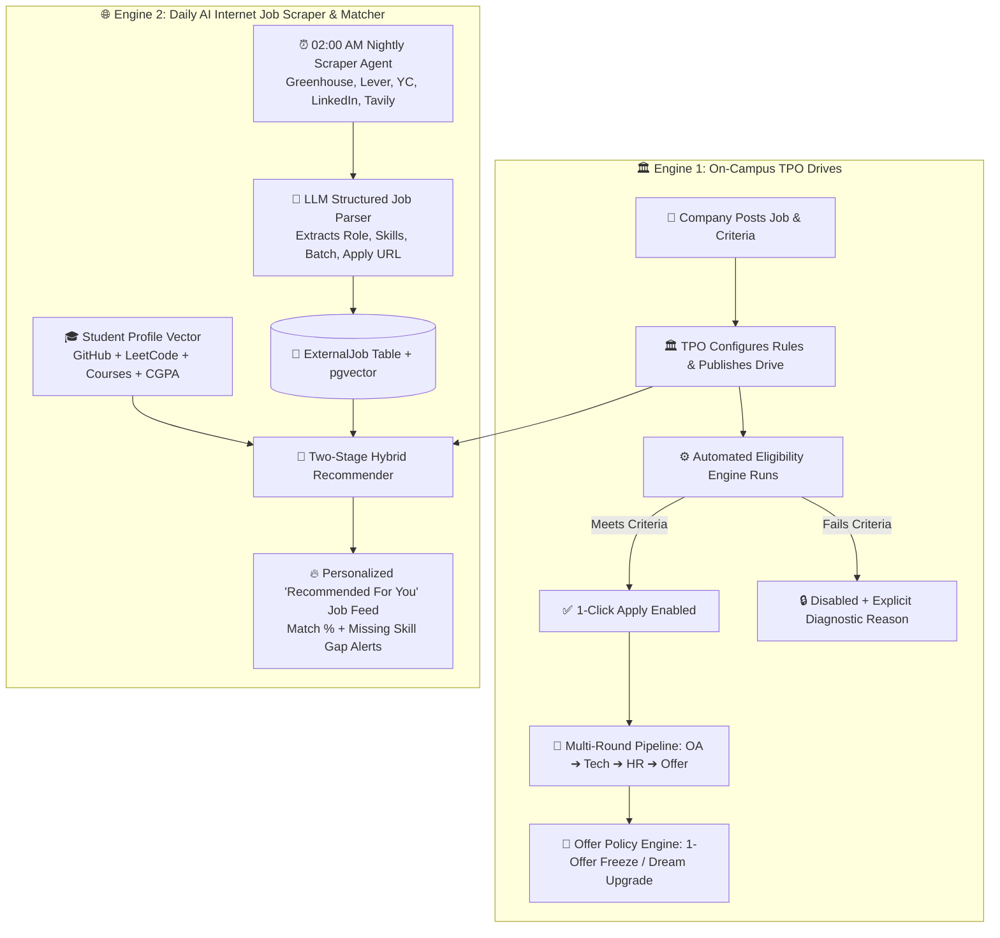

# Superset Placement Engine & AI Opportunity Hub: Architecture & Implementation Blueprint

---

## 📌 Executive Summary

**Superset** is an end-to-end **Campus Placement Automation & ATS (Applicant Tracking System)**.
Traditionally, college placement cells (TPOs) handle recruitment manually using Google Sheets, WhatsApp groups, and notice boards, which causes data errors, student disputes, and placement policy violations.

In our **KIET Campus Platform**, we upgrade the traditional Superset model in two revolutionary ways:

1. **On-Campus Governance + Proof of Work:** Automated eligibility rules, multi-round tracking, and "1-Student-1-Job / Dream Upgrade" policy enforcement backed by verified GitHub/LeetCode metrics.
2. **🧠 Autonomous Daily Internet Job Hunter & AI Recommender:** Unlike standard Superset (which sits idle when no campus drive is active), an AI Agent scrapes relevant off-campus internships and fresher jobs from across the internet every night and recommends top-matching opportunities (both on-campus and off-campus) tailored to each student's `StudentProfile` vector.

---

## 🔄 1. Dual-Engine Placement & AI Job Discovery Workflow



---

## 💻 2. Database Schema (Prisma / PostgreSQL + pgvector)

```prisma
enum ApplicationStatus {
  APPLIED
  OA_SHORTLISTED
  INTERVIEW_SCHEDULED
  HR_ROUND
  OFFERED
  REJECTED
  WITHDRAWN
}

enum JobSourceType {
  ON_CAMPUS_TPO
  AI_INTERNET_SCRAPED
}

model JobDrive {
  id               String             @id @default(uuid())
  tenantId         String             @default("kiet-main")
  sourceType       JobSourceType      @default(ON_CAMPUS_TPO)
  companyName      String             // e.g., "Amazon", "TCS", "Stripe"
  jobRole          String             // e.g., "SDE-1", "AI/ML Intern"
  ctcLpa           Float?             // e.g., 12.5
  isDreamCompany   Boolean            @default(false)
  externalApplyUrl String?            // Populated by Daily AI Scraper for off-campus jobs
  driveDate        DateTime?
  deadline         DateTime

  // JSONB rule engine allows 100% dynamic eligibility rules per drive
  eligibilityRules Json
  /* Example JSON Structure:
    {
      "minCgpa": 7.5,
      "allowedBranches": ["CSE", "IT", "CS-AI"],
      "maxBacklogs": 0,
      "maxGapYears": 1,
      "minVerifiedBadges": 3,
      "requiredSkills": ["Node.js", "PostgreSQL", "Docker"],
      "eligibleBatches": [2026, 2027, 2028]
    }
  */

  // 🧠 Vector embedding of Job Description + Required Skills for AI Recommender
  jobEmbedding     Unsupported("vector(384)")?

  applications     JobApplication[]
  createdAt        DateTime           @default(now())
  updatedAt        DateTime           @updatedAt

  @@index([deadline])
  @@index([sourceType, createdAt(sort: Desc)])
}

model JobApplication {
  id           String            @id @default(uuid())
  jobDriveId   String
  userId       String            // Student ID
  status       ApplicationStatus @default(APPLIED)
  aiMatchScore Float?            // 0 to 100% match score computed at application time
  notes        String?
  appliedAt    DateTime          @default(now())
  updatedAt    DateTime          @updatedAt

  jobDrive     JobDrive          @relation(fields: [jobDriveId], references: [id], onDelete: Cascade)

  @@unique([jobDriveId, userId])
  @@index([userId, status])
}
```

---

## ⚙️ 3. Core Eligibility Checking Engine (Node.js)

Evaluates all criteria simultaneously and returns a complete diagnostic array so students know every exact requirement they meet or miss:

```javascript
/**
 * Evaluates student profile against drive criteria.
 * Combines traditional academic rules with Proof-of-Work checks.
 */
export function evaluateJobEligibility(student, drive) {
  const rules = drive.eligibilityRules;
  const unmetReasons = [];

  if (rules.minCgpa && student.cgpa < rules.minCgpa) {
    unmetReasons.push(`CGPA requirement not met (Required: ${rules.minCgpa}, Current: ${student.cgpa})`);
  }

  if (rules.allowedBranches && !rules.allowedBranches.includes(student.branch)) {
    unmetReasons.push(`Branch ${student.branch} is not eligible for this drive`);
  }

  if (rules.maxBacklogs !== undefined && student.activeBacklogs > rules.maxBacklogs) {
    unmetReasons.push(`Active backlogs exceed limit (Allowed: ${rules.maxBacklogs}, You have: ${student.activeBacklogs})`);
  }

  if (rules.maxGapYears !== undefined && student.educationGapYears > rules.maxGapYears) {
    unmetReasons.push(`Education gap exceeds maximum allowed (${rules.maxGapYears} year/s)`);
  }

  // Offer Policy Enforcement (1-Student 1-Job / Dream Rule)
  if (student.currentOfferCtc && drive.sourceType === 'ON_CAMPUS_TPO') {
    const isDreamDrive = drive.isDreamCompany || (drive.ctcLpa && drive.ctcLpa >= student.currentOfferCtc * 1.5);
    if (!isDreamDrive) {
      unmetReasons.push(
        `Offer Policy: Holding ${student.currentOfferCtc} LPA. Eligible only for Dream drives (>= ${student.currentOfferCtc * 1.5} LPA).`
      );
    }
  }

  // Custom Innovation: Proof of Work / Verified Badges Requirement
  if (rules.minVerifiedBadges && student.verifiedBadgesCount < rules.minVerifiedBadges) {
    unmetReasons.push(
      `Requires at least ${rules.minVerifiedBadges} verified skill badges (You have: ${student.verifiedBadgesCount})`
    );
  }

  return {
    eligible: unmetReasons.length === 0,
    reasons: unmetReasons
  };
}
```

---

## 🧠 4. Daily AI Job Scraper & Personalized Recommender (`ai-service`)

### A. Autonomous Daily Internet Job Hunter (`app/agents/job_hunter.py`)

Runs every night at 02:00 AM IST, fetching fresh SDE, Data Science, DevOps, and AI/ML opportunities across India and remote boards:

```python
from fastapi import APIRouter
from pydantic import BaseModel, Field

router = APIRouter(prefix="/ai/v1/jobs", tags=["AI Job Hunter & Recommender"])

class ScrapedJobSchema(BaseModel):
    companyName: str
    jobRole: str
    ctcLpa: float | None = None
    externalApplyUrl: str
    requiredSkills: list[str] = Field(description="Extracted tech stack keywords")
    eligibleBatches: list[int] = Field(description="Graduation years e.g. [2026, 2027, 2028]")

@router.post("/scrape-daily")
async def trigger_daily_job_scraper():
    """
    1. Queries Tavily Search API / Greenhouse / Lever / Wellfound feeds for fresher & intern roles.
    2. Deduplicates URLs against existing JobDrive records in PostgreSQL.
    3. Uses Structured LLM output (ScrapedJobSchema) to extract clean eligibility JSON.
    4. Generates 384-dim jobEmbedding via BAAI/bge-small-en-v1.5 and inserts into JobDrive.
    """
    return {"status": "success", "jobsIngested": 42, "duplicatesSkipped": 15}
```

### B. Two-Stage Student Job Recommender (`GET /ai/v1/jobs/recommend/{student_id}`)

Powers the **"🔥 Recommended For You"** tab in the Placement Portal:

- **Stage 1 (Hard SQL Filter):** Filters active `ON_CAMPUS_TPO` and `AI_INTERNET_SCRAPED` jobs matching the student's batch year and branch.
- **Stage 2 (pgvector Cosine Similarity + Skill Gap Diff):** Computes semantic similarity between `StudentProfile.profileEmbedding` and `JobDrive.jobEmbedding`, returning exact match percentages and missing skills.

```python
@router.get("/recommend/{student_id}")
async def get_personalized_job_recommendations(student_id: str):
    # Executes pgvector cosine similarity query:
    # SELECT id, "companyName", "jobRole", 1 - ("jobEmbedding" <=> student.profileEmbedding) AS match_score
    # FROM "JobDrive" WHERE deadline > NOW() ORDER BY match_score DESC LIMIT 20;
    return {
        "studentId": student_id,
        "recommendations": [
            {
                "jobDriveId": "uuid-1",
                "companyName": "Razorpay",
                "jobRole": "Backend SDE Intern",
                "sourceType": "AI_INTERNET_SCRAPED",
                "matchPercentage": 93.4,
                "matchedSkills": ["Node.js", "PostgreSQL", "Redis", "Docker"],
                "missingSkills": ["Golang"],
                "aiAdvice": "Your Verified Project 'Distributed Task Queue' strongly aligns with this role."
            }
        ]
    }
```

---

## 🚀 5. How Our KIET Platform Beats Vanilla Superset

| Feature | Standard Superset | Our KIET Platform (Superset + AI & Proof of Work) |
|---|---|---|
| **Primary Metric** | CGPA, Marks, & Claims | CGPA + Verified Code + AST Score & LeetCode Telemetry |
| **Opportunity Scope** | Only On-Campus Drives | On-Campus TPO Drives + Daily AI-Scraped Off-Campus Jobs |
| **Job Discovery** | Chronological list of drives | Personalized AI Match % Feed based on Student Profile Vector |
| **Target Audience** | Final year students during placement season | 1st to 4th year continuous talent & internship pipeline |
| **Recruiter Experience** | Filter by Marks only | Filter by Marks + Specific Tech Stacks + Real GitHub Repos |
