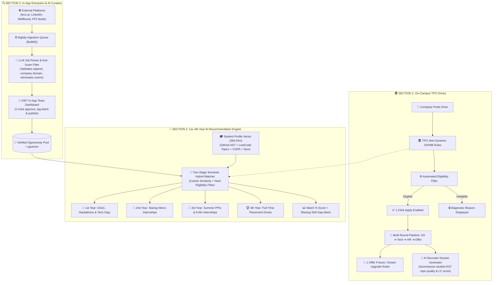

# Superset Placement Engine & AI Opportunity Hub: Architecture & Implementation Blueprint
> **The 3 AI-Enhanced Pillars of Campus Placements & Opportunity Matching for KIET Group of Institutions**

---

## 📌 Executive Summary

Traditional placement software (like vanilla Superset) operates strictly as a transactional database for final-year placement drives.

In the **KIET Campus Platform (`Only_Jobs`)**, the **Placement Engine** is expanded into a **Triple-Pillar Opportunity Hub** powered by local asynchronous queues and a specialized **FastAPI AI Code & Vector Intelligence Microservice**:

1. **🏛️ Section 1: On-Campus Corporate TPO Drives:** Automated eligibility checks, multi-round selection tracking, and institutional policies (1-Student 1-Job & Dream Upgrades) combined with **AI Recruiter Candidate Dossiers**.
2. **🔍 Section 2: KIET In-App Opportunity Extraction Team:** Dedicated student ops committee assisted by an **Autonomous LLM Parser & Scraper** extracting verified internships and fresher roles from `leco.ai`, LinkedIn, Wellfound, Greenhouse, Lever, and Ashby with spam-filtering.
3. **🎯 Section 3: 1st-to-4th Year Personalized AI Recommendation Engine:** Semantic `pgvector` matchmaking connecting students (from 1st-year open-source/hackathons to 4th-year marquee FTE roles) with real-time **Match %** and **Missing Skill Gap Alerts**.

---

## 🔄 1. Triple-Pillar Placement & AI Discovery Architecture



---

## 💻 2. Database Schema (Prisma / PostgreSQL + pgvector)

```prisma
enum OpportunityType {
  ON_CAMPUS_TPO         // Section 1: Official college drive
  IN_APP_CURATED        // Section 2: External job extracted by in-app team
  OPEN_SOURCE_PROGRAM   // Section 3: GSoC, MLH, Hackathons for 1st/2nd years
}

enum OpportunityCategory {
  INTERNSHIP_SUMMER     // 2-month summer internship (3rd years)
  INTERNSHIP_SEMESTER   // 6-month pre-placement internship (7th/8th sem)
  MICRO_INTERNSHIP      // Part-time / project gig (1st/2nd years)
  FULL_TIME_FTE         // Full-time corporate placement (4th years)
}

enum ApplicationStatus {
  APPLIED
  OA_SHORTLISTED
  INTERVIEW_SCHEDULED
  HR_ROUND
  OFFERED
  REJECTED
  WITHDRAWN
}

model JobOpportunity {
  id                  String               @id @default(uuid())
  tenantId            String               @default("kiet-main")
  type                OpportunityType      @default(ON_CAMPUS_TPO)
  category            OpportunityCategory  @default(FULL_TIME_FTE)
  
  companyName         String               // e.g. "Amazon", "Cred", "Stripe"
  jobRole             String               // e.g. "Backend Intern", "SDE-1"
  location            String               // e.g. "Delhi-NCR", "Bengaluru", "Remote"
  ctcLpa              Float?               // e.g. 14.5 LPA
  stipendMonthly      Float?               // e.g. 45,000 INR/mo
  isDreamCompany      Boolean              @default(false)
  externalApplyUrl    String?              // Populated for IN_APP_CURATED
  deadline            DateTime
  
  // Section 1: JSONB rule engine for TPO drives
  eligibilityRules    Json?
  /* Example JSON Structure:
    {
      "minCgpa": 7.5,
      "allowedBranches": ["CSE", "IT", "CS-AI"],
      "maxBacklogs": 0,
      "eligibleBatches": [2026, 2027],
      "minVerifiedBadges": 2
    }
  */

  // Section 2 & 3: Metadata for In-App Extraction & Year-Based Matching
  targetYears         Int[]                // [1, 2] for 1st/2nd yr; [3] for summer interns; [4] for FTE
  targetSkills        String[]             // ["Node.js", "PostgreSQL", "Docker"]
  curatedByUserId     String?              // In-App Team member ID
  isVerifiedByTeam    Boolean              @default(false)

  // Section 3: 🧠 Semantic Vector Embedding for AI Recommender
  opportunityVector   Unsupported("vector(384)")?

  applications        JobApplication[]
  createdAt           DateTime             @default(now())
  updatedAt           DateTime             @updatedAt

  @@index([type, category])
  @@index([deadline])
  @@index([isVerifiedByTeam])
}

model JobApplication {
  id                  String               @id @default(uuid())
  jobOpportunityId    String
  userId              String               // Student ID
  status              ApplicationStatus    @default(APPLIED)
  roundIndex          Int                  @default(1)
  appliedAt           DateTime             @default(now())
  updatedAt           DateTime             @updatedAt

  opportunity         JobOpportunity       @relation(fields: [jobOpportunityId], references: [id], onDelete: Cascade)

  @@unique([jobOpportunityId, userId])
  @@index([userId, status])
}
```

---

## 🧠 3. Detailed AI Subsystem Implementations

### A. Section 1 AI Enhancement: Instant Recruiter Candidate Dossiers
When a company requests a candidate shortlist from the TPO, the FastAPI AI service generates a 1-page structured JSON dossier summarizing verifiable proof of work:

```python
# FastAPI AI Service (app/routers/dossier.py)
@router.post("/generate-candidate-dossier")
async def generate_candidate_dossier(student_id: str, db: Session = Depends(get_db)):
    student = db.query(Student).filter(Student.id == student_id).first()
    
    # Analyze AST complexity of top projects & LeetCode topic distribution
    dossier = {
        "roll_number": student.roll_number,
        "academic_summary": {
            "cgpa": student.cgpa,
            "branch": student.branch,
            "backlogs": student.active_backlogs
        },
        "verified_coding_proof": {
            "leetcode_rating": student.coding_stats.get("leetcode_rating"),
            "problem_depth": {
                "dp_graphs_greedy": student.coding_stats.get("hard_medium_count", 0),
                "streak_consistency": student.coding_stats.get("streak_days", 0)
            },
            "github_verified_projects": [
                {
                    "repo_name": p.title,
                    "ast_complexity_score": p.ast_score,
                    "plagiarism_risk": "VERY_LOW" if p.plagiarism_score < 15 else "FLAGGED",
                    "live_url": p.live_url
                } for p in student.projects[:3]
            ]
        },
        "placement_readiness_score": calculate_readiness_index(student)
    }
    return dossier
```

---

### B. Section 2 AI Enhancement: Ingestion Parser & Anti-Scam Classifier
For the **KIET In-App Team**, incoming external job postings from `leco.ai`, LinkedIn, or web crawlers are pre-filtered to remove scams and normalize fields before human review:

```python
# FastAPI AI Service (app/routers/job_parser.py)
from pydantic import BaseModel, HttpUrl

class ParsedJobOutput(BaseModel):
    company_name: str
    role_title: str
    category: str  # "INTERNSHIP_SUMMER", "FULL_TIME_FTE", "MICRO_INTERNSHIP"
    target_years: list[int]  # [1, 2], [3], or [4]
    stipend_or_ctc: str
    required_skills: list[str]
    apply_url: HttpUrl
    scam_risk_score: float  # 0.0 to 1.0 (Flagged if > 0.3)
    is_auto_approved: bool

@router.post("/parse-and-verify-raw-job", response_model=ParsedJobOutput)
async def parse_and_verify_job(raw_text: str, source_url: str):
    # LLM extracts metadata and flags fraud/consultancy warning signs
    parsed_job = await extract_and_classify_job_posting(raw_text, source_url)
    return parsed_job
```

---

### C. Section 3 AI Enhancement: 1st-to-4th Year Hybrid Vector Recommender
Combines semantic text matching with **hard academic-year filtering**:

```python
# FastAPI AI Service (app/routers/recommendations.py)
@router.post("/recommend-opportunities")
async def recommend_opportunities(student_id: str, db: Session = Depends(get_db)):
    student = db.query(Student).filter(Student.id == student_id).first()
    student_vector = student.profile_embedding  # 384-dim vector
    student_year = calculate_student_year(student.semester)  # 1, 2, 3, or 4
    
    # 1. Hard Filter by Academic Year:
    # 1st yr -> Hackathons & Open-source; 2nd yr -> Micro-interns; 3rd yr -> Summer PPI; 4th yr -> FTE
    query = text("""
        SELECT id, company_name, job_role, type, category, target_skills,
               1 - (opportunity_vector <=> :student_vector) AS match_score
        FROM job_opportunities
        WHERE is_verified_by_team = true
          AND deadline > NOW()
          AND :student_year = ANY(target_years)
        ORDER BY match_score DESC
        LIMIT 10;
    """)
    
    results = db.execute(query, {
        "student_vector": str(student_vector),
        "student_year": student_year
    }).fetchall()
    
    # 2. Compute Missing Skill Gaps
    recommendations = []
    for r in results:
        missing_skills = [s for s in r.target_skills if s not in student.verified_skills]
        recommendations.append({
            "job_id": r.id,
            "company": r.company_name,
            "role": r.job_role,
            "match_percentage": round(r.match_score * 100, 1),
            "missing_skills": missing_skills
        })
        
    return recommendations
```

---

## 🎯 Summary of Key Benefits

1. **For TPO:** Zero manual spreadsheets, zero student disputes, policy-enforced 1-student 1-job rules, and instant recruiter candidate dossiers.
2. **For In-App Extraction Team:** Automated tooling to discover, filter, normalize, and publish high-quality external opportunities from platforms like `leco.ai` and startup ATS feeds.
3. **For 1st to 4th-Year Students:** Continuous, personalized career guidance that presents the right opportunity (GSoC $\rightarrow$ Micro-Internships $\rightarrow$ High-Stakes PPI $\rightarrow$ Marquee Placements) at the exact right semester.

---
*Maintained by Arpit Prajapati & The KIET Campus Platform Engineering Team.*
