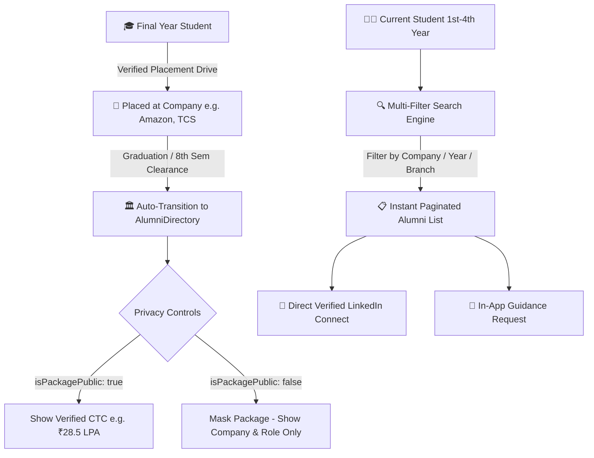

# Alumni Directory & Career Network: Architecture, Search Engine & Privacy Controls

---

## 📌 Executive Summary

The **Alumni Directory & Career Network** bridges the gap between current KIET undergraduates (1st to 4th year) and graduated seniors working in top tech companies, startups, and multinational corporations. 

Unlike LinkedIn, where anyone can falsely claim to be a KIET alumnus or inflate their CTC package, this directory is **auto-populated strictly from verified campus placement records**:
1. **Automated Alumni Transition:** Once a final-year student is placed and graduates, their profile automatically transitions to verified alumni status.
2. **Strict Privacy Safeguards:** Alumni have full autonomy to toggle package visibility (`isPackagePublic: false`), ensuring data security while maintaining mentorship access.
3. **High-Performance Multi-Filter Discovery:** Indexed search by Company, Passout Year, Engineering Branch, and Domain with cursor-based pagination.
4. **Direct Mentorship Rails:** 1-click verified LinkedIn redirects and in-app guidance ticket workflows.

---

## 🔄 1. Alumni Lifecycle & Discovery Flow



---

## 🗄️ 2. Database Schema (`schema.prisma`)

```prisma
model AlumniDirectory {
  id               String          @id @default(uuid())
  tenantId         String          @default("kiet-main") // College isolation
  studentProfileId String          @unique
  studentProfile   StudentProfile  @relation(fields: [studentProfileId], references: [id], onDelete: Cascade)
  
  // Basic Identity
  fullName         String          @db.VarChar(100)
  avatarUrl        String?
  branch           String          // "CSE", "IT", "CS-AI", "ECE"
  passoutYear      Int             // e.g., 2024, 2025, 2026
  
  // Professional Placement Records
  company          String          @db.VarChar(120) // e.g., "Microsoft", "Zomato", "Amazon"
  designation      String?         @db.VarChar(100) // e.g., "SDE-1", "Cloud Systems Engineer"
  domain           String?         @db.VarChar(80)  // "Backend", "DevOps", "AI/ML", "Fintech"
  packageLpa       Float?          // e.g., 28.5 (Verified college placement CTC)
  isPackagePublic  Boolean         @default(true)   // Privacy toggle
  
  // Connect & Mentorship Rails
  linkedinUrl      String          // Mandatory verified LinkedIn link
  xUrl             String?
  workEmail        String?         // Optional company-issued email

  createdAt        DateTime        @default(now())
  updatedAt        DateTime        @updatedAt

  // Multi-column B-tree indexes for sub-10ms filtered searches
  @@index([tenantId, passoutYear])
  @@index([tenantId, company])
  @@index([tenantId, branch])
}
```

---

## ⚡ 3. High-Performance Multi-Filter Search Controller (`getAlumniList`)

Handles multi-dimensional queries, fuzzy keyword search, and automatic package masking in a single efficient database query:

```javascript
import { prisma } from '../lib/prisma.js';

export async function getAlumniList(req, res) {
  const { tenantId = 'kiet-main' } = req.user;
  const {
    search,         // Search by Name, Company, or Designation
    company,        // Dropdown company filter
    passoutYear,    // Filter by batch: 2023, 2024, 2025
    branch,         // CSE, IT, ECE
    domain,         // Backend, DevOps, Data Science
    cursor,
    limit = 12
  } = req.query;

  const pageSize = Math.min(Number(limit) || 12, 36);

  // Dynamic filter construction
  const whereClause = {
    tenantId,
    ...(passoutYear && { passoutYear: Number(passoutYear) }),
    ...(branch && { branch }),
    ...(domain && { domain: { equals: domain, mode: 'insensitive' } }),
    ...(company && { company: { equals: company, mode: 'insensitive' } }),
    ...(search && {
      OR: [
        { fullName: { contains: search, mode: 'insensitive' } },
        { company: { contains: search, mode: 'insensitive' } },
        { designation: { contains: search, mode: 'insensitive' } }
      ]
    })
  };

  try {
    const alumniRecords = await prisma.alumniDirectory.findMany({
      take: pageSize,
      skip: cursor ? 1 : 0,
      cursor: cursor ? { id: cursor } : undefined,
      where: whereClause,
      orderBy: [
        { passoutYear: 'desc' },
        { packageLpa: 'desc' }
      ],
      select: {
        id: true,
        fullName: true,
        avatarUrl: true,
        branch: true,
        passoutYear: true,
        company: true,
        designation: true,
        domain: true,
        packageLpa: true,
        isPackagePublic: true,
        linkedinUrl: true,
        xUrl: true
      }
    });

    // Privacy Masking: Redact packageLpa if user disabled public disclosure
    const sanitizedAlumni = alumniRecords.map(alumnus => ({
      ...alumnus,
      packageLpa: alumnus.isPackagePublic ? alumnus.packageLpa : null
    }));

    const nextCursor = alumniRecords.length === pageSize ? alumniRecords[alumniRecords.length - 1].id : null;

    return res.json({
      success: true,
      data: sanitizedAlumni,
      pagination: {
        nextCursor,
        hasMore: nextCursor !== null
      }
    });
  } catch (error) {
    console.error('[GetAlumniList Error]', error);
    return res.status(500).json({ error: "Failed to retrieve alumni directory." });
  }
}
```

---

## 🎨 4. Frontend Card Specification & Visual Preview

### Visual Card Wireframe
```
┌────────────────────────────────────────────────────────────────────────┐
│ 👤 Arpit Prajapati • [VERIFIED ALUMNUS ✅]                              │
│    Branch: CSE • Batch of 2026                                         │
├────────────────────────────────────────────────────────────────────────┤
│ 💼 Backend & Cloud Native Systems Engineer at Amazon                   │
│ 🏷️ Domain: Distributed Systems / Cloud Infrastructure                 │
│ 💰 Verified CTC: ₹28.5 LPA (Institutional Placement Audit)            │
├────────────────────────────────────────────────────────────────────────┤
│ [ 🔗 Connect on LinkedIn ↗ ]           [ 📩 Request Guidance Ticket ]  │
└────────────────────────────────────────────────────────────────────────┘
```

* **Instant Pill Filters:** Top of the UI renders quick filters for top recruiting companies:  
  `[ All ]` `[ Amazon ]` `[ Microsoft ]` `[ Google ]` `[ TCS Digital ]` `[ Zomato ]`
* **Verified Institutional Badge:** Green verified checkmark proves the placement is cross-verified against official TPO records.
* **Privacy Compliance:** If `isPackagePublic === false`, the card displays:  
  `💰 Package: Confidential (Alumnus opted out)`

---

## 🏛️ 5. Dean Pitch Angle (Why This Wins Administration Support)

1. **NAAC / NIRF Accreditation Scoring:** Accreditation bodies heavily evaluate institutional alumni tracking and alumni-to-student mentoring networks.
2. **Organic Placement Motivation:** 1st and 2nd year juniors see tangible proof of seniors getting hired at top packages, motivating them to complete courses and projects on the platform.
3. **Referral Flywheel:** Startups and top firms get internal referrals from existing KIET alumni, directly increasing placement conversion rates.

---
*Generated: 15 October 2026 — Alumni Directory & Career Network Specification.*
