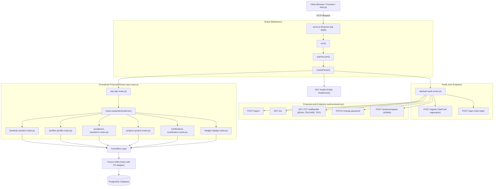
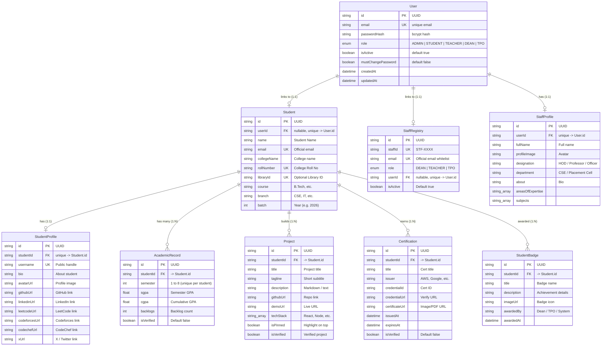
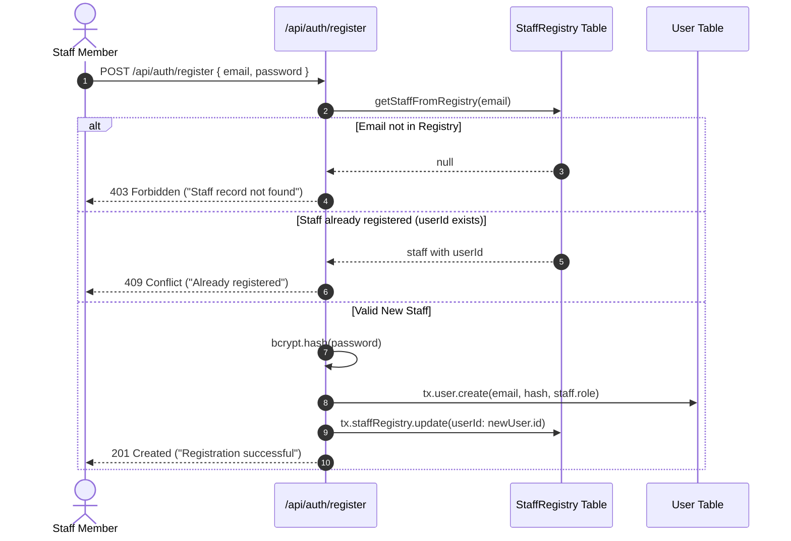
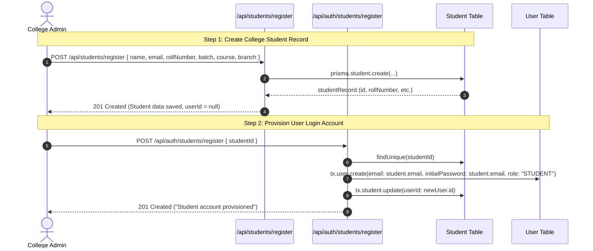
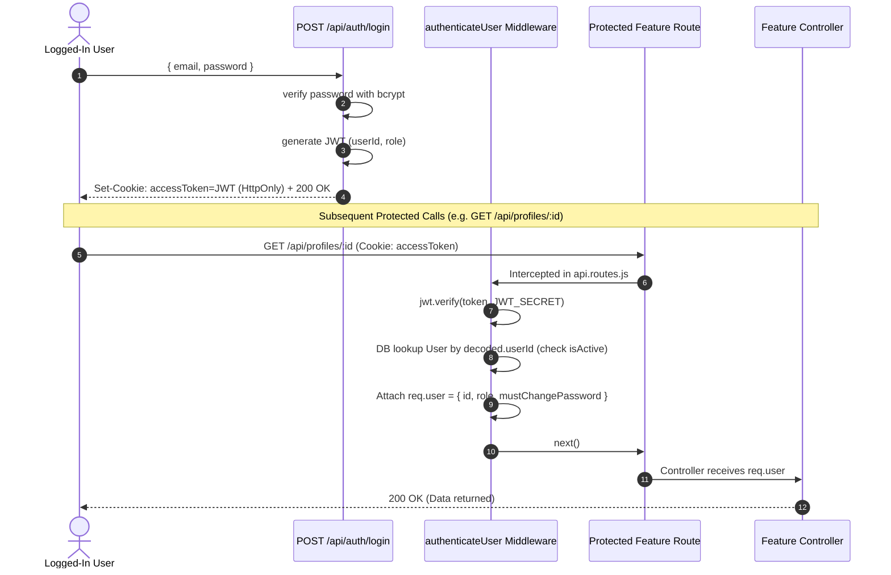
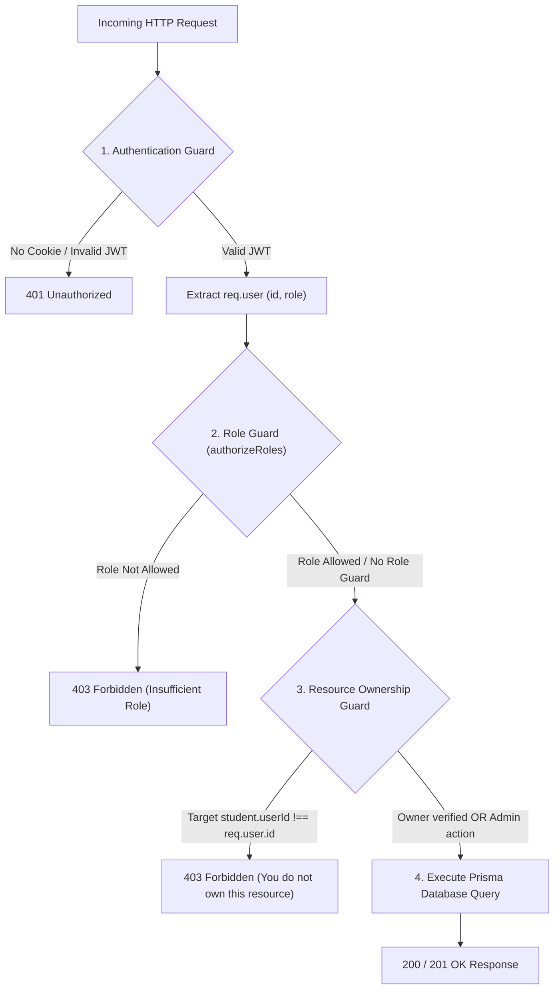

# ONLY_JOBS Backend — Complete Architecture & System Maps

---

## 1. High-Level Architecture Map

Ye diagram dikhata hai ki client se aayi hui HTTP request kis tarah backend ke alag-alag layers se guzarti hai:



---

## 2. Database & Entity Relationship (ER) Map

Platform me do main pillars hain: **Users (Authentication & Account)** aur **Entities (Student Profile, Staff Profile, Academics, Projects, Certifications, Badges)**.



---

## 3. Authentication & User Lifecycles Map

### Flow A: Staff Registration Lifecycle
Staff seedha register nahi ho sakte jab tak unka email pehle se `StaffRegistry` whitelist me na ho.



### Flow B: Student 2-Step Onboarding Lifecycle
Students self-register nahi karte. College Admin do steps me student ko platform pe lata hai:



### Flow C: Login & Protected Request Lifecycle
Ek baar user login karta hai, tab JWT HttpOnly cookie ke through har protected request ko pass karta hai:



---

## 4. Feature Modules Breakdown & Endpoints Map

Platform ke 6 feature modules hain, jo sab `/api` ke under centralized protected hain:

### 1. Student Module (`/api/students`)
*Mounted at:* `backend/src/routes/student.routes.js`  
*Controller:* `backend/src/controllers/student.controller.js`

| Method | Endpoint | Required Role | Ownership Check | Description |
|---|---|---|---|---|
| `POST` | `/api/students/register` | `ADMIN` | N/A (Admin action) | College database me student ka official record banata hai. |
| `GET` | `/api/students/:identifier/full` | Any Authenticated | N/A (Public read) | 5 modules ka data (Demographics, Profile, Academics, Projects, Certifications, Badges) 1 single query me return karta hai. *(Note: Query currently has relation typo `studentBadges` vs `badges`)*. |

---

### 2. Profile Module (`/api/profiles`)
*Mounted at:* `backend/src/routes/profile.routes.js`  
*Controller:* `backend/src/controllers/profile.controller.js`

| Method | Endpoint | Required Role | Ownership Check | Description |
|---|---|---|---|---|
| `POST` | `/api/profiles/create` | Student (Own Record) | **Yes** (`student.userId === req.user.id`) | Student apna username, bio, avatar, and coding handles save karta hai. |
| `GET` | `/api/profiles/:studentId` | Any Authenticated | N/A (Public read) | Kisi bhi student ka profile card aur social links view karta hai. |
| `PATCH` | `/api/profiles/:studentId` | Student (Own Record) | **Yes** (`student.userId === req.user.id`) | Student apna bio ya links update karta hai. |
| `DELETE` | `/api/profiles/:studentId` | Student (Own Record) | **Yes** (`student.userId === req.user.id`) | Student apna profile record delete karta hai. |

---

### 3. Academic Module (`/api/academics`)
*Mounted at:* `backend/src/routes/academic.routes.js`  
*Controller:* `backend/src/controllers/academic.controller.js`

| Method | Endpoint | Required Role | Ownership Check | Description |
|---|---|---|---|---|
| `POST` | `/api/academics/add` | `ADMIN` | N/A (Admin only) | Kisi student ka semester SGPA, CGPA, backlogs record enter karta hai. |
| `GET` | `/api/academics/:studentId` | Any Authenticated | N/A (Public read) | Student ke saare semesters ke academic marks dekhta hai. |
| `PATCH` | `/api/academics/:studentId/:semester` | `ADMIN` | N/A (Admin only) | Marks ya backlogs correct karta hai. |
| `DELETE` | `/api/academics/:studentId/:semester` | `ADMIN` | N/A (Admin only) | Semester record delete karta hai. |

---

### 4. Projects Module (`/api/projects`)
*Mounted at:* `backend/src/routes/project.routes.js`  
*Controller:* `backend/src/controllers/project.controller.js`

| Method | Endpoint | Required Role | Ownership Check | Description |
|---|---|---|---|---|
| `POST` | `/api/projects/add` | Student (Own Record) | **Missing (Vulnerability)** | Student apna project (title, techStack, githubUrl, demoUrl) add karta hai. |
| `GET` | `/api/projects/:studentId` | Any Authenticated | N/A (Public read) | Student ke saare projects list karta hai. |
| `PATCH` | `/api/projects/:studentId/:projectId` | Student (Own Record) | **Missing (Vulnerability)** | Project details update karta hai. |
| `DELETE` | `/api/projects/:studentId/:projectId` | Student (Own Record) | **Missing (Vulnerability)** | Project delete karta hai. |

---

### 5. Certifications Module (`/api/certifications`)
*Mounted at:* `backend/src/routes/certification.routes.js`  
*Controller:* `backend/src/controllers/certification.controller.js`

| Method | Endpoint | Required Role | Ownership Check | Description |
|---|---|---|---|---|
| `POST` | `/api/certifications/add` | Student (Own Record) | **Missing (Vulnerability)** | New certificate record add karta hai. |
| `GET` | `/api/certifications/:studentId` | Any Authenticated | N/A (Public read) | Student ke saare certificates list karta hai. |
| `PATCH` | `/api/certifications/:studentId/:certId` | Student (Own Record) | **Missing (Vulnerability)** | Certificate update karta hai. |
| `DELETE` | `/api/certifications/:studentId/:certId` | Student (Own Record) | **Missing (Vulnerability)** | Certificate delete karta hai. |

---

### 6. Badges Module (`/api/badges`)
*Mounted at:* `backend/src/routes/badge.routes.js`  
*Controller:* `backend/src/controllers/badge.controller.js`

| Method | Endpoint | Required Role | Ownership Check | Description |
|---|---|---|---|---|
| `GET` | `/api/badges/:studentId` | Any Authenticated | N/A (Public read) | Student ko mile badges aur achievements list karta hai. |

---

### 7. Staff Profile Module (Part of Auth Routes)
*Mounted at:* `backend/src/auth/routes/auth.routes.js`  
*Service:* `backend/src/auth/services/staff-profile.service.js`

| Method | Endpoint | Required Role | Ownership Check | Description |
|---|---|---|---|---|
| `GET` | `/api/auth/staff/profile` | `DEAN`, `TEACHER`, `TPO` | **Strict (`req.user.id`)** | Logged-in staff member ka profile fetch karta hai. |
| `PUT` | `/api/auth/staff/profile` | `DEAN`, `TEACHER`, `TPO` | **Strict (`req.user.id`)** | Staff member ka designation, department, about, areasOfExpertise save/upsert karta hai. |

---

## 5. Security & Request Flow Model (How RBAC & Ownership Work)

Har request in tin security checks se guzarti hai:



---

## 6. Directory Structure & Key Files Quick Index

```
backend/
├── arch/
│   └── backend_architecture_and_maps.md # Architecture & system maps reference
├── prisma/
│   └── schema.prisma                  # Master database models and relations
└── src/
    ├── server.js                      # Express bootstrap, CORS, port listener
    ├── config/
    │   ├── env.js                     # Validates JWT_SECRET, DATABASE_URL
    │   └── prisma.js                  # PostgreSQL pool adapter and Prisma Client
    ├── auth/                          # Auth domain
    │   ├── routes/auth.routes.js      # /api/auth endpoints (login, register, me, staff)
    │   ├── controllers/auth.controller.js # Request handlers for auth
    │   ├── services/                  # Business logic (auth, staff-reg, student-prov)
    │   ├── middlewares/               # authenticateUser, authorizeRoles
    │   └── utils/                     # bcrypt password hashing, jwt token util
    ├── routes/
    │   ├── api.routes.js              # Centralized parent router (applies auth)
    │   ├── student.routes.js          # /api/students
    │   ├── profile.routes.js          # /api/profiles
    │   ├── academic.routes.js         # /api/academics
    │   ├── project.routes.js          # /api/projects
    │   ├── certification.routes.js    # /api/certifications
    │   └── badge.routes.js            # /api/badges
    └── controllers/                   # 6 Feature Controllers
        ├── student.controller.js
        ├── profile.controller.js
        ├── academic.controller.js
        ├── project.controller.js
        ├── certification.controller.js
        └── badge.controller.js
```

