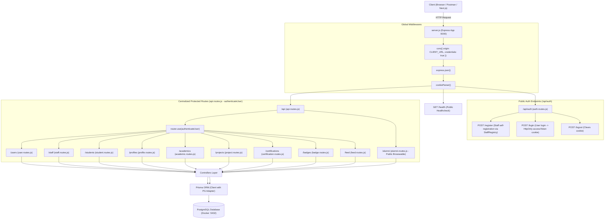
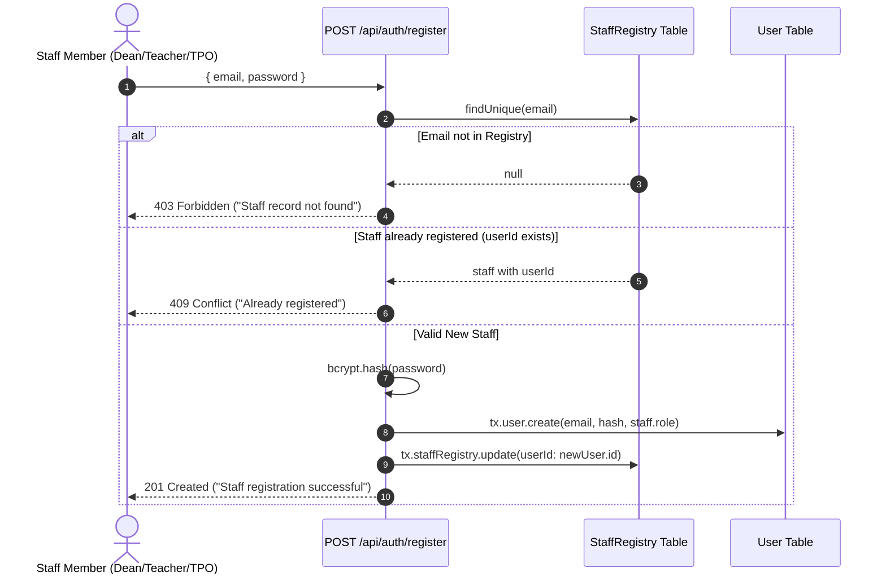
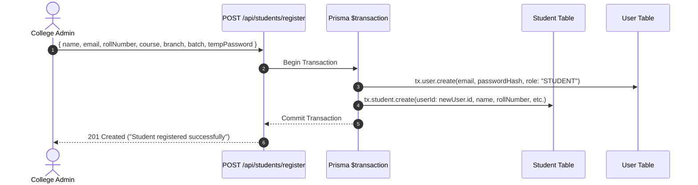
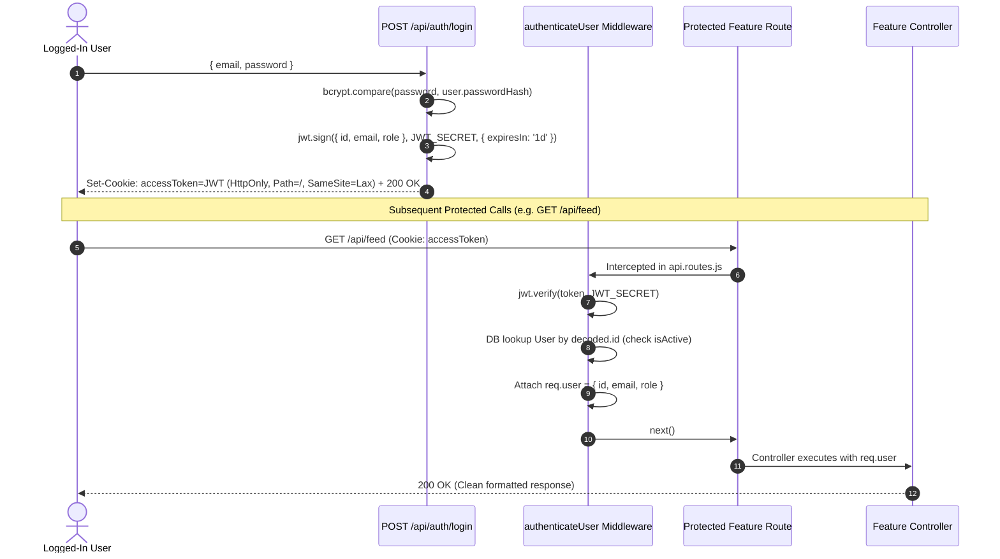

# JOBSONLY Backend — Complete Architecture & System Maps
**Project:** JobsOnly (KIET Campus Talent, Placement & Community Platform)  
**Stack:** Node.js v24 ESM, Express, PostgreSQL, Prisma 7, Next.js  
**Target Scale:** ~7,000 Students, Faculty, TPO Cell, & Dean of Academics  
**Last Updated:** November 2026 (Fully Synchronized with Implemented Codebase)

---

## 1. High-Level Architecture Map

Yeh diagram dikhata hai ki client se aayi hui HTTP request kis tarah backend ke alag-alag layers se guzarti hai:

---

## 2. Database & Entity Relationship (ER) Map

Platform ke 4 main pillars hain:
1. **User Identity & Auth** (`User`, `StaffRegistry`, `StaffProfile`, `Student`)
2. **Student Growth & Portfolio** (`StudentProfile`, `AcademicRecord`, `Project`, `Certification`, `BadgeCatalog`, `StudentBadge`)
3. **Campus Social & Engagement** (`Post`, `PostLike`, `PostComment`, `CampusSignal`)
4. **Alumni & Institutional Career Mentorship** (`AlumniDirectory`)

```mermaid
erDiagram
    User ||--o| Student : "links to (1:1)"
    User ||--o| StaffRegistry : "links to (1:1)"
    User ||--o| StaffProfile : "has (1:1)"
    User ||--o{ Post : "authors (1:N)"
    User ||--o{ PostLike : "likes (1:N)"
    User ||--o{ PostComment : "writes (1:N)"

    Student ||--o| StudentProfile : "has (1:1)"
    Student ||--o{ AcademicRecord : "has many (1:N)"
    Student ||--o{ Project : "builds (1:N)"
    Student ||--o{ Certification : "earns (1:N)"
    Student ||--o{ StudentBadge : "claims (1:N)"

    BadgeCatalog ||--o{ StudentBadge : "catalog definitions (1:N)"
    Post ||--o{ PostLike : "receives (1:N)"
    Post ||--o{ PostComment : "receives (1:N)"

    User {
        string id PK "UUID"
        string email UK "unique college email"
        string passwordHash "bcrypt hash"
        enum role "ADMIN | STUDENT | TEACHER | DEAN | TPO"
        boolean isActive "default true"
        datetime createdAt
        datetime updatedAt
    }

    Student {
        string id PK "UUID"
        string userId FK "nullable, unique -> User.id"
        string name "Student Full Name"
        string email UK "Official email"
        string collegeName "College name"
        string rollNumber UK "College Roll No"
        string libraryId UK "Optional Library ID"
        string course "B.Tech, etc."
        string branch "CSE, IT, etc."
        int batch "Graduation Year (e.g. 2026)"
        int currentSemester "1 to 8"
    }

    StudentProfile {
        string id PK "UUID"
        string studentId FK "unique -> Student.id"
        string username UK "Public handle"
        string bio "About student"
        string avatarUrl "Profile image"
        string githubUrl "GitHub link"
        string linkedinUrl "LinkedIn link"
        string leetcodeUrl "LeetCode link"
        string codeforcesUrl "Codeforces link"
        string codechefUrl "CodeChef link"
        string xUrl "X / Twitter link"
    }

    AcademicRecord {
        string id PK "UUID"
        string studentId FK "-> Student.id"
        int semester "1 to 8 (unique per student)"
        float sgpa "Semester GPA"
        float cgpa "Cumulative GPA"
        int backlogs "Backlog count"
        boolean isVerified "Default false (verified by Admin)"
        datetime verifiedAt
    }

    Project {
        string id PK "UUID"
        string studentId FK "-> Student.id"
        string title "Project title"
        string tagline "Short subtitle"
        string description "Full description"
        string githubUrl "Repo link"
        string demoUrl "Live demo URL"
        string_array techStack "Go, Node.js, K8s, etc."
        boolean isPinned "Highlight on top of portfolio"
        boolean isVerified "Default false"
    }

    Certification {
        string id PK "UUID"
        string studentId FK "-> Student.id"
        string title "Cert title"
        string issuer "AWS, Google, etc."
        string credentialId "Cert ID"
        string credentialUrl "Verify URL"
        string certificateUrl "Image/PDF URL"
        datetime issuedAt
        datetime expiresAt
        boolean isVerified "Default false (Admin verifies)"
        datetime verifiedAt
    }

    BadgeCatalog {
        string id PK "UUID"
        string title UK "Master badge title"
        string description "Criteria description"
        string imageUrl "Badge icon"
        string category "Coding, Hackathon, OpenSource"
    }

    StudentBadge {
        string id PK "UUID"
        string studentId FK "-> Student.id"
        string badgeId FK "-> BadgeCatalog.id"
        string title "Badge name"
        string description "Achievement details"
        string imageUrl "Badge icon"
        string proofUrl "Evidence link"
        string screenshotUrl "Evidence image"
        enum status "PENDING | APPROVED | REJECTED"
        boolean isPinned "Max 2 pinned approved badges"
        string reviewedBy "Admin / Dean ID"
        datetime reviewedAt
    }

    StaffRegistry {
        string id PK "UUID"
        string staffId UK "STF-XXXX"
        string email UK "Official email whitelist"
        enum role "DEAN | TEACHER | TPO"
        string userId FK "nullable, unique -> User.id"
        boolean isActive "Default true"
    }

    StaffProfile {
        string id PK "UUID"
        string userId FK "unique -> User.id"
        string fullName "Full name"
        string profileImage "Avatar"
        string designation "Dean of Academics / Assoc. Professor"
        string department "Academic Council / CSE"
        string about "Bio"
        string_array areasOfExpertise
        string_array subjects
    }

    Post {
        string id PK "UUID"
        string userId FK "-> User.id"
        enum type "DEAN_NOTICE | PROJECT_SHOWCASE | PLACEMENT_UPDATE | HACKATHON_WIN | GENERAL"
        string content "Post message or notice"
        string_array hashtags "['#SIH2026', '#DevOps']"
        string imageUrl "Attached photo"
        string imageTag "Tag label"
        string projectRepo "GitHub repo url"
        string projectUrl "Live deployment url"
        string_array projectStack "['Go', 'Node.js', 'K8s']"
        int projectStars "GitHub stars"
        boolean isPinned "Dean pinned circular"
        datetime createdAt
        datetime updatedAt
    }

    PostLike {
        string id PK "UUID"
        string postId FK "-> Post.id"
        string userId FK "-> User.id"
        datetime createdAt
    }

    PostComment {
        string id PK "UUID"
        string postId FK "-> Post.id"
        string userId FK "-> User.id"
        string content "Comment text"
        datetime createdAt
    }

    CampusSignal {
        string id PK "UUID"
        string title "Signal update text"
        string category "CRPC | ACADEMIC | ENDORSEMENT"
        string timeText "15m ago"
        string linkUrl "Target url"
        datetime createdAt
    }

    AlumniDirectory {
        string id PK "UUID"
        string fullName "VarChar(120)"
        string company "VarChar(120) Indexed"
        string role "VarChar(120)"
        string batch "e.g. Class of 2024"
        int passoutYear "Indexed"
        string branch "VarChar Indexed"
        string domain "VarChar(80) Indexed"
        string_array skills "Default []"
        string linkedinUrl "Mandatory"
        boolean verifiedByTpo "Default true"
        string workEmail "Optional"
        datetime createdAt
        datetime updatedAt
    }
```

---

## 3. Core Lifecycles & Workflows

### Flow A: Staff Whitelist Registration Lifecycle
Staff seedha register nahi ho sakte jab tak unka email pehle se `StaffRegistry` whitelist me na ho.

### Flow B: Student 1-Step Atomic Registration Lifecycle
Students self-register nahi karte. College Administration (Admin) student ka academic record aur login credentials ek hi transaction mein create karta hai:

### Flow C: Authenticated Request Lifecycle (JWT Cookie)
Login hone par browser ko HttpOnly cookie milti hai jo automatic har subsequent API call mein pass hoti hai:

---

## 4. Feature Modules & Endpoints Matrix (All 9 Modules)

### 1. Auth Module (`/api/auth`)
*Public endpoints (no login required):*

| Method | Endpoint | Required Role | Description |
| :--- | :--- | :--- | :--- |
| `POST` | `/api/auth/register` | Public (Whitelisted Staff) | Staff self-registration verified against `StaffRegistry`. |
| `POST` | `/api/auth/login` | Public | Authenticates credentials, sets `accessToken` cookie. |
| `POST` | `/api/auth/logout` | Authenticated | Clears `accessToken` cookie (`path: "/"`). |

---

### 2. User Module (`/api/users`)
*Mounted at:* `/api/users` (Protected)

| Method | Endpoint | Required Role | Description |
| :--- | :--- | :--- | :--- |
| `GET` | `/api/users/me` | Authenticated | Returns current logged-in user profile, role, and identity. |
| `PATCH` | `/api/users/change-password` | Authenticated | Allows current user to update their account password. |

---

### 3. Staff Module (`/api/staff`)
*Mounted at:* `/api/staff` (Protected)

| Method | Endpoint | Required Role | Description |
| :--- | :--- | :--- | :--- |
| `GET` | `/api/staff/profile` | `DEAN`, `TEACHER`, `TPO` | Gets logged-in staff member's profile. |
| `PUT` | `/api/staff/profile` | `DEAN`, `TEACHER`, `TPO` | Updates logged-in staff member's designation, about, expertise. |
| `POST` | `/api/staff/registry` | `ADMIN` | Pre-approves a staff email into `StaffRegistry`. |
| `GET` | `/api/staff/registry` | `ADMIN` | Lists all staff members in the registry. |

---

### 4. Student Module (`/api/students`)
*Mounted at:* `/api/students` (Protected)

| Method | Endpoint | Required Role | Description |
| :--- | :--- | :--- | :--- |
| `POST` | `/api/students/register` | `ADMIN` | 1-step atomic student creation (User account + Student record). |
| `GET` | `/api/students/:identifier/full` | Authenticated | Aggregates full student profile (demographics, profile, academics, projects, certs, badges). Identifier = `studentId` OR `rollNumber`. |

---

### 5. Profile Module (`/api/profiles`)
*Mounted at:* `/api/profiles` (Protected)

| Method | Endpoint | Required Role | Description |
| :--- | :--- | :--- | :--- |
| `POST` | `/api/profiles/create` | `STUDENT` (Owner) | Creates student profile handles, bio, social links (auto-resolves `studentId`). |
| `GET` | `/api/profiles/:studentId` | Authenticated | Views public profile of any student. |
| `PATCH` | `/api/profiles/:studentId` | `STUDENT` (Owner) | Updates bio, avatar, and social handles. |
| `DELETE` | `/api/profiles/:studentId` | `STUDENT` (Owner) | Deletes student profile. |

---

### 6. Academic Module (`/api/academics`)
*Mounted at:* `/api/academics` (Protected)

| Method | Endpoint | Required Role | Description |
| :--- | :--- | :--- | :--- |
| `POST` | `/api/academics/add` | `ADMIN` | Adds verified semester SGPA, CGPA, and backlog count. |
| `GET` | `/api/academics/:studentId` | Authenticated | Reads all academic records of a student. |
| `PATCH` | `/api/academics/:studentId/:semester` | `ADMIN` | Updates semester marks or clears backlogs. |
| `DELETE` | `/api/academics/:studentId/:semester` | `ADMIN` | Deletes semester record. |

---

### 7. Project Module (`/api/projects`)
*Mounted at:* `/api/projects` (Protected)

| Method | Endpoint | Required Role | Description |
| :--- | :--- | :--- | :--- |
| `POST` | `/api/projects/add` | `STUDENT` (Owner) | Adds portfolio project (title, tagline, description, techStack, repoUrl, demoUrl, isPinned). |
| `GET` | `/api/projects/:studentId` | Authenticated | Reads all projects of a student. |
| `PATCH` | `/api/projects/:studentId/:projectId` | `STUDENT` (Owner) | Updates project details or toggles pinned status. |
| `DELETE` | `/api/projects/:studentId/:projectId` | `STUDENT` (Owner) | Deletes a project. |

---

### 8. Certification Module (`/api/certifications`)
*Mounted at:* `/api/certifications` (Protected)

| Method | Endpoint | Required Role | Description |
| :--- | :--- | :--- | :--- |
| `POST` | `/api/certifications/add` | `STUDENT` (Owner) | Uploads certificate (pending verification). |
| `GET` | `/api/certifications/:studentId` | Authenticated | Lists certifications (public view only sees `isVerified: true`). |
| `PATCH` | `/api/certifications/:studentId/:certId` | `STUDENT` (Owner) | Updates certification details. |
| `PATCH` | `/api/certifications/verify/:certId` | `ADMIN` | Verifies and marks certificate as authentic. |
| `DELETE` | `/api/certifications/:studentId/:certId` | `STUDENT` (Owner) | Deletes certificate. |

---

### 9. Badge Module (`/api/badges`)
*Mounted at:* `/api/badges` (Protected)

| Method | Endpoint | Required Role | Description |
| :--- | :--- | :--- | :--- |
| `POST` | `/api/badges/catalog` | `ADMIN` | Creates master badge definition in catalog. |
| `GET` | `/api/badges/catalog` | Authenticated | Lists all available master badges. |
| `POST` | `/api/badges/apply` | `STUDENT` (Owner) | Student applies for a badge with `proofUrl` & `screenshotUrl`. |
| `GET` | `/api/badges/:studentId` | Authenticated | Reads student badges (public sees approved; student/admin see all). |
| `PATCH` | `/api/badges/requests/:studentBadgeId/review` | `ADMIN` | Approves or rejects badge application. |
| `PATCH` | `/api/badges/:studentBadgeId/pin` | `STUDENT` (Owner) | Toggles pinned status for approved badges (**strictly max 2 pinned**). |

---

### 10. Feed Module (`/api/feed`)
*Mounted at:* `/api/feed` (Protected)

| Method | Endpoint | Required Role | Description |
| :--- | :--- | :--- | :--- |
| `GET` | `/api/feed/sidebar-summary` | Authenticated | Returns Left Profile Card: Avatar, Initials (`AP`), Name, Email, **2 BADGES**, **78% TRUST**, **3 PROJECTS**, and link to `/profile`. |
| `GET` | `/api/feed/signals` | Authenticated | Returns Right Widget: 3 Live Campus Signals (CRPC Amazon shortlists, Prof. Sharma verification, Rohan endorsement). |
| `GET` | `/api/feed/network` | Authenticated | Returns Right Widget: KIET Network directory suggestions (Aman Gupta, Sneha Rawat, Priya Sharma). |
| `GET` | `/api/feed` | Authenticated | Main Feed Stream. Pinned Dean notices (`isPinned: true`) always at top. Student posts render up to 2 pinned approved badges, techStack chips, and repo link. Supports pagination (`page`, `limit`). |
| `POST` | `/api/feed` | Authenticated | Publishes post. `DEAN_NOTICE` / `isPinned: true` restricted to `ADMIN`. `PLACEMENT_UPDATE` restricted to `TPO`/`ADMIN`. Students can publish `PROJECT_SHOWCASE` with GitHub links and tech chips. |
| `DELETE` | `/api/feed/:id` | Authenticated | Deletes post (Author can delete own post; Admin can delete any post). |

---

### 11. Alumni Module (`/api/alumni`)
*Mounted at:* `/api/alumni` (Public / Student Browseable)

| Method | Endpoint | Required Role | Description |
| :--- | :--- | :--- | :--- |
| `GET` | `/api/alumni` | Public / Student | Paginated multi-filter search (`search`, `company`, `domain`, `batch`, `branch`, `page`, `limit`). Case-insensitive AND filter logic. |
| `GET` | `/api/alumni/stats` | Public / Student | Header statistics (`totalVerified`, `totalCompanies`, distinct `companies`, `domains`, `batches`). |
| `GET` | `/api/alumni/:id` | Public / Student | Detailed public profile of a single alumnus by UUID. Returns 404 if not found. |
| `POST` | `/api/alumni` | `TPO` / `ADMIN` | Ingestion endpoint to insert new verified alumni records with validation. |

---

## 5. Security & Verification Summary

1. **Password Security:**
   - All passwords hashed using `bcrypt` (10 salt rounds).
   - `mustChangePassword` permanently eliminated in favor of clean standard user password management (`/api/users/change-password`).
2. **Cookie & Session Security:**
   - `accessToken` cookie stored with `httpOnly: true`, `sameSite: "lax"`, and explicit `path: "/"`.
3. **CORS Configuration:**
   - Explicit client origin (`http://localhost:3000` / `CLIENT_URL`) with `credentials: true`.
4. **Ownership & IDOR Protection:**
   - All student mutations verify that `student.userId === req.user.id`.
5. **Role-Based Access Control (RBAC):**
   - Protected routes guarded with `authorizeRoles("ADMIN", "STUDENT", "TEACHER", "DEAN", "TPO")`.
