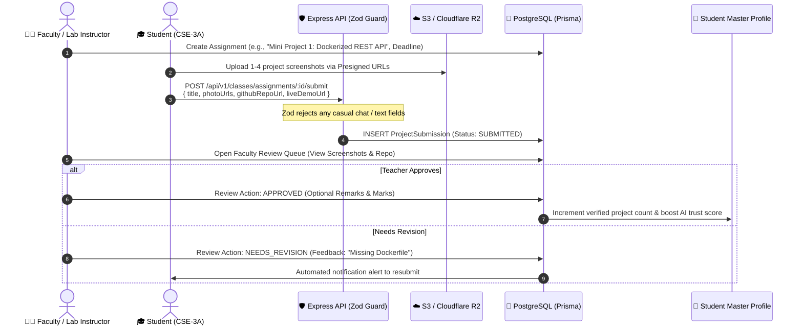

# Class Project Rooms: Architecture, Zero-Text Verification & Faculty Review Engine

---

## 📌 Executive Summary

The **Class Project Room** module is **NOT** a casual WhatsApp, Discord, or Slack group. 
Traditional college WhatsApp groups suffer from conversational clutter ("Good morning sir", "Sir check my project", lost assignment links), placing an unbearable administrative burden on professors.

This module is engineered as a **Strict Project Submission & Faculty Verification Room**:
1. **Zero-Text Policy:** Conversational text chatting is disabled. Students cannot send casual text messages.
2. **Proof-Only Submissions:** Submissions are strictly restricted to 1–4 UI/circuit screenshots, a mandatory GitHub repository URL, and an optional live demo link.
3. **Streamlined Faculty Review Queue:** Teachers evaluate submissions through a 1-click review portal (`Approve & Mark Verified`, `Request Revision`, `Reject`).
4. **Seamless Trust Feed:** Approved projects automatically upgrade the student's verified project count on their master profile and increase their visibility in the Dean's talent discovery engine.

---

## 🔄 1. The Zero-Clutter Project Submission Lifecycle



---

## 🗄️ 2. Database Schema (`schema.prisma`)

```prisma
enum SubmissionStatus {
  SUBMITTED
  APPROVED
  NEEDS_REVISION
  REJECTED
}

model ClassRoom {
  id          String   @id @default(uuid())
  tenantId    String   @default("kiet-main") // College isolation
  name        String   // e.g. "Cloud Computing Lab - CSE 3A"
  subjectCode String   // e.g. "KCS-601"
  section     String   // "A", "B", "C"
  semester    Int      // 1 to 8

  // Teacher / Lab Instructor in-charge
  teacherId   String
  teacher     User     @relation("TeacherClasses", fields: [teacherId], references: [id])

  // Students enrolled in this room
  enrollments ClassEnrollment[]
  assignments ClassAssignment[]

  createdAt   DateTime @default(now())

  @@index([tenantId, teacherId])
  @@index([tenantId, semester, section])
}

model ClassEnrollment {
  id          String    @id @default(uuid())
  classRoomId String
  classRoom   ClassRoom @relation(fields: [classRoomId], references: [id], onDelete: Cascade)
  studentId   String
  student     User      @relation(fields: [studentId], references: [id], onDelete: Cascade)

  joinedAt    DateTime  @default(now())

  // Prevents duplicate enrollment of the same student in the same room
  @@unique([classRoomId, studentId])
  @@index([studentId])
}

model ClassAssignment {
  id          String              @id @default(uuid())
  classRoomId String
  classRoom   ClassRoom           @relation(fields: [classRoomId], references: [id], onDelete: Cascade)
  
  title       String              // e.g. "Mini Project 1: Dockerized REST API"
  description String              @db.Text // Lab task brief & requirements
  deadline    DateTime
  
  submissions ProjectSubmission[]

  createdAt   DateTime            @default(now())

  @@index([classRoomId, deadline])
}

model ProjectSubmission {
  id             String           @id @default(uuid())
  assignmentId   String
  assignment     ClassAssignment  @relation(fields: [assignmentId], references: [id], onDelete: Cascade)
  
  studentId      String
  student        User             @relation(fields: [studentId], references: [id], onDelete: Cascade)

  // STRICT ZERO-TEXT CONTENT: Only Proof Artifacts
  projectTitle   String           @db.VarChar(120)
  photoUrls      String[]         // 1 to 4 screenshots / circuit diagrams (S3/R2 direct links)
  githubRepoUrl  String           // Mandatory GitHub repository link
  liveDemoUrl    String?          // Optional Vercel / Render / AWS deployment link
  
  // Faculty Evaluation Section
  status         SubmissionStatus @default(SUBMITTED)
  facultyRemarks String?          @db.VarChar(500) // Feedback written strictly by teacher
  gradeOrMarks   Float?           // Optional grade (e.g. 9.5 / 10)
  evaluatedAt    DateTime?

  createdAt      DateTime         @default(now())
  updatedAt      DateTime         @updatedAt

  // 1 submission per student per assignment (can update during NEEDS_REVISION)
  @@unique([assignmentId, studentId])
  @@index([assignmentId, status])
}
```

---

## 🛡️ 3. Backend Zero-Text Guard (`submission.validation.js`)

To guarantee zero conversational spam, the submission route is locked behind a strict **Zod validation schema**. 
Any extraneous fields (such as `message`, `chat`, `comment`) are rejected.

```javascript
import { z } from 'zod';

export const projectSubmissionSchema = z.object({
  assignmentId: z.string().uuid("Invalid assignment ID format"),
  projectTitle: z.string().min(3, "Title must be at least 3 characters").max(80, "Title cannot exceed 80 characters"),
  
  // Mandatory Screenshots: Minimum 1, Maximum 4
  photoUrls: z
    .array(z.string().url("Invalid image URL format"))
    .min(1, "At least 1 project screenshot or architecture diagram is mandatory")
    .max(4, "Maximum 4 screenshots allowed"),

  // Mandatory GitHub Repository Link (Regex validated)
  githubRepoUrl: z
    .string()
    .url("Invalid URL format")
    .regex(/^https:\/\/github\.com\/[A-Za-z0-9_.-]+\/[A-Za-z0-9_.-]+/, "Must be a valid public GitHub repository URL"),

  // Optional Live Hosted Demo Link
  liveDemoUrl: z
    .string()
    .url("Invalid URL format")
    .optional()
    .or(z.literal(''))
}).strict(); // strict() rejects any unrecognized keys like 'chat' or 'text'
```

---

## 👨‍🏫 4. Faculty Review & Verification Workflow

When a teacher opens their classroom, they see a dedicated **Submissions Review Queue** instead of a chat feed:

```
┌────────────────────────────────────────────────────────────────────────┐
│ 📚 Cloud Computing Lab (KCS-601) • Section 3A • Prof. V. Sharma        │
│ Assignment: "Mini Project 1: Dockerized REST API" (Deadline: 20 Oct)  │
├────────────────────────────────────────────────────────────────────────┤
│ 👤 Rahul Sharma (Roll: 2100290120045)                 Status: SUBMITTED│
│ 📌 Project Title: "Distributed Task Queue with Redis"                  │
│                                                                        │
│ [ 🖼️ Screenshot 1 ]  [ 🖼️ Architecture ]  [ 🖼️ Terminal Logs ]          │
│ 🔗 GitHub: https://github.com/rahul/distributed-task-queue             │
│ 🌐 Live Demo: https://taskqueue.render.com                             │
│                                                                        │
│ Faculty Remarks: [ Add actionable review feedback here...           ]  │
│ Grade: [ 9.5 ] / 10                                                    │
│                                                                        │
│ [ ✔️ Approve & Mark Verified ]   [ 🔄 Request Revision ]   [ ❌ Reject ] │
└────────────────────────────────────────────────────────────────────────┘
```

### Review Action Controller (`src/controllers/submissionReview.controller.js`)

```javascript
import { prisma } from '../lib/prisma.js';

export async function reviewSubmission(req, res) {
  const { submissionId } = req.params;
  const { status, remarks, grade } = req.body;
  const teacherId = req.user.id;

  try {
    // 1. Authorize: Ensure the authenticated user is the assigned faculty for this classroom
    const submission = await prisma.projectSubmission.findUnique({
      where: { id: submissionId },
      include: {
        assignment: {
          include: { classRoom: true }
        }
      }
    });

    if (!submission) {
      return res.status(404).json({ error: "Project submission not found." });
    }

    if (submission.assignment.classRoom.teacherId !== teacherId) {
      return res.status(403).json({ error: "Forbidden: Only the assigned faculty instructor can evaluate this submission." });
    }

    // 2. Update submission status, remarks, and marks
    const updated = await prisma.projectSubmission.update({
      where: { id: submissionId },
      data: {
        status, // APPROVED, NEEDS_REVISION, REJECTED
        facultyRemarks: remarks || null,
        gradeOrMarks: grade !== undefined ? Number(grade) : null,
        evaluatedAt: new Date()
      },
      include: {
        student: {
          select: { id: true, name: true, email: true }
        }
      }
    });

    // 3. When APPROVED, automatically link to student profile's verified projects
    if (status === 'APPROVED') {
      await prisma.project.create({
        data: {
          studentProfile: { connect: { userId: submission.studentId } },
          title: submission.projectTitle,
          shortTagline: `Lab Verified: ${submission.assignment.title}`,
          markdownContent: `## Project verified by Prof. ${req.user.name}\n\nGitHub: ${submission.githubRepoUrl}`,
          githubRepoUrl: submission.githubRepoUrl,
          liveDemoUrl: submission.liveDemoUrl || null,
          isTeacherApproved: true,
          teacherRemarks: remarks || "Officially approved during lab evaluation."
        }
      });
    }

    return res.json({
      success: true,
      message: `Submission marked as ${status}`,
      submission: updated
    });
  } catch (error) {
    console.error('[ReviewSubmission Error]', error);
    return res.status(500).json({ error: "Failed to evaluate submission." });
  }
}
```

---

## 🏛️ 5. Dean Pitch Angle (Why Faculty & Administration Will Welcome This)

When meeting Dean on 25 October, faculty workload is often the #1 objection. Here is the ironclad defense:

| Common Administrative Fear | How Class Project Rooms Solves It |
| :--- | :--- |
| *"Teachers will resist another portal that creates extra work."* | **Zero extra work.** Currently, teachers spend hours digging through emails, pen drives, and WhatsApp groups during lab submissions. This gives them a single 1-click batch queue. |
| *"Students will spam teachers with doubts and complaints."* | **Zero text chat capability.** The room is strictly a submission drop box. Feedback is recorded as structured remarks, completely eliminating message clutter. |
| *"How does this help placements?"* | **Verified code pipeline.** Instead of self-claimed final year projects, students accumulate 4–6 faculty-verified lab projects starting from their 2nd year. |

---
*Generated: 15 October 2026 — Class Project Rooms Architecture Specification.*
