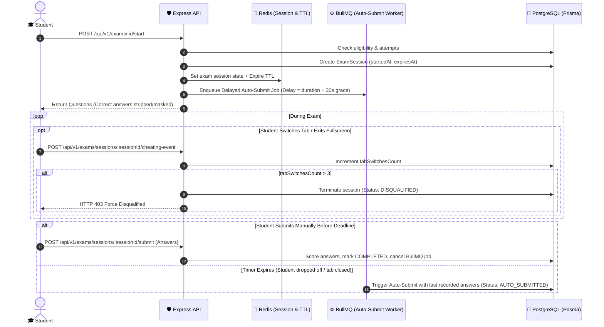

# Exams & Mock Tests Engine: Server-Enforced Timers, Anti-Cheating & Auto-Evaluation

---

## 📌 Executive Summary

The **Exams & Mock Tests Engine** is the evaluation core that powers phase gatekeeping, placement readiness tests, and campus drive screening. 

In traditional college web portals, exams fail due to two glaring flaws:
1. **Client-Side Timer Vulnerability:** Timers running strictly in JavaScript (`setInterval`) can be manipulated by pausing devtools, tampering with `localStorage`, or altering system clocks.
2. **Rampant Tab Switching & Cheating:** Students open new tabs, Google answers, or share screens without any server-side detection.

Our engine enforces **Server-Side Expiration Authority**, **Redis Delayed Auto-Submission**, and a **Real-Time Anti-Cheating Telemetry Layer**.

---

## 🔄 1. End-to-End Exam Session Lifecycle



---

## 🗄️ 2. Database Schema (`schema.prisma`)

```prisma
enum ExamStatus {
  SCHEDULED
  IN_PROGRESS
  COMPLETED
  AUTO_SUBMITTED
  DISQUALIFIED
}

enum QuestionType {
  SINGLE_CHOICE
  MULTIPLE_CHOICE
  BOOLEAN
}

model Exam {
  id              String        @id @default(uuid())
  tenantId        String        @default("kiet-main")
  title           String        // e.g. "DevOps Phase 1: Linux & Docker Assessment"
  description     String?
  durationMinutes Int           // e.g. 45 minutes
  totalMarks      Float         @default(100.0)
  passingPercent  Float         @default(70.0) // 70% threshold
  maxAttempts     Int           @default(2)

  // Associated Course Phase or Placement Drive
  phaseId         String?       @unique // Optional link to CoursePhase
  jobDriveId      String?       // Optional link to Placement Drive
  
  questions       ExamQuestion[]
  sessions        ExamSession[]

  createdAt       DateTime      @default(now())
  updatedAt       DateTime      @updatedAt

  @@index([tenantId])
}

model ExamQuestion {
  id              String        @id @default(uuid())
  examId          String
  exam            Exam          @relation(fields: [examId], references: [id], onDelete: Cascade)

  questionText    String        @db.Text
  codeSnippet     String?       @db.Text // Optional code block for debugging questions
  questionType    QuestionType  @default(SINGLE_CHOICE)
  options         String[]      // Array of 4 option strings: ["Option A", "Option B", ...]
  
  // NEVER send correctOptionIndex to frontend during exam!
  correctIndices  Int[]         // E.g. [1] for Option B, [0, 2] for multi-select
  marks           Float         @default(2.0)
  explanation     String?       @db.Text // Revealed only after exam submission

  answers         StudentExamAnswer[]

  @@index([examId])
}

model ExamSession {
  id               String        @id @default(uuid())
  examId           String
  exam             Exam          @relation(fields: [examId], references: [id], onDelete: Cascade)
  userId           String
  user             User          @relation(fields: [userId], references: [id], onDelete: Cascade)

  // Server-Enforced Time Windows
  startedAt        DateTime      @default(now())
  expiresAt        DateTime      // Hard server cutoff
  submittedAt      DateTime?

  // Status & Integrity Metrics
  status           ExamStatus    @default(IN_PROGRESS)
  tabSwitchesCount Int           @default(0)
  fullscreenExits  Int           @default(0)
  disqualifyReason String?

  // Evaluation
  obtainedMarks    Float         @default(0.0)
  isPassed         Boolean       @default(false)

  answers          StudentExamAnswer[]

  @@unique([examId, userId, startedAt])
  @@index([userId, status])
}

model StudentExamAnswer {
  id              String        @id @default(uuid())
  sessionId       String
  session         ExamSession   @relation(fields: [sessionId], references: [id], onDelete: Cascade)
  questionId      String
  question        ExamQuestion  @relation(fields: [questionId], references: [id], onDelete: Cascade)

  selectedIndices Int[]         // What student chose: e.g. [1]
  isCorrect       Boolean       @default(false)
  marksAwarded    Float         @default(0.0)

  @@unique([sessionId, questionId])
}
```

---

## ⏰ 3. Server-Side Timer Enforcement & Auto-Submission Worker

### A. Exam Start Controller (`startExamSession.controller.js`)

When a student clicks "Start Exam", the server calculates `expiresAt` based on the authoritative server timestamp and registers a delayed BullMQ job:

```javascript
import { prisma } from '../lib/prisma.js';
import { Queue } from 'bullmq';

const examQueue = new Queue('exam-auto-submit', {
  connection: { host: process.env.REDIS_HOST || 'localhost', port: 6379 }
});

export async function startExam(req, res) {
  const { examId } = req.params;
  const userId = req.user.id;

  try {
    const exam = await prisma.exam.findUnique({
      where: { id: examId },
      include: {
        questions: {
          select: {
            id: true,
            questionText: true,
            codeSnippet: true,
            questionType: true,
            options: true,
            marks: true
            // NOTICE: correctIndices is intentionally excluded to prevent inspecting client state
          }
        }
      }
    });

    if (!exam) return res.status(404).json({ error: "Exam not found" });

    // Check existing active or max attempts
    const existingSessionsCount = await prisma.examSession.count({
      where: { examId, userId, status: { in: ['COMPLETED', 'AUTO_SUBMITTED'] } }
    });

    if (existingSessionsCount >= exam.maxAttempts) {
      return res.status(403).json({ error: "Maximum attempts reached for this assessment." });
    }

    const now = new Date();
    const expiresAt = new Date(now.getTime() + exam.durationMinutes * 60 * 1000);

    // Create session record
    const session = await prisma.examSession.create({
      data: {
        examId,
        userId,
        startedAt: now,
        expiresAt,
        status: 'IN_PROGRESS'
      }
    });

    // Schedule delayed auto-submit worker job with 30s network grace period
    const delayMs = (exam.durationMinutes * 60 + 30) * 1000;
    await examQueue.add(
      'auto-submit-session',
      { sessionId: session.id },
      { delay: delayMs, jobId: `auto-submit-${session.id}` }
    );

    return res.status(201).json({
      success: true,
      sessionId: session.id,
      durationMinutes: exam.durationMinutes,
      serverTime: now.toISOString(),
      expiresAt: expiresAt.toISOString(),
      questions: exam.questions
    });
  } catch (error) {
    console.error('[StartExam Error]', error);
    return res.status(500).json({ error: "Failed to initialize exam session." });
  }
}
```

---

### B. BullMQ Auto-Submit Worker (`examAutoSubmit.worker.js`)

If the student closes the tab or loses internet connection, the server automatically grades whatever answers were saved up to that point:

```javascript
import { Worker } from 'bullmq';
import { prisma } from '../lib/prisma.js';
import { evaluateAndGradeSession } from '../services/examGrading.service.js';

export const autoSubmitWorker = new Worker(
  'exam-auto-submit',
  async (job) => {
    const { sessionId } = job.data;

    const session = await prisma.examSession.findUnique({
      where: { id: sessionId }
    });

    // If student already submitted manually, do nothing
    if (!session || session.status !== 'IN_PROGRESS') {
      return;
    }

    console.log(`[AutoSubmit] Exam time elapsed for session ${sessionId}. Executing grading...`);
    await evaluateAndGradeSession(sessionId, 'AUTO_SUBMITTED');
  },
  { connection: { host: process.env.REDIS_HOST || 'localhost', port: 6379 } }
);
```

---

## 🛡️ 4. Anti-Cheating Telemetry & Disqualification Engine

### Cheating Event Tracker (`recordCheatingEvent.controller.js`)

The frontend attaches event listeners to `visibilitychange` (tab switch) and `fullscreenchange`. 
If a violation occurs, the client sends an immediate beacon ping.

```javascript
export async function recordCheatingEvent(req, res) {
  const { sessionId } = req.params;
  const { eventType } = req.body; // "TAB_SWITCH" or "FULLSCREEN_EXIT"
  const userId = req.user.id;

  try {
    const session = await prisma.examSession.findUnique({
      where: { id: sessionId }
    });

    if (!session || session.userId !== userId || session.status !== 'IN_PROGRESS') {
      return res.status(403).json({ error: "Invalid or inactive session." });
    }

    const updatePayload = {};
    if (eventType === 'TAB_SWITCH') updatePayload.tabSwitchesCount = { increment: 1 };
    if (eventType === 'FULLSCREEN_EXIT') updatePayload.fullscreenExits = { increment: 1 };

    const updatedSession = await prisma.examSession.update({
      where: { id: sessionId },
      data: updatePayload
    });

    // Disqualification policy: Max 3 tab switches allowed
    if (updatedSession.tabSwitchesCount >= 3) {
      await prisma.examSession.update({
        where: { id: sessionId },
        data: {
          status: 'DISQUALIFIED',
          disqualifyReason: "Exceeded maximum allowed window/tab switches (Limit: 3).",
          submittedAt: new Date()
        }
      });

      return res.status(403).json({
        disqualified: true,
        message: "You have been disqualified due to repeated tab switching."
      });
    }

    return res.json({
      success: true,
      warningsRemaining: 3 - updatedSession.tabSwitchesCount
    });
  } catch (error) {
    console.error('[CheatingEvent Error]', error);
    return res.status(500).json({ error: "Failed to record event." });
  }
}
```

---

## 💯 5. Instant Evaluation & Grading Engine (`submitExam.controller.js`)

When an exam is submitted (manually or via auto-submit):
1. Verifies that submission occurred before `expiresAt + 30s grace`.
2. Computes total marks earned against `correctIndices`.
3. If percentage $\ge 70\%$, automatically sets `isPassed: true` and connects to the Course Phase progression engine.

```javascript
export async function submitExam(req, res) {
  const { sessionId } = req.params;
  const { answers = [] } = req.body; // [{ questionId, selectedIndices: [1] }]
  const userId = req.user.id;

  try {
    const session = await prisma.examSession.findUnique({
      where: { id: sessionId },
      include: {
        exam: {
          include: { questions: true }
        }
      }
    });

    if (!session || session.userId !== userId) {
      return res.status(404).json({ error: "Session not found." });
    }

    if (session.status !== 'IN_PROGRESS') {
      return res.status(400).json({ error: "Session is already closed or evaluated." });
    }

    // Server-side cutoff check (with 30s network buffer)
    const now = new Date();
    const cutoffWithGrace = new Date(session.expiresAt.getTime() + 30000);
    if (now > cutoffWithGrace) {
      // Force auto-submit state if delayed beyond grace period
      return res.status(403).json({ error: "Exam window has officially expired." });
    }

    // Evaluate answers
    let totalScore = 0;
    const answerRecords = [];

    for (const q of session.exam.questions) {
      const studentAns = answers.find(a => a.questionId === q.id);
      const selected = studentAns?.selectedIndices || [];

      // Check if arrays match
      const isCorrect =
        selected.length === q.correctIndices.length &&
        selected.every((val, index) => val === q.correctIndices[index]);

      const marksAwarded = isCorrect ? q.marks : 0;
      totalScore += marksAwarded;

      answerRecords.push({
        sessionId,
        questionId: q.id,
        selectedIndices: selected,
        isCorrect,
        marksAwarded
      });
    }

    const percentage = (totalScore / session.exam.totalMarks) * 100;
    const isPassed = percentage >= session.exam.passingPercent;

    // Atomic transaction: Save answers and finalize session
    await prisma.$transaction([
      ...answerRecords.map(ans =>
        prisma.studentExamAnswer.upsert({
          where: { sessionId_questionId: { sessionId, questionId: ans.questionId } },
          update: ans,
          create: ans
        })
      ),
      prisma.examSession.update({
        where: { id: sessionId },
        data: {
          status: 'COMPLETED',
          submittedAt: now,
          obtainedMarks: totalScore,
          isPassed
        }
      })
    ]);

    return res.json({
      success: true,
      obtainedMarks: totalScore,
      totalMarks: session.exam.totalMarks,
      percentage: percentage.toFixed(1),
      isPassed,
      message: isPassed
        ? "Congratulations! You have passed the assessment."
        : "Assessment not cleared. You may review your syllabus and retake according to policy."
    });
  } catch (error) {
    console.error('[SubmitExam Error]', error);
    return res.status(500).json({ error: "Failed to process exam submission." });
  }
}
```

---

## 🏛️ 6. Dean Pitch Angle (Academic Integrity Defense)

When Dean asks: *"Online tests always have cheating issues, how do you prevent students from gaming the system?"*

> **Winning Pitch Answer:**  
> *"Sir, we solve this with three server-enforced layers: First, **questions are delivered with zero answer keys in the client payload**. Second, **timers are locked to server clocks with background auto-submission**, meaning pausing JavaScript does nothing. Third, **live tab-switch telemetry automatically disqualifies students after 3 window departures**, guaranteeing authentic assessment credibility for recruiters and faculty."*

---
*Generated: 15 October 2026 — Exams & Mock Tests Engine Specification.*
