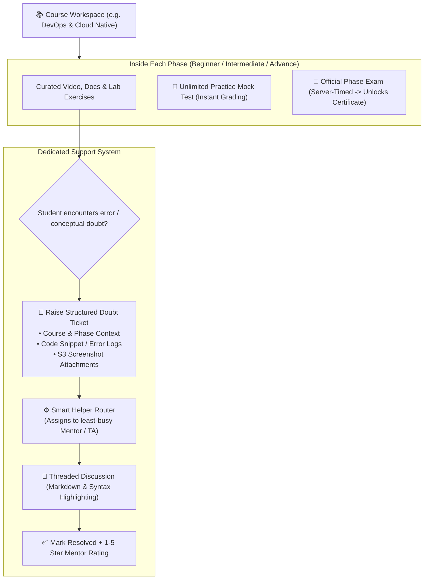

# Helper & Mentor Support Engine: In-Course Testing & Spam-Proof Ticket Routing

---

## 📌 Executive Summary

The **Helper & Mentor Support Engine** solves two critical product experience problems for 7,000+ KIET students:
1. **Embedded In-Course Testing:** Instead of forcing students into a detached "Exams" portal, testing is placed **directly inside the course phase** ("Phase Practice Mock" for unlimited attempts and "Official Phase Exam" for verified certification).
2. **Spam-Proof Ticket & Thread Architecture:** Direct open chat (DMs/WhatsApp) crashes mentor inboxes and creates chaotic unrecorded support. We replace it with a **Structured Doubt Ticket & Thread System** featuring automated load-balanced helper routing.

---

## 🔄 1. The Embedded Learning & Support Lifecycle



---

## 🗄️ 2. Database Schema (`schema.prisma`)

```prisma
enum TicketStatus {
  OPEN
  ASSIGNED
  IN_PROGRESS
  RESOLVED
  CLOSED
}

enum Priority {
  LOW
  MEDIUM
  HIGH
  URGENT
}

model SupportTicket {
  id              String          @id @default(uuid())
  tenantId        String          @default("kiet-main") // College isolation
  
  // Student who raised the ticket
  studentId       String
  student         User            @relation("StudentTickets", fields: [studentId], references: [id], onDelete: Cascade)
  
  // Assigned Helper/Mentor (Senior, TA, or Faculty Mentor)
  helperId        String?
  helper          User?           @relation("HelperTickets", fields: [helperId], references: [id])
  
  // Categorization & Course Context
  category        String          // "COURSE_DOUBT", "LAB_PROJECT_HELP", "BUG_REPORT"
  courseContext   String          // e.g. "DevOps - Phase 1: Docker Containerization"
  
  // Problem Details
  title           String          @db.VarChar(120)
  description     String          @db.Text
  codeSnippet     String?         @db.Text
  attachmentUrls  String[]        // S3 / Cloudflare R2 error screenshots
  
  status          TicketStatus    @default(OPEN)
  priority        Priority        @default(MEDIUM)
  
  // Feedback upon resolution
  rating          Int?            // 1 to 5 Stars
  feedback        String?         @db.VarChar(300)
  resolvedAt      DateTime?

  // Threaded Conversation
  messages        TicketMessage[]

  createdAt       DateTime        @default(now())
  updatedAt       DateTime        @updatedAt

  @@index([tenantId, status])
  @@index([helperId, status])
}

model TicketMessage {
  id          String        @id @default(uuid())
  ticketId    String
  ticket      SupportTicket @relation(fields: [ticketId], references: [id], onDelete: Cascade)
  
  senderId    String
  sender      User          @relation(fields: [senderId], references: [id], onDelete: Cascade)
  
  message     String        @db.Text // Full markdown & code block support
  isHelper    Boolean       @default(false)
  
  createdAt   DateTime      @default(now())

  @@index([ticketId, createdAt(sort: Asc)])
}
```

---

## ⚙️ 3. Smart Helper Routing & Load Balancing Engine

When a student submits a ticket, the backend evaluates the active queue of mentors within the college and automatically assigns the ticket to the **least-busy helper**:

```javascript
import { prisma } from '../lib/prisma.js';

export async function createSupportTicket(req, res) {
  const { title, description, codeSnippet, attachmentUrls = [], category, courseContext, priority } = req.body;
  const { id: studentId, tenantId = 'kiet-main' } = req.user;

  try {
    // 1. Identify active helper/mentor with lowest active ticket load
    const leastBusyHelper = await prisma.user.findFirst({
      where: {
        tenantId,
        role: { in: ['TEACHER', 'HELPER_MENTOR'] } // Mentors, TAs, or Faculty
      },
      include: {
        _count: {
          select: {
            helperTickets: {
              where: { status: { in: ['OPEN', 'ASSIGNED', 'IN_PROGRESS'] } }
            }
          }
        }
      },
      orderBy: {
        helperTickets: { _count: 'asc' } // Lowest active tickets first
      }
    });

    // 2. Create ticket with auto-assignment
    const ticket = await prisma.supportTicket.create({
      data: {
        tenantId,
        studentId,
        helperId: leastBusyHelper ? leastBusyHelper.id : null,
        status: leastBusyHelper ? 'ASSIGNED' : 'OPEN',
        priority: priority || 'MEDIUM',
        category: category || 'COURSE_DOUBT',
        courseContext,
        title: title.trim(),
        description: description.trim(),
        codeSnippet: codeSnippet || null,
        attachmentUrls
      },
      include: {
        helper: {
          select: { id: true, name: true, email: true }
        }
      }
    });

    return res.status(201).json({
      success: true,
      ticketId: ticket.id,
      assignedHelper: ticket.helper ? ticket.helper.name : "Unassigned (Pooled)",
      message: "Ticket created successfully. A mentor has been assigned and will reply shortly."
    });
  } catch (error) {
    console.error('[CreateTicket Error]', error);
    return res.status(500).json({ error: "Failed to create support ticket." });
  }
}
```

---

## 🎨 4. In-Course UI Wireframe (Where Tests & Helpers Live)

By co-locating practice tests, exams, and support in the course UI, cognitive friction is removed:

```
┌────────────────────────────────────────────────────────────────────────┐
│ 📚 DevOps & Cloud Native Engineering • [CSE / IT Core Roadmap]         │
├────────────────────────────────────────────────────────────────────────┤
│ [ Phase 1: Docker ]   [ Phase 2: Kubernetes ]   [ Phase 3: CI/CD AWS ]  │
│                                                                        │
│  ▶ Module 1.1: Linux Kernel Namespaces & cgroups (Watched ✔)           │
│  ▶ Module 1.2: Multi-Stage Dockerfile Optimization (Watched ✔)          │
│                                                                        │
│  ┌──────────────────────────────────────────────────────────────────┐  │
│  │ 🎯 Phase 1 Completion & Skill Validation                         │  │
│  │ • Practice Mock Test       [ 🧪 Start Practice (Unlimited) ]     │  │
│  │ • Official Phase 1 Exam    [ 🎯 Take Exam & Mint Certificate ]   │  │
│  └──────────────────────────────────────────────────────────────────┘  │
│                                                                        │
│  ┌──────────────────────────────────────────────────────────────────┐  │
│  │ 🆘 Stuck on a container runtime bug or syntax error?              │  │
│  │ [ 🎫 Raise Structured Doubt Ticket ]  (Active Mentors Online: 4) │  │
│  └──────────────────────────────────────────────────────────────────┘  │
└────────────────────────────────────────────────────────────────────────┘
```

---

## 👨‍💻 5. Helper Team Dashboard & Resolution Workflow

Helpers (Senior students, TAs, or faculty) access a high-efficiency **Support Desk Queue**:

```
┌────────────────────────────────────────────────────────────────────────┐
│ 🎫 Active Support Desk • Prof. V. Sharma / Senior TA Queue             │
├────────────────────────────────────────────────────────────────────────┤
│ 👤 Student: Priya Verma (Roll: 2100290120088)           Priority: HIGH │
│ 🏷️ Context: DevOps Phase 1 — "Docker daemon permission denied"        │
│                                                                        │
│ 📝 Issue: "Getting socket permission error when running docker build"  │
│ 💻 Code Snippet:                                                       │
│    $ docker build -t myapp .                                           │
│    Got permission denied while trying to connect to the Docker daemon  │
│                                                                        │
│ [ 🖼️ Screenshot.png ]                                                   │
│                                                                        │
│ 💬 Quick Reply (Markdown supported):                                   │
│ [ Type solution here: run `sudo usermod -aG docker $USER`...        ] │
│                                                                        │
│ [ 📨 Send Reply ]     [ ✅ Mark Resolved ]     [ ➡️ Reassign Ticket ]  │
└────────────────────────────────────────────────────────────────────────┘
```

### Resolution & Star Rating Controller (`resolveTicket.controller.js`)

```javascript
export async function resolveTicket(req, res) {
  const { ticketId } = req.params;
  const { rating, feedback } = req.body; // Submitted by student upon resolution
  const userId = req.user.id;

  try {
    const ticket = await prisma.supportTicket.findUnique({
      where: { id: ticketId }
    });

    if (!ticket) return res.status(404).json({ error: "Ticket not found." });

    const updated = await prisma.supportTicket.update({
      where: { id: ticketId },
      data: {
        status: 'RESOLVED',
        rating: rating ? Math.min(Math.max(Number(rating), 1), 5) : null,
        feedback: feedback || null,
        resolvedAt: new Date()
      }
    });

    return res.json({
      success: true,
      message: "Ticket marked as resolved. Feedback recorded.",
      ticket: updated
    });
  } catch (error) {
    console.error('[ResolveTicket Error]', error);
    return res.status(500).json({ error: "Failed to resolve ticket." });
  }
}
```

---

## 🏛️ 6. Dean Pitch Angle (Scalable Peer Mentorship)

When presenting to the Dean:
* **Peer Learning Economy:** 3rd and 4th year high-performing students act as verified TAs/Helpers, earning leadership badges and certificates for their own resumes.
* **Faculty Bandwidth Protected:** Faculty are only looped into escalated high-priority tickets, preventing teachers from getting overwhelmed by basic syntax doubts.
* **Continuous Student Retention:** Beginners never get stranded or give up on coding roadmaps because structured help is always available inside the course.

---
*Generated: 15 October 2026 — Helper & Mentor Support Engine Specification.*
