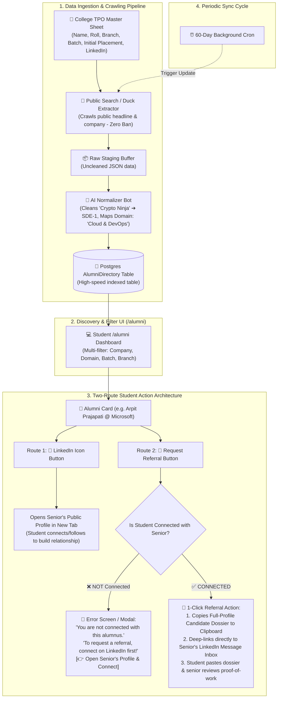

# Alumni Directory & Career Network: Production Architecture Blueprint
**Platform:** JobsOnly (KIET Campus Talent, Placement & Career Network)  
**Target Scale:** ~30,000 Total Alumni (~4,000–5,000 Active Mentorship Pool)  
**Stack:** Node.js v24 ESM, Express, PostgreSQL, Prisma 7, Next.js 14  
**Last Updated:** November 2026 (Finalized Master Architecture)

---

## 📌 1. Core Philosophy: Why This Wins

Traditional college alumni portals fail because **alumni never log in or check college apps**. Their entire professional networking lives on **LinkedIn**.

JobsOnly solves this with a **Zero-Friction, Zero-App-Login Architecture for Alumni**:
1. **Alumni do NOT need to download the app or create an account.**
2. All outreach, referral requests, and messages land directly where alumni already are: **in their LinkedIn inbox**.
3. The platform serves as an **institutional verified discovery layer** for current KIET undergraduates (1st to 4th year).

---

## 🔄 2. End-to-End System Architecture



---

## 🗄️ 3. Database Schema (`AlumniDirectory`)

```prisma
model AlumniDirectory {
    id                     String   @id @default(uuid())
    fullName               String   @db.VarChar(120)
    avatarUrl              String?
    company                String   @db.VarChar(120) // e.g. "Microsoft", "Amazon"
    role                   String   @db.VarChar(120) // e.g. "Software Development Engineer II"
    batch                  String   // e.g. "Class of 2024"
    passoutYear            Int      // e.g. 2024 (Numeric index for fast sorting)
    branch                 String   // e.g. "CSE", "IT", "ECE", "CS-AI"
    domain                 String   @db.VarChar(80)  // "Distributed Systems", "Cloud & DevOps", "AI / ML"
    skills                 String[] @default([])     // e.g. ["Next.js", "Azure", "C++"]
    packageLpa             Float?   // e.g. 28.5 (Official verified college CTC)
    isPackagePublic        Boolean  @default(true)   // Privacy toggle
    referralSlotsAvailable Int      @default(3)
    linkedinUrl            String   // Mandatory LinkedIn profile URL
    verifiedByTpo          Boolean  @default(true)
    workEmail              String?  // Optional corporate email

    createdAt              DateTime @default(now())
    updatedAt              DateTime @updatedAt

    // High-performance B-tree indexes for sub-10ms filtered queries
    @@index([company])
    @@index([domain])
    @@index([passoutYear])
    @@index([branch])
}
```

---

## ⚡ 4. Backend API Specifications (`/api/alumni`)

### 1. `GET /api/alumni` (Multi-Filter Paginated Search)
* **Access:** Student / Faculty / Admin
* **Query Parameters:**
  * `search`: Fuzzy keyword search matching `fullName`, `company`, `role`, or `skills`.
  * `company`: Exact filter (`Microsoft`, `Amazon`, `Swiggy`, etc. or `ALL`).
  * `domain`: Exact domain (`Distributed Systems`, `Frontend & Mobile`, `Cloud & DevOps`, `AI / ML`, `Quant & FinTech`).
  * `batch`: Filter by passout year (`Class of 2024`, `Class of 2023`, etc.).
  * `branch`: Filter by branch (`CSE`, `IT`, `ECE`, `CS-AI`).
  * `page`: Integer (default `1`).
  * `limit`: Integer (default `12`, max `50`).
* **Privacy Enforcement:** If `isPackagePublic === false`, backend redacts `packageLpa: null`.

### 2. `GET /api/alumni/stats` (Overview Summary)
* Returns aggregated dynamic counts for the frontend header banner:
  * `totalVerified`: Total verified alumni count.
  * `totalCompanies`: Total unique companies count.
  * `companies`: Sorted list of represented companies (including `ALL`).
  * `domains`: Sorted list of active tech domains.
  * `batches`: Sorted list of batches.

### 3. `GET /api/alumni/:id` (Single Profile Details)
* Fetches full public details of a single alumnus.

### 4. `POST /api/alumni` (Admin / TPO Ingestion)
* Endpoint for TPO coordinators to add or import new alumni records.

---

## 📋 5. Candidate Dossier Specification (Clipboard Format)

When an eligible connected student clicks **"Request Referral"**, the application compiles their live profile data into this standardized clipboard dossier:

```text
══════════════════════════════════════════════════════════════════
🎓 KIET VERIFIED CANDIDATE DOSSIER · REFERRAL REQUEST
══════════════════════════════════════════════════════════════════

Hi [Senior Name],

I am [Student Name], a 4th-year [Branch] student at KIET (Batch [Batch]).
I came across your profile on the KIET JobsOnly Alumni Network and admire your work at [Company].
I am actively seeking a referral for an opening at [Company].

──────────────────────────────────────────────────────────────────
📌 CANDIDATE SNAPSHOT (TPO VERIFIED)
──────────────────────────────────────────────────────────────────
• Degree: B.Tech [Branch] (KIET Group of Institutions)
• Academic CGPA: [CGPA] / 10 · Institutional TPO Verified
• Core Tech Stack: [Top 5 Skills/Technologies]
• Problem Solving: [LeetCode Solved Count]+ Solved · GitHub [Streak Days]+ Active Streak

🚀 TOP VERIFIED PROJECTS:
1. [Project 1 Title] ([Summary])
   • Tech Stack: [Stack]
   • GitHub: [Repo Link]
   • Live Demo: [Live URL]

2. [Project 2 Title] ([Summary])
   • Tech Stack: [Stack]
   • GitHub: [Repo Link]

🏆 VERIFIED BADGES & CERTIFICATIONS:
• [Badge 1]
• [Badge 2]

🔗 FULL INTERACTIVE VERIFIED PROFILE:
https://jobsonly.kiet.edu/profile/[student-username]
──────────────────────────────────────────────────────────────────
Would you be open to reviewing my profile or referring me if an opening matches?
Thank you so much for your time and guidance!
══════════════════════════════════════════════════════════════════
```

---

## 🏛️ 6. Dean Pitch & Institutional Value Proposition

1. **100% Verified Accreditations (NAAC / NIRF):**
   Accreditation boards require proof of active alumni career outcomes. This directory automatically showcases seniors progressing from mass recruiters to Tier-1 product firms.
2. **Organic Junior Mentorship:**
   1st and 2nd-year students gain concrete proof of what skills produce ₹20LPA+ packages, directing their elective choices and lab projects.
3. **Zero Maintenance Burden on Alumni:**
   By routing all actions to LinkedIn, the college never suffers from "dead/abandoned alumni accounts".
