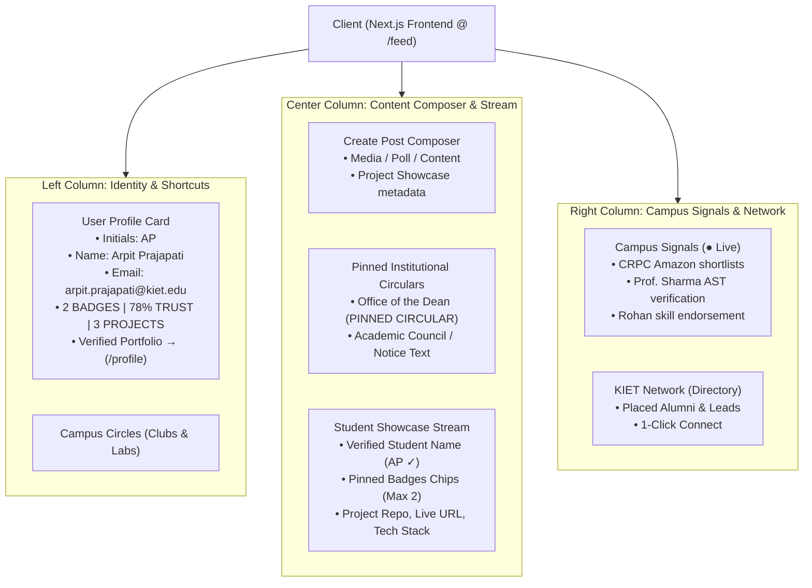

# Campus Feed Engine: Production Architecture & System Blueprint
**Platform:** OnlyJobs (KIET Campus Talent, Placement & Community Platform)  
**Target Scale:** ~7,000 Students, Faculty, TPO Cell, & Dean of Academics  
**Tech Stack:** Node.js v24 ESM, Express, PostgreSQL, Prisma 7, Next.js  
**Last Updated:** November 2026 (Synchronized with Implemented Backend & Live Frontend)

---

## 1. Executive Summary

The **Campus Feed** (`/feed`) is the central social engagement, academic announcement, and peer proof-of-work showcase hub of the **KIET Campus Platform**. 

It eliminates chaotic, spammy social networking by enforcing **strict institutional governance and role-based differentiation**:
1. **Official Institutional Authority:** Pinned circulars from the **Office of the Dean** and **Academic Council** are permanently anchored to the top of the feed stream.
2. **Verified Proof-of-Work Showcase:** Students showcase real production projects (e.g., KubePay on AWS EKS) displaying verified tech stack chips, repository links, and up to 2 approved badges earned on their profile.
3. **No Badges for Authorities:** Dean, TPO, and Faculty posts display verified official designation pills (`Dean of Academics`, `CRPC Officer`, `Faculty Member`) rather than gamified student badges.
4. **Live Institutional Signals:** Real-time campus updates (CRPC Amazon shortlists, faculty verification, peer endorsements) and verified alumni networking directory.

---

## 2. 3-Column Dashboard Layout & API Mapping

The feed is partitioned into a high-density 3-column dashboard matching the live frontend interface:



---

## 3. Database Schema (`schema.prisma`)

```prisma
enum PostType {
    DEAN_NOTICE
    PROJECT_SHOWCASE
    PLACEMENT_UPDATE
    HACKATHON_WIN
    GENERAL
}

model Post {
    id           String      @id @default(uuid())
    userId       String
    user         User        @relation(fields: [userId], references: [id], onDelete: Cascade)

    type         PostType    @default(GENERAL)
    content      String
    hashtags     String[]    @default([])
    imageUrl     String?
    imageTag     String?

    // Optional Project Showcase metadata
    projectRepo  String?
    projectUrl   String?
    projectStack String[]    @default([])
    projectStars Int?        @default(0)

    isPinned     Boolean     @default(false)

    likes        PostLike[]
    comments     PostComment[]

    createdAt    DateTime    @default(now())
    updatedAt    DateTime    @updatedAt
}

model PostLike {
    id        String   @id @default(uuid())
    postId    String
    post      Post     @relation(fields: [postId], references: [id], onDelete: Cascade)
    userId    String
    user      User     @relation(fields: [userId], references: [id], onDelete: Cascade)

    createdAt DateTime @default(now())

    @@unique([postId, userId])
}

model PostComment {
    id        String   @id @default(uuid())
    postId    String
    post      Post     @relation(fields: [postId], references: [id], onDelete: Cascade)
    userId    String
    user      User     @relation(fields: [userId], references: [id], onDelete: Cascade)

    content   String
    createdAt DateTime @default(now())
    updatedAt DateTime @updatedAt
}

model CampusSignal {
    id        String   @id @default(uuid())
    title     String
    category  String?  // "CRPC" | "ACADEMIC" | "ENDORSEMENT"
    timeText  String?  // "15m ago", "1h ago"
    linkUrl   String?
    createdAt DateTime @default(now())
}
```

---

## 4. Feed API Contracts & Endpoints

### 1. `GET /api/feed/sidebar-summary`
**Description:** Supplies the Left Profile Mini-Card.

**Response Payload:**
```json
{
  "success": true,
  "data": {
    "role": "STUDENT",
    "id": "student-uuid",
    "name": "Arpit Prajapati",
    "email": "arpit.prajapati@kiet.edu",
    "initials": "AP",
    "avatarUrl": null,
    "course": "B.Tech",
    "branch": "CSE",
    "currentSemester": 7,
    "badgesCount": 2,
    "trustScore": 78,
    "projectsCount": 3,
    "profileUrl": "/profile"
  }
}
```

---

### 2. `GET /api/feed/signals`
**Description:** Supplies Right Widget 1 (Live Campus Signals).

**Response Payload:**
```json
{
  "success": true,
  "data": [
    {
      "id": "sig-1",
      "title": "CRPC Cell announced Amazon SDE shortlists.",
      "timeText": "15m ago",
      "category": "CRPC",
      "dotColor": "blue"
    },
    {
      "id": "sig-2",
      "title": "Prof. Sharma verified AST complexity.",
      "timeText": "1h ago",
      "category": "ACADEMIC",
      "dotColor": "green"
    },
    {
      "id": "sig-3",
      "title": "Rohan endorsed Docker & K8s skills.",
      "timeText": "1D ago",
      "category": "ENDORSEMENT",
      "dotColor": "purple"
    }
  ]
}
```

---

### 3. `GET /api/feed/network`
**Description:** Supplies Right Widget 2 (KIET Alumni & Peer Network).

**Response Payload:**
```json
{
  "success": true,
  "data": [
    {
      "id": "net-1",
      "name": "Aman Gupta",
      "headline": "SDE @ Atlassian · '24",
      "isConnected": false,
      "avatarUrl": null
    },
    {
      "id": "net-2",
      "name": "Sneha Rawat",
      "headline": "Innogeeks Lead · CSE '26",
      "isConnected": true,
      "avatarUrl": null
    },
    {
      "id": "net-3",
      "name": "Priya Sharma",
      "headline": "Placed @ Adobe · IT '25",
      "isConnected": true,
      "avatarUrl": null
    }
  ]
}
```

---

### 4. `GET /api/feed`
**Description:** Returns the unified, paginated feed stream.

**Sorting Strategy:**
```javascript
const orderBy = [
    { isPinned: "desc" }, // Dean circulars anchored to top
    { createdAt: "desc" }, // Chronological newest first
];
```

**Response Payload:**
```json
{
  "success": true,
  "data": {
    "posts": [
      {
        "id": "post-dean-001",
        "type": "DEAN_NOTICE",
        "content": "Mandatory Briefing on Smart India Hackathon (SIH 2026) internal college evaluations scheduled for Friday 2:00 PM at Main Auditorium. All 1st–4th year teams must link their verified GitHub repository on the portal before Thursday midnight.",
        "hashtags": ["#SIH2026", "#KIETAcademics", "#Hackathon"],
        "imageUrl": null,
        "imageTag": null,
        "isPinned": true,
        "createdAt": "2026-11-10T01:00:00.000Z",
        "project": null,
        "author": {
          "id": "user-dean-uuid",
          "name": "Office of the Dean",
          "subtitle": "Dean of Academics",
          "department": "Academic Council",
          "avatarUrl": null,
          "verifiedType": "dean",
          "isStaff": true,
          "pinnedBadges": []
        }
      },
      {
        "id": "post-student-002",
        "type": "PROJECT_SHOWCASE",
        "content": "Deployed KubePay to production. Microservices payment gateway on AWS EKS with Argo Rollouts and double-entry ledger. Passed k6 load tests at 1.2k RPS with zero-downtime canary updates.",
        "hashtags": ["#Kubernetes", "#DevOps", "#EKS", "#Go", "#Microservices"],
        "imageUrl": null,
        "imageTag": null,
        "isPinned": false,
        "createdAt": "2026-11-10T01:15:00.000Z",
        "project": {
          "repoUrl": "https://github.com/arpit/kubepay",
          "liveUrl": null,
          "techStack": ["Go", "Node.js", "PostgreSQL", "Docker", "Kubernetes", "AWS"]
        },
        "author": {
          "id": "user-student-uuid",
          "studentId": "student-uuid",
          "name": "Arpit Prajapati",
          "subtitle": "B.Tech CSE · Sem 7",
          "avatarUrl": null,
          "verifiedType": "student",
          "isStaff": false,
          "pinnedBadges": [
            { "id": "badge-1", "title": "200+ LeetCode", "imageUrl": null },
            { "id": "badge-2", "title": "Full-Stack Builder", "imageUrl": null }
          ]
        }
      }
    ],
    "pagination": {
      "page": 1,
      "limit": 10,
      "totalPosts": 2,
      "totalPages": 1,
      "hasMore": false
    }
  }
}
```

---

### 5. `POST /api/feed`
**Description:** Publishes a new post with role-based restrictions.

**Rules:**
- `DEAN_NOTICE` and `isPinned = true` strictly require `req.user.role === "ADMIN"`.
- `PLACEMENT_UPDATE` strictly requires `req.user.role === "TPO" || "ADMIN"`.
- `PROJECT_SHOWCASE`, `HACKATHON_WIN`, and `GENERAL` are open to all authenticated users.

---

### 6. `DELETE /api/feed/:id`
**Description:** Deletes a post. Restricted to the original post author or an institutional `ADMIN`.
