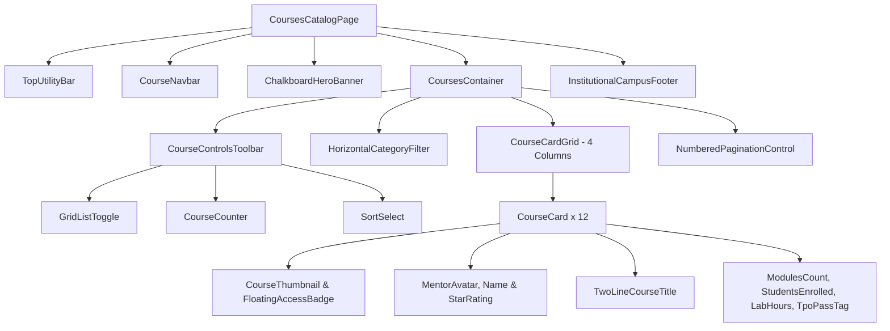

# Courses & Learning Hub: UI/UX Architecture & Layout Specification
### Modeled on the *Aduki Online Academy & Course Catalog* Standard for KIET × Only Jobs

---

## 📌 1. Executive Overview & Visual Direction

This specification establishes the **Courses & Learning Hub** for the **Only Jobs × KIET Campus Platform**, directly adapting the layout, visual hierarchy, and component anatomy from the reference design (**Aduki Online Academy Courses & Education Template**).

Traditional campus courses fail because they are either buried inside messy LMS portals (Moodle/Google Classroom) or lack direct career motivation. The **Only Jobs Learning Hub** solves this by packaging institutional learning into a **high-converting, marketplace-style course catalog** that connects directly to the **3-Phase Gatekeeper Engine** and **TPO Recruiter Shortlists**.

```
┌────────────────────────────────────────────────────────────────────────────────────────┐
│  🎓 WELCOME TO KIET LEARNING PORTAL | 📞 +91-120-297-4300 | ✉️ academics@kiet.edu      │
├────────────────────────────────────────────────────────────────────────────────────────┤
│  [OJ KIET]    Home   Courses & Tracks (Active)   Feed   Project Rooms   Verify Cert    │
├────────────────────────────────────────────────────────────────────────────────────────┤
│                                                                                        │
│                                COURSES & LEARNING TRACKS                               │
│                         Home  >  Skill Verification  >  Courses                        │
│                           [Dark Slate / Chalkboard Hero Banner]                        │
│                                                                                        │
├────────────────────────────────────────────────────────────────────────────────────────┤
│  [田 Grid] [☰ List]  12 Verified Campus Tracks                  [ Sort by Placement Demand ▾ ] │
├────────────────────────────────────────────────────────────────────────────────────────┤
│  (All Tracks)  (Full Stack)  (DevOps & Cloud)  (DSA & Algorithms)  (AI / ML)  (Systems) │
├────────────────────────────────────────────────────────────────────────────────────────┤
│  ┌──────────────────┐  ┌──────────────────┐  ┌──────────────────┐  ┌──────────────────┐│
│  │ [Thumbnail] [₹0] │  │ [Thumbnail] [₹0] │  │ [Thumbnail] [₹0] │  │ [Thumbnail] [₹0] ││
│  │ 👤 Mentor  ★★★★★ │  │ 👤 Mentor  ★★★★★ │  │ 👤 Mentor  ★★★★★ │  │ 👤 Mentor  ★★★★★ ││
│  │ React & Next.js  │  │ Python & PyTorch │  │ Cloud Native K8s │  │ DSA Mastery in C ││
│  │ 📄 8  👥 142  👁 12K│  │ 📄 6  👥 98   👁 9K │  │ 📄 10 👥 210  👁 15K│  │ 📄 12 👥 340  👁 24K││
│  └──────────────────┘  └──────────────────┘  └──────────────────┘  └──────────────────┘│
│  ┌──────────────────┐  ┌──────────────────┐  ┌──────────────────┐  ┌──────────────────┐│
│  │  [Course Card 5] │  │  [Course Card 6] │  │  [Course Card 7] │  │  [Course Card 8] ││
│  └──────────────────┘  └──────────────────┘  └──────────────────┘  └──────────────────┘│
│                                                                                        │
│                                    [ 1 ]  [ 2 ]  [ Next → ]                            │
└────────────────────────────────────────────────────────────────────────────────────────┘
```

---

## 🎨 2. Design System & Visual Translation (Aduki $\rightarrow$ Only Jobs KIET)

| Reference Element (Aduki Template) | Aduki Implementation | Only Jobs × KIET Campus Adaptation |
| :--- | :--- | :--- |
| **Top Utility Bar** | Phone, Email, Social icons on dark navy | Official KIET TPO Hotline, `placement@kiet.edu`, Student Helpdesk |
| **Main Navbar** | Aduki logo + Nav links + Wishlist/Cart + "Register For Free →" | `Only Jobs KIET` logo, `Profile`, `Feed`, `Courses (Active)`, `TPO Drives`, `Student Identity Pill` |
| **Hero Breadcrumb Section** | Chalkboard green background with pencil/stationery textures + large title "Courses" | Deep Slate/Navy chalkboard header (`#0F172A` / `#1E3A8A`) with subtle engineering grid texture + "Courses & Verified Tracks" + breadcrumb navigation |
| **Course Controls Toolbar** | Grid/List toggle + Course counter ("12 Courses") + Sorting dropdown | Grid/List view toggle + "12 Verified Tracks" + Sort: "Placement Demand", "Highest Faculty Rating", "Most Enrolled" |
| **Category Filter Pills** | Horizontal tabs: `All`, `Design`, `Development`, `Photography`, `Music`, `Cooking`... | Horizontal category pills: `All Tracks`, `Full Stack Web`, `DevOps & Cloud`, `DSA & Core`, `AI & Machine Learning`, `System Design`, `Cybersecurity` |
| **Course Card Grid** | 4 columns × 3 rows (12 cards per page), clean white surface with subtle hairline borders | 4 columns on desktop, 2 on tablet, 1 on mobile (`grid-cols-1 sm:grid-cols-2 lg:grid-cols-3 xl:grid-cols-4`) |
| **Card Header & Badge** | Course photo with floating red/pink price badge (`$336`, `$445`) | 16:9 engineering visual + floating badge: `100% Free · KIET Sponsored` or `Phase 1 Ready` |
| **Card Mentor & Rating** | Circular avatar + Mentor Name + 5 gold stars + rating score (`5.00`) | Faculty / Lead TA avatar + Name + Rating (`★ 4.95 (120 reviews)`) + Department badge |
| **Card Title** | Bold, tight 2-line title | High-contrast, 2-line title (`text-[15px] font-black text-ink`) |
| **Card Stats Footer** | `📄 Lesson X` · `👥 Students Y` · `👁 View Z` | `📄 8 Modules (3 Phases)` · `👥 142 Enrolled` · `👁 40 Lab Hrs` · `📜 TPO Certified` |
| **Pagination** | Centered `[1]` `[2]` `[Next →]` | Clean pagination pills with active blue state and disabled edge handling |

---

## 📐 3. Component Hierarchy & Layout Breakdown



---

## 🗂️ 4. Detailed Component Specifications (React & Tailwind)

### 4.1. Hero Chalkboard Banner (`CourseHeroBanner.tsx`)
Emulates the chalkboard background of the Aduki template with deep academic styling:

```tsx
export function CourseHeroBanner() {
  return (
    <div className="relative overflow-hidden bg-gradient-to-b from-[#0B132B] via-[#1C2541] to-[#0D1528] py-14 sm:py-18 text-center text-white border-b border-black/[0.08]">
      {/* Subtle Math & Code Chalkboard Texture Overlay */}
      <div 
        className="absolute inset-0 opacity-10 pointer-events-none bg-[radial-gradient(#ffffff_1px,transparent_1px)] [background-size:24px_24px]" 
      />
      
      <div className="relative max-w-4xl mx-auto px-4 sm:px-6">
        <span className="inline-flex items-center gap-1.5 rounded-full bg-white/10 backdrop-blur-md px-3.5 py-1 text-xs font-bold text-blue-200 border border-white/15 mb-3">
          <span>KIET Skill Academies</span>
          <span className="opacity-50">·</span>
          <span>Proof-of-Work Curricula</span>
        </span>
        
        <h1 className="text-3xl sm:text-5xl font-black tracking-tight text-white font-sans">
          Courses & Learning Tracks
        </h1>
        
        <p className="mt-3 text-sm sm:text-base text-gray-300 max-w-xl mx-auto font-medium leading-relaxed">
          Faculty-curated 3-Phase syllabi. Pass rigorous phase exams ($\ge 70\%$) to earn cryptographically verifiable certificates and enter the placement shortlists.
        </p>

        {/* Breadcrumb Trail */}
        <nav className="mt-5 flex items-center justify-center gap-2 text-xs font-semibold text-gray-400">
          <Link href="/" className="hover:text-white transition-colors">Home</Link>
          <span>›</span>
          <span className="text-blue-400 font-bold">Courses</span>
        </nav>
      </div>
    </div>
  );
}
```

---

### 4.2. Toolbar & Category Filter Tabs (`CourseFilterBar.tsx`)
Mirrors Aduki’s dual control bar: top row for View Switch & Sorting, bottom row for Category Tabs:

```tsx
const CATEGORIES = [
  { id: 'ALL', label: 'All Tracks' },
  { id: 'FULLSTACK', label: 'Full Stack Web' },
  { id: 'DEVOPS', label: 'DevOps & Cloud' },
  { id: 'DSA', label: 'DSA & Algorithms' },
  { id: 'AIML', label: 'AI & Machine Learning' },
  { id: 'SYSTEMS', label: 'System Design & Core' },
  { id: 'SECURITY', label: 'Cybersecurity' },
  { id: 'MOBILE', label: 'Mobile Engineering' },
];

export function CourseFilterBar({
  viewMode,
  setViewMode,
  selectedCategory,
  setSelectedCategory,
  courseCount = 12,
  sortBy,
  setSortBy,
}: FilterBarProps) {
  return (
    <div className="space-y-4 mb-8">
      {/* Top Toolbar: View Toggle + Count + Sort */}
      <div className="flex flex-wrap items-center justify-between gap-3 pb-3 border-b border-black/[0.06]">
        <div className="flex items-center gap-3">
          {/* Grid / List Switch */}
          <div className="flex items-center rounded-lg bg-surface2 p-1 border border-line">
            <button
              onClick={() => setViewMode('grid')}
              className={cn(
                'grid h-7 w-7 place-items-center rounded-md transition-all',
                viewMode === 'grid' ? 'bg-[#1E75FF] text-white shadow-2xs' : 'text-muted hover:text-ink'
              )}
              title="Grid View"
            >
              <LayoutGrid className="h-4 w-4" />
            </button>
            <button
              onClick={() => setViewMode('list')}
              className={cn(
                'grid h-7 w-7 place-items-center rounded-md transition-all',
                viewMode === 'list' ? 'bg-[#1E75FF] text-white shadow-2xs' : 'text-muted hover:text-ink'
              )}
              title="List View"
            >
              <List className="h-4 w-4" />
            </button>
          </div>

          <span className="text-xs font-bold text-muted">
            Showing <span className="text-ink font-extrabold">{courseCount}</span> Courses
          </span>
        </div>

        {/* Sort Select Dropdown */}
        <div className="flex items-center gap-2">
          <span className="text-xs font-bold text-muted hidden sm:inline">Sort:</span>
          <select
            value={sortBy}
            onChange={(e) => setSortBy(e.target.value)}
            className="rounded-xl border border-line bg-surface px-3 py-1.5 text-xs font-bold text-ink outline-none focus:border-[#1E75FF] shadow-2xs"
          >
            <option value="placement">Placement Demand</option>
            <option value="rating">Highest Faculty Rating</option>
            <option value="enrolled">Most Enrolled</option>
            <option value="newest">Recently Released</option>
          </select>
        </div>
      </div>

      {/* Bottom Category Tabs (Aduki Horizontal Pill Bar) */}
      <div className="flex items-center gap-1.5 overflow-x-auto pb-1 scrollbar-none">
        {CATEGORIES.map((cat) => (
          <button
            key={cat.id}
            onClick={() => setSelectedCategory(cat.id)}
            className={cn(
              'whitespace-nowrap rounded-full px-4 py-1.5 text-xs font-bold transition-all',
              selectedCategory === cat.id
                ? 'bg-[#1E75FF] text-white shadow-sm'
                : 'bg-surface hover:bg-surface2 text-muted hover:text-ink border border-line/80'
            )}
          >
            {cat.label}
          </button>
        ))}
      </div>
    </div>
  );
}
```

---

### 4.3. The Aduki Course Card Anatomy (`CourseCard.tsx`)
Implements the 4-tier visual anatomy from the Aduki template:
1. **Thumbnail & Floating Tag**: 16:9 picture with top-right pill badge (`₹0 · Sponsored` / `Phase 1 Active`).
2. **Mentor & Rating Row**: Avatar, name, and 5-star rating (`★ 4.98`).
3. **Course Title**: Two-line tight tracking headline.
4. **Metadata Metrics Footer**: Module count, student enrollment, lab hours, and TPO certification icon.

```tsx
export interface CourseCardData {
  id: string;
  title: string;
  slug: string;
  thumbnailUrl: string;
  category: string;
  currentPhaseLevel: 'BEGINNER' | 'INTERMEDIATE' | 'ADVANCE';
  mentor: {
    name: string;
    avatarUrl: string;
    department: string;
  };
  rating: number; // e.g., 4.95
  reviewCount: number;
  totalModules: number;
  enrolledStudentsCount: number;
  labHours: number;
  isEnrolled?: boolean;
}

export function CourseCard({ course }: { course: CourseCardData }) {
  return (
    <div className="group relative flex flex-col justify-between rounded-2xl border border-line/80 bg-surface overflow-hidden shadow-2xs hover:shadow-card hover:border-black/20 transition-all duration-200">
      <div>
        {/* 1. Thumbnail Container + Floating Price/Access Pill */}
        <div className="relative aspect-[16/10] w-full overflow-hidden bg-surface2">
          
          {/* Floating Pill Tag (Aduki style: bright pill badge at top right) */}
          <span className="absolute top-2.5 right-2.5 rounded-full bg-[#1E75FF] px-2.5 py-0.5 text-[10.5px] font-black text-white shadow-md border border-white/20">
            100% Free · KIET
          </span>

          {/* Phase Badge at bottom left */}
          <span className="absolute bottom-2.5 left-2.5 rounded-md bg-black/60 backdrop-blur-xs px-2 py-0.5 text-[9.5px] font-mono font-bold text-white uppercase tracking-wider">
            {course.currentPhaseLevel}
          </span>
        </div>

        {/* Content Body */}
        <div className="p-4 sm:p-5">
          {/* 2. Mentor Row + Star Rating */}
          <div className="flex items-center justify-between gap-2 pb-2.5">
            {/* Mentor Info */}
            <div className="flex items-center gap-2 min-w-0">
              
              <span className="truncate text-xs font-bold text-ink/80">
                {course.mentor.name}
              </span>
            </div>

            {/* 5-Star Rating */}
            <div className="flex items-center gap-1 shrink-0 text-amber-500">
              <Star className="h-3.5 w-3.5 fill-current" />
              <span className="text-xs font-black font-mono text-ink">
                {course.rating.toFixed(2)}
              </span>
            </div>
          </div>

          {/* 3. Course Title (2-Line Clamp) */}
          <Link href={`/courses/${course.slug}`} className="focus:outline-none">
            <h3 className="line-clamp-2 text-[14.5px] font-black leading-snug tracking-tight text-ink group-hover:text-[#1E75FF] transition-colors">
              {course.title}
            </h3>
          </Link>
        </div>
      </div>

      {/* 4. Metadata Metrics Footer (Aduki standard: Lessons, Students, Views) */}
      <div className="px-4 sm:px-5 py-3 border-t border-line/60 bg-surface2/30 flex items-center justify-between text-[11px] font-semibold text-muted">
        {/* Module / Lesson Count */}
        <div className="flex items-center gap-1.5" title={`${course.totalModules} Lessons across 3 Phases`}>
          <FileText className="h-3.5 w-3.5 text-muted/80" />
          <span>{course.totalModules} Lessons</span>
        </div>

        {/* Enrolled Students */}
        <div className="flex items-center gap-1.5" title={`${course.enrolledStudentsCount} campus peers enrolled`}>
          <Users className="h-3.5 w-3.5 text-muted/80" />
          <span>{course.enrolledStudentsCount} Students</span>
        </div>

        {/* Lab / Watch Hours */}
        <div className="flex items-center gap-1.5" title={`${course.labHours} hours of practical lab work`}>
          <Clock className="h-3.5 w-3.5 text-muted/80" />
          <span>{course.labHours}h Labs</span>
        </div>
      </div>
    </div>
  );
}
```

---

## 📚 5. Complete Initial Catalog of 12 Campus Tracks (Matching Aduki Grid)

The reference template displays **12 courses** in a 4×3 grid. Below is the official production curriculum mapped directly to KIET's placement requirements:

| # | Course Title | Domain / Category | Lead Faculty / Mentor | Phases | Lab Hours | Rating |
| :- | :--- | :--- | :--- | :--- | :--- | :--- |
| **01** | **Full Stack Next.js & Distributed Systems** | `FULLSTACK` | Arpit Prajapati (Alumni Lead) | 3 Phases | 48h | ★ 4.98 |
| **02** | **Cloud Native Kubernetes & Microservices** | `DEVOPS` | Prof. K. Sharma (HOD CSE) | 3 Phases | 52h | ★ 5.00 |
| **03** | **Data Structures & Algorithms Mastery in C++** | `DSA` | Dr. Vandana Rao (Dean Academics) | 3 Phases | 64h | ★ 4.96 |
| **04** | **Python for Deep Learning & Machine Learning** | `AIML` | Dr. R. K. Goel (AI Lab Chair) | 3 Phases | 42h | ★ 4.92 |
| **05** | **Golang System Programming & High-Concurrency APIs** | `SYSTEMS` | Siddharth Sen (SDE II, Placed Alumni) | 3 Phases | 38h | ★ 4.97 |
| **06** | **Production PostgreSQL & Database Architecture** | `SYSTEMS` | Prof. Anjali Mishra (DBMS Lead) | 3 Phases | 30h | ★ 4.90 |
| **07** | **AWS Cloud Practitioner to Solutions Architect** | `DEVOPS` | Er. Neeraj Gupta (AWS Cloud Club) | 3 Phases | 45h | ★ 4.94 |
| **08** | **React Native & Cross-Platform Mobile Apps** | `MOBILE` | Priya Verma (Placed Alumni '24) | 3 Phases | 36h | ★ 4.88 |
| **09** | **Linux Kernel Internals, Bash & Networking** | `SYSTEMS` | Prof. B. S. Rawat (Networks Lead) | 3 Phases | 40h | ★ 4.93 |
| **10** | **Applied Computer Vision with OpenCV & PyTorch** | `AIML` | Dr. Amit Sharma (Research Lead) | 3 Phases | 35h | ★ 4.91 |
| **11** | **Cybersecurity Fundamentals & Threat Modeling** | `SECURITY` | Er. Alok Jha (Cisco Academy Mentor) | 3 Phases | 32h | ★ 4.89 |
| **12** | **Spring Boot & Enterprise Microservices** | `FULLSTACK` | Prof. Preeti Saxena (Java Lead) | 3 Phases | 44h | ★ 4.95 |

---

## 🔄 6. Linking Aduki Card Architecture to 3-Phase Gatekeeper

When a student clicks on any course card from the Aduki-style catalog:

```
┌────────────────────────────────────────────────────────────────────────────────┐
│ 🎓 COURSE DETAIL VIEW: Cloud Native Kubernetes & Microservices Architecture    │
├────────────────────────────────────────────────────────────────────────────────┤
│                                                                                │
│  Phase 1: BEGINNER (Fundamentals & Lab Tasks)                      [PASSED ✅] │
│  └─ Linux kernel, cgroups, Dockerfile multi-stage, OverlayFS                   │
│     Score: 88% • Certificate: CERT-KIET-DEV-1718902345                         │
│                                                                                │
│  Phase 2: INTERMEDIATE (Cluster Architecture & Helm)            [IN PROGRESS]  │
│  └─ Control plane components, Pod lifecycle, Services, Ingress, Helm v3       │
│     Current Progress: 6/8 Modules completed • Eligible for Test in 2 modules   │
│                                                                                │
│  Phase 3: ADVANCE (Production Capstone & Defense)                    [LOCKED 🔒]│
│  └─ Argo Rollouts Canary, Prometheus/Grafana Monitoring, Zero-Downtime EKS     │
│     Prerequisite: Must pass Phase 2 Practical Exam first ($\ge 70\%$)           │
│                                                                                │
└────────────────────────────────────────────────────────────────────────────────┘
```

1. **Auto-Enrollment:** 1-Click enroll using college email (`@kiet.edu`).
2. **Phase Progression:** Student begins at **Phase 1 (Beginner)**.
3. **Assessment Gatekeeper:** Unlocks Phase 2 only after achieving $\ge 70\%$ in Phase 1 test.
4. **Auto-Minted Hash:** Upon passing Phase 3, cryptographic certificate hash is mapped to their profile and injected into the **Dean & TPO Talent Extraction Engine**.

---

## 🏛️ 7. Dean & Placement Cell Value Proposition

* **Eliminates Static Video Watching:** Unlike Coursera/Udemy where students leave videos running on 2x speed without understanding, Only Jobs courses require **code defense and phase assessments**.
* **Zero Licensing Cost:** Standard open-source and campus-curated syllabi mean KIET pays ₹0 in external licensing fees.
* **Instant Placement Shortlisting:** When a company demands candidates with Kubernetes and Next.js knowledge, the placement office filters by `Course: Cloud Native K8s (Advance Passed)`, producing an instant, verified talent roster.

---

*Generated: 25 October 2026 — Master Specification for Aduki-Inspired Courses & Learning Engine.*
