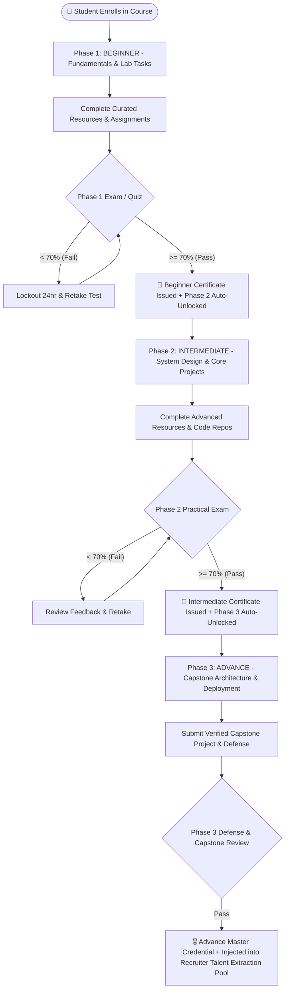

# Skill Verification & 3-Phase Learning Engine: Architecture & Talent Extraction Blueprint

---

## 📌 Executive Summary

The **Skill Verification & 3-Phase Learning Engine** is the talent production pipeline of the **KIET Campus Platform**. 
Traditional placement cells suffer because student resumes are filled with unverified self-claims ("Proficient in MERN", "Experienced in Kubernetes"). 

This module converts passive learning into **institution-verified talent pipelines**:
1. **Curated 3-Phase Roadmaps:** Beginner $\rightarrow$ Intermediate $\rightarrow$ Advance.
2. **Catalog & Course Experience UI:** Modeled directly after the high-converting *Aduki Online Academy* standard ([courses_and_learning_ui_architecture.md](file:///c:/Users/arpit/New%20folder%20(6)/Only_jobs/plan/courses_and_learning_ui_architecture.md)).
3. **Strict Gatekeeping:** Students cannot jump directly to advanced topics without passing rigorous phase assessments ($\ge 70\%$).
4. **Cryptographic Auto-Certification:** Tamper-proof certificate hashes minted on the fly and mapped directly to student profiles.
5. **Talent Extraction Engine for Startups/MNCs:** Deans and TPOs can query and export pre-vetted candidate pools in 1-click.

---

## 🔄 1. The 3-Phase Progression & Gatekeeping Lifecycle



---

## 🗄️ 2. Database Schema (`schema.prisma`)

```prisma
enum PhaseLevel {
  BEGINNER
  INTERMEDIATE
  ADVANCE
}

enum ProgressStatus {
  LOCKED
  IN_PROGRESS
  TEST_ELIGIBLE
  PASSED
}

model Course {
  id          String        @id @default(uuid())
  tenantId    String?       // NULL = Global course (created by platform), String = College custom course
  title       String        // e.g. "Cloud Native DevOps Engineering", "Full Stack Systems"
  description String        @db.Text
  thumbnail   String?
  category    String        // "DEVOPS", "WEB_DEV", "AI_ML", "SYSTEMS"
  isPublished Boolean       @default(true)

  phases      CoursePhase[]
  mentors     CourseMentor[]

  createdAt   DateTime      @default(now())
  updatedAt   DateTime      @updatedAt

  @@index([category, isPublished])
}

model CoursePhase {
  id              String              @id @default(uuid())
  courseId        String
  course          Course              @relation(fields: [courseId], references: [id], onDelete: Cascade)
  
  level           PhaseLevel          // BEGINNER, INTERMEDIATE, ADVANCE
  title           String              // e.g. "Phase 1: Linux Kernel & Container Runtimes"
  roadmapMarkdown String              @db.Text // Comprehensive syllabus, checklist, instructions
  
  resources       PhaseResource[]
  userProgress    UserPhaseProgress[]

  @@unique([courseId, level])
  @@index([courseId])
}

model PhaseResource {
  id          String      @id @default(uuid())
  phaseId     String
  phase       CoursePhase @relation(fields: [phaseId], references: [id], onDelete: Cascade)
  
  title       String      // e.g., "Deep Dive into Docker OverlayFS"
  type        String      // "VIDEO", "DOCUMENTATION", "GITHUB_REPO", "LAB_EXERCISE"
  url         String
  orderIndex  Int

  @@index([phaseId, orderIndex])
}

model UserPhaseProgress {
  id             String         @id @default(uuid())
  userId         String
  user           User           @relation(fields: [userId], references: [id], onDelete: Cascade)
  phaseId        String
  phase          CoursePhase    @relation(fields: [phaseId], references: [id], onDelete: Cascade)
  
  status         ProgressStatus @default(LOCKED) // LOCKED -> IN_PROGRESS -> TEST_ELIGIBLE -> PASSED
  completedItems String[]       // IDs of finished PhaseResource items
  
  // Assessment Tracking
  testAttempts   Int            @default(0)
  testScore      Float?         // Percentage (0.0 to 100.0)
  passedAt       DateTime?

  // Auto-Generated Cryptographic Certificate
  certificateId  String?        @unique // e.g. "CERT-KIET-DEV-1718902345"
  certificateUrl String?

  updatedAt      DateTime       @updatedAt

  @@unique([userId, phaseId])
  @@index([userId, status])
}

model CourseMentor {
  id          String   @id @default(uuid())
  courseId    String
  course      Course   @relation(fields: [courseId], references: [id], onDelete: Cascade)
  
  name        String
  role        String   // "Faculty Mentor", "Senior Lead TA"
  avatarUrl   String?
  connectUrl  String   // Calendly link, Google Meet, or Discord room
  email       String

  @@index([courseId])
}
```

---

## 🛡️ 3. Backend Gatekeeper Middleware (`verifyPhaseAccess.js`)

Prevents unauthorized API calls trying to access higher-level phases or tests without clearing prerequisite tiers.

```javascript
import { prisma } from '../lib/prisma.js';

export async function verifyPhaseAccess(req, res, next) {
  const { phaseId } = req.params;
  const userId = req.user.id;

  try {
    const currentPhase = await prisma.coursePhase.findUnique({
      where: { id: phaseId },
      include: {
        course: {
          include: {
            phases: { orderBy: { level: 'asc' } }
          }
        }
      }
    });

    if (!currentPhase) {
      return res.status(404).json({ error: "Course phase not found" });
    }

    // 1. Beginner phase is always unlocked for enrolled students
    if (currentPhase.level === 'BEGINNER') {
      return next();
    }

    // 2. Identify required prerequisite level
    const prerequisiteLevel = currentPhase.level === 'INTERMEDIATE' ? 'BEGINNER' : 'INTERMEDIATE';
    const prereqPhase = currentPhase.course.phases.find(p => p.level === prerequisiteLevel);

    if (!prereqPhase) {
      return res.status(500).json({ error: "Invalid course structure: missing prerequisite tier." });
    }

    // 3. Query prerequisite status in database
    const prereqProgress = await prisma.userPhaseProgress.findUnique({
      where: {
        userId_phaseId: {
          userId,
          phaseId: prereqPhase.id
        }
      }
    });

    if (!prereqProgress || prereqProgress.status !== 'PASSED') {
      return res.status(403).json({
        success: false,
        error: `Access Denied: You must complete and pass the ${prerequisiteLevel} phase test first.`
      });
    }

    // Prerequisite met -> Proceed
    next();
  } catch (error) {
    console.error('[PhaseAccess Error]', error);
    return res.status(500).json({ error: "Failed to verify phase gatekeeper." });
  }
}
```

---

## 📜 4. Assessment Submission & Auto-Certification Engine

When a student submits a phase exam:
1. Automated evaluation checks MCQ/code challenge answers.
2. If score $\ge 70\%$, an atomic database transaction updates the phase progress and mints a verified credential into `StudentProfile.certifications`.

```javascript
import { prisma } from '../lib/prisma.js';

export async function submitPhaseTest(req, res) {
  const { phaseId } = req.params;
  const { answers } = req.body;
  const userId = req.user.id;
  const tenantId = req.user.tenantId || 'kiet-main';

  try {
    // 1. Auto-evaluation logic (MCQ / Code grader)
    const { score, isPassed } = await evaluatePhaseTest(phaseId, answers);

    if (!isPassed) {
      // Increment attempt counter
      await prisma.userPhaseProgress.update({
        where: { userId_phaseId: { userId, phaseId } },
        data: {
          testAttempts: { increment: 1 },
          testScore: score
        }
      });

      return res.json({
        passed: false,
        score,
        message: "Minimum 70% score required to clear this phase. Review syllabus and retake in 24 hours."
      });
    }

    // 2. Generate unique verifiable certificate hash
    const certHash = `CERT-${tenantId.toUpperCase().slice(0, 4)}-${Date.now()}`;

    // 3. Atomic transaction: Mark phase as PASSED and add to Student Certifications
    const [updatedProgress, newCert] = await prisma.$transaction([
      prisma.userPhaseProgress.update({
        where: { userId_phaseId: { userId, phaseId } },
        data: {
          status: 'PASSED',
          testScore: score,
          passedAt: new Date(),
          certificateId: certHash,
          testAttempts: { increment: 1 }
        },
        include: { phase: true }
      }),
      prisma.certification.create({
        data: {
          studentProfile: { connect: { userId } },
          title: `Certified in ${phaseId}`,
          issuingOrg: "KIET Verified Academy",
          isInternalCourse: true,
          certificateHash: certHash,
          issueDate: new Date()
        }
      })
    ]);

    return res.status(200).json({
      success: true,
      passed: true,
      score,
      certificateId: certHash,
      message: "Congratulations! Phase cleared. Certificate issued and next tier unlocked."
    });
  } catch (error) {
    console.error('[SubmitPhaseTest Error]', error);
    return res.status(500).json({ error: "Failed to process phase assessment." });
  }
}
```

---

## 🎯 5. Dean & TPO Talent Extraction Engine (Startup & MNC Recruiter Pipeline)

### The Placement Problem It Solves
When a startup visits KIET asking:  
*"We need 10 students who actually know Docker, Kubernetes, and Golang right now."*  
Traditional TPOs search via CGPA in Excel sheets, resulting in poor technical fits.

### Our Solution: Filter by Verifiable Evidence
The Dean/TPO Dashboard runs an instant multi-dimensional filter:

```javascript
export async function extractVettedTalent(req, res) {
  const { tenantId = 'kiet-main' } = req.user;
  const { category = 'DEVOPS', minPhase = 'ADVANCE', minCgpa = 7.0, minLeetCode = 100 } = req.query;

  try {
    const vettedStudents = await prisma.studentProfile.findMany({
      where: {
        tenantId,
        isAccountFrozen: false,
        user: {
          phaseProgress: {
            some: {
              status: 'PASSED',
              phase: {
                level: minPhase,
                course: { category }
              }
            }
          }
        }
      },
      select: {
        rollNumber: true,
        branch: true,
        currentSemester: true,
        user: { select: { name: true, email: true } },
        githubHandle: true,
        leetcodeHandle: true,
        codingStats: true,
        projects: {
          where: { isTeacherApproved: true },
          select: { title: true, githubRepoUrl: true, techStack: true }
        },
        certifications: {
          where: { isInternalCourse: true },
          select: { title: true, certificateHash: true, issueDate: true }
        }
      }
    });

    return res.json({
      count: vettedStudents.length,
      category,
      minPhase,
      students: vettedStudents
    });
  } catch (error) {
    console.error('[TalentExtraction Error]', error);
    return res.status(500).json({ error: "Failed to extract vetted talent." });
  }
}
```

### 1-Click Dossier Output (Shared with Recruiter)
```
┌────────────────────────────────────────────────────────────────────────┐
│ 🎯 KIET Vetted Talent Pool: [DevOps & Cloud Native] (ADVANCE Passed)   │
│ Total Qualified Candidates: 18 Students                                │
├────────────────────────────────────────────────────────────────────────┤
│ 1. Arpit Prajapati • CSE • Sem 7 • CGPA: 8.42                          │
│    • Internal Cred: CERT-KIET-1718902345 (Passed Advance Phase 92%)    │
│    • GitHub: github.com/arpit (482 commits, KubePay EKS deployment)    │
│    • LeetCode: 350+ Solved                                             │
├────────────────────────────────────────────────────────────────────────┤
│ 2. Priya Verma • IT • Sem 7 • CGPA: 8.65                               │
│    • Internal Cred: CERT-KIET-1718908812 (Passed Advance Phase 88%)    │
│    • Verified Project: Distributed Kafka Event Pipeline (Approved ✅)   │
└────────────────────────────────────────────────────────────────────────┘
```

---

## 🏛️ 6. Dean Pitch Angle (Why Administration Will Love This)

* **Zero Course Setup Overhead:** We ship standard industry courses (Full Stack, DevOps, AI/ML) out of the box; faculty don't have to record hundreds of hours of lectures.
* **Institutional Reputation:** Startups hiring from KIET receive verifiable high-tier engineers rather than untested resume claims, elevating KIET's placement rankings.
* **Student Equity:** First-year and second-year students have a clear, step-by-step ladder to become competitive before placement season opens.

---
*Generated: 15 October 2026 — Skill Verification & Learning Engine Specification.*
