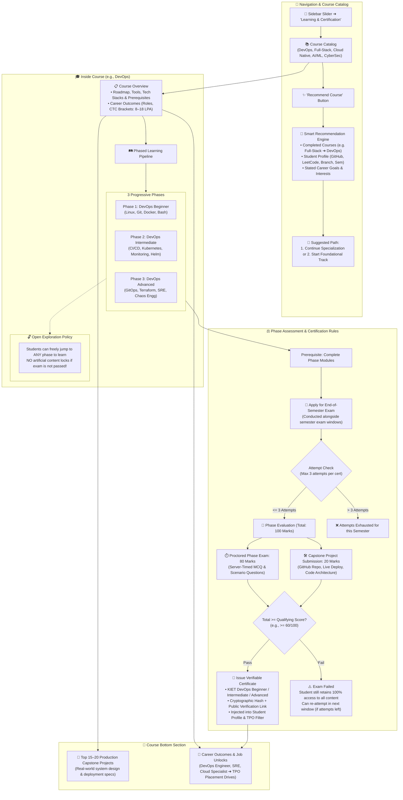
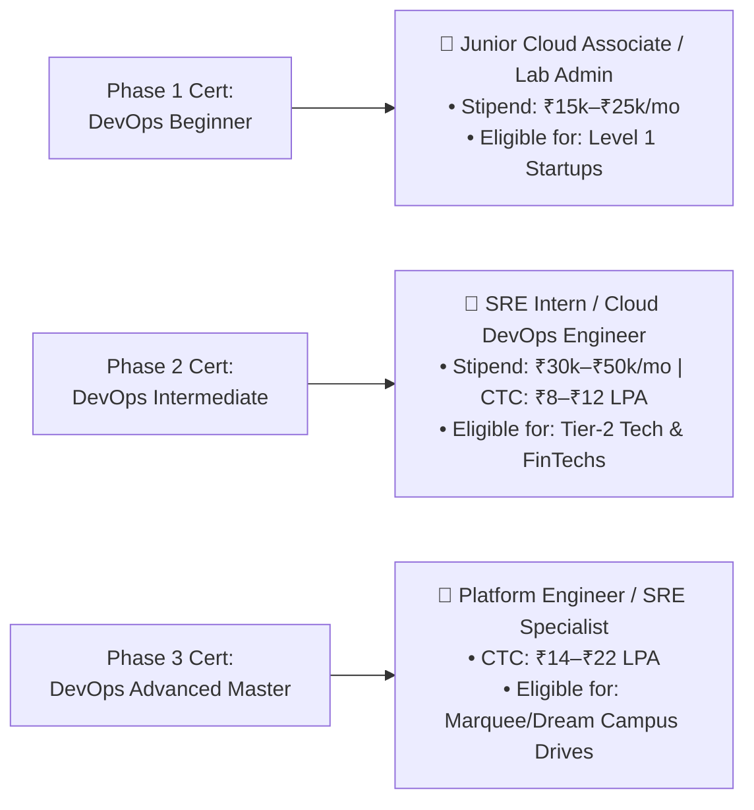

# Learning & Certification Engine: Architecture, Workflow & Implementation Blueprint
> **Institutional Skill Mastery, Open Exploration, Phased Certification & Career Outcomes for KIET Group of Institutions**

---

## 📌 Executive Summary

Traditional college learning management systems (LMS) either act as passive video repositories or enforce rigid locks that frustrate students. Meanwhile, commercial certification platforms lack institutional credibility and connection to campus hiring drives.

In the **KIET Campus Platform (`Only_Jobs`)**, the **Learning & Certification Engine** provides a student-centric, outcome-driven learning pipeline:
1. **Catalog & Smart Course Recommendation:** Accessible directly from the navigation slider. A dedicated **"Recommend Course"** engine analyzes past completed courses (e.g., Full-Stack completed $\rightarrow$ recommend DevOps), GitHub/LeetCode stats, and career goals to suggest the optimal learning path.
2. **Open Exploration Freedom (Zero Learning Locks):** Students can jump to any phase, explore any module, and learn any topic without artificial lockouts—even if they haven't taken or passed an earlier phase exam.
3. **Structured Phase Pipeline (e.g., DevOps):** Courses are divided into sequential skill tiers (Phase 1: Beginner $\rightarrow$ Phase 2: Intermediate $\rightarrow$ Phase 3: Advanced).
4. **Balanced Evaluation (20 Marks Project + 80 Marks Exam):** Each phase certification requires a real-world repository submission (20 marks) and a proctored, server-timed exam (80 marks) with a minimum qualifying threshold.
5. **Scheduled End-Term Certification Exams:** Students apply for certification tests at the end of the semester (conducted alongside semester exams) with a strict **maximum of 3 attempts per certification**.
6. **Top 15–20 Production Capstone Projects:** Every course features an extensive portfolio project library at the bottom.
7. **Direct Job Outcomes & Placement Links:** Clear career mapping detailing exact job roles, salary brackets, and eligible recruitment drives unlocked upon earning each certificate.

---

## 🏗️ Master Architectural Workflow



---

## 🔍 Detailed Functional Specifications

### 1. Navigation, Catalog & Smart Course Recommendation
* **Navigation Placement:** In the main sidebar slider under **`Learning & Certification`**.
* **Catalog Grid:** Shows interactive cards for major engineering tracks:
  - DevOps & Cloud Infrastructure
  - Full-Stack Software Engineering
  - Data Engineering & AI/ML Systems
  - Cyber Security & Network Defense
  - Systems Programming & Distributed Systems
* **The "Recommend Course" Button:**
  When clicked, an interactive modal or personalized banner evaluates three inputs:
  1. **Course Progression History:** If a student completed *Full-Stack Web Dev*, the system recommends *DevOps* or *Cloud Native Architecture* as the next logical career multiplier.
  2. **Student Profile Proof-of-Work:** Analyzes top languages in their GitHub repos, LeetCode topic tags, current academic semester, and department.
  3. **Student Career Objective:** Asks a quick 1-question pulse (*"Are you aiming for Product Startups, High-Scale MNCs, or Infrastructure Roles?"*).
  * **Result:** Suggests either a **Specialization Continuation** (e.g., *"Take DevOps to complement your Full-Stack badge"*) or a **Foundational Starting Track** with estimated completion timelines.

---

### 2. Inside a Course: The DevOps Blueprint Example

When a student clicks into a course like **DevOps Engineering**:

#### A. Course Overview Header
* **Track Mission:** Complete end-to-end infrastructure automation, container orchestration, CI/CD, and site reliability engineering.
* **Tools & Technologies:** Linux, Git, Docker, Kubernetes, GitHub Actions, Terraform, Prometheus, Grafana, AWS.
* **Target Job Roles & CTC:** SRE Intern (₹35k–₹60k/mo stipend), Junior DevOps Engineer (₹8–₹14 LPA), Cloud Infrastructure Engineer (₹12–₹20 LPA).

#### B. The 3 Phased Pipelines

```
PHASE 1: BEGINNER (Foundations)   PHASE 2: INTERMEDIATE (Core Scale)   PHASE 3: ADVANCED (Production SRE)
┌───────────────────────────────┐ ┌──────────────────────────────────┐ ┌──────────────────────────────────┐
│ • Linux Kernel & Shell Script │ │ • Container Orchestration (K8s)  │ │ • Infrastructure as Code (TF)   │
│ • Git Workflows & Branching   │ │ • Production CI/CD Pipelines     │ │ • GitOps (ArgoCD / Flux)         │
│ • Docker & Multi-Stage Builds │ │ • Monitoring & Metrics (Prom/Graf)│ │ • Service Mesh & Chaos Testing   │
│ • Basic Networking & Reverse  │ │ • Ingress & Cloud Networking     │ │ • SRE Reliability & On-Call SLIs │
│   Proxies (Nginx, TLS)        │ │ • Helm Packaging & ConfigMaps    │ │ • Multi-Region Resiliency        │
└───────────────────────────────┘ └──────────────────────────────────┘ └──────────────────────────────────┘
```

#### C. Open Exploration Policy (Zero Content Lockout)
* **No Artificial Walls:** A student interested in Kubernetes (Phase 2) or Terraform (Phase 3) is **not blocked** from reading notes, viewing reference architectures, or cloning starter repos just because they haven't passed the Phase 1 exam.
* **Learning is Open; Certification is Earned:** Content access is 100% unrestricted across all phases. Certification exams remain strictly evaluated.

---

### 3. Balanced Assessment & Certification Pipeline

#### A. 100-Mark Evaluation Split
Every Phase Certification requires two components:
$$\text{Total Score (100 Marks)} = \text{Capstone Project (20 Marks)} + \text{Proctored Exam (80 Marks)}$$

| Component | Weightage | Evaluation Criteria |
| :--- | :---: | :--- |
| **Phase Capstone Project** | **20 Marks** | • GitHub repository quality and commit hygiene<br/>• Dockerfile/YAML syntax and best practices<br/>• Working live deployment URL or demonstration video<br/>• Clean documentation (README.md with architecture diagram) |
| **Proctored Phase Exam** | **80 Marks** | • Server-timed MCQ + Scenario-based problem solving<br/>• Conducted in anti-cheat exam engine (tab-switch telemetry)<br/>• Covers debugging, configuration troubleshooting, and core concepts |

* **Minimum Qualification Threshold:** A student must score at least **60% combined (60/100)** to pass and earn the certificate.

#### B. Exam Scheduling & Attempt Rules
1. **Prerequisite:** Student must mark all modules in the respective phase as completed.
2. **Scheduled Testing Window:** Certification tests are **not** on-demand trivia quizzes. Students register and apply for tests scheduled at the **end of each semester**, held in coordinated testing windows alongside semester/end-term exams.
3. **Strict Limit of 3 Attempts:** 
   - A student can attempt a certification exam a **maximum of 3 times**.
   - If a student fails on the 1st attempt, they can re-register in subsequent test slots (up to 3 total attempts).
   - If they fail, they **do not lose access** to the course content and can continue exploring higher phases.

#### C. Verifiable Cryptographic Credentials
Upon qualifying, the system automatically mints a credential:
* **Credential Tiers:**
  - `KIET DevOps Certified — Beginner (Phase 1)`
  - `KIET DevOps Certified — Intermediate (Phase 2)`
  - `KIET DevOps Certified — Advanced Master (Phase 3)`
* **Tamper-Proof Verification:** Contains a SHA-256 cryptographic hash, student roll number, issuing authority (KIET Placement & Skill Cell), and a public verification link (`https://platform.kiet.edu/verify/cert/{hash}`).
* **Profile Integration:** Instantly badges the student's public profile and unlocks eligibility for high-tier company drives in the **Placement Engine (Module M2)**.

---

### 4. Top 15–20 Production Capstone Projects Library

Positioned at the bottom of the course page, these real-world projects guide students from basic scripting to production infrastructure:

```
┌────────────────────────────────────────────────────────────────────────────────────────┐
│                        TOP PRODUCTION CAPSTONE PROJECTS (DEVOPS)                       │
├────────────────────────────────────────────────────────────────────────────────────────┤
│  PHASE 1: BEGINNER CAPSTONES (1–6)                                                     │
│  1. Multi-Stage Optimized Docker Build for Node.js Microservices (Alpine, non-root)    │
│  2. Automated Linux Server Hardening & SSH Bastion Script with Bash                    │
│  3. Nginx Reverse Proxy with Automated Let's Encrypt SSL/TLS Certificate Renewal       │
│  4. Centralized System Resource Monitor with Shell + Discord/Slack Webhooks            │
│  5. Automated Git Commit Linter & Semantic Release Pipeline via GitHub Actions         │
│  6. Static Site Deployment on AWS S3 + CloudFront with Custom Domain via Terraform     │
├────────────────────────────────────────────────────────────────────────────────────────┤
│  PHASE 2: INTERMEDIATE CAPSTONES (7–13)                                                │
│  7. Complete GitHub Actions CI/CD to Amazon EKS with Automated Semantic Versioning     │
│  8. Self-Healing Kubernetes Cluster Setup with Helm Charts & Secrets Management        │
│  9. Prometheus + Grafana Observability Stack with Custom Alertmanager Routing          │
│ 10. Automated Database Backup, Encryption, and S3 Rotation Cron Deployment             │
│ 11. Zero-Downtime Blue/Green Deployment Pipeline using Nginx / Kubernetes Ingress      │
│ 12. ELK Stack (Elasticsearch, Logstash, Kibana) Centralized Logging Cluster            │
│ 13. Docker Swarm to K8s Migration: Multi-Tier Microservice Architecture                │
├────────────────────────────────────────────────────────────────────────────────────────┤
│  PHASE 3: ADVANCED PRODUCTION CAPSTONES (14–20)                                        │
│  14. End-to-End GitOps Continuous Delivery with ArgoCD on Multi-Node K3s Cluster       │
│  15. Complete Multi-Cloud Infrastructure as Code (IaC) Provisioning via Terraform     │
│  16. Istio Service Mesh Implementation with Mutual TLS (mTLS) & Traffic Shifting      │
│  17. Chaos Engineering Resilience Testing with Chaos Mesh on EKS                       │
│  18. Automated Vulnerability Scanning & Container Signing Pipeline (Trivy + Cosign)    │
│  19. Serverless Event-Driven ETL Pipeline on AWS Lambda, SQS & DynamoDB                │
│  20. Production High-Availability Disaster Recovery (Multi-AZ Failover Automation)    │
└────────────────────────────────────────────────────────────────────────────────────────┘
```

---

### 5. Career Outcomes & Job Unlocks Hub

The bottom of each course explicitly maps certification achievements to actual job profiles:



* **Direct Placement Link:** When TPO publishes a drive requiring *"DevOps / Kubernetes"*, students holding Phase 2 or Phase 3 certificates receive priority shortlisting and direct recruiter dossier export.

---

## 💻 Database Schema Architecture (`Prisma` / `PostgreSQL`)

```prisma
enum PhaseLevel {
  BEGINNER
  INTERMEDIATE
  ADVANCED
}

enum ExamAttemptStatus {
  REGISTERED
  IN_PROGRESS
  PASSED
  FAILED
}

model Course {
  id               String            @id @default(uuid())
  tenantId         String            @default("kiet-main")
  slug             String            @unique // e.g. "cloud-devops"
  title            String            // "Cloud Native DevOps Engineering"
  description      String            @db.Text
  category         String            // "DEVOPS", "WEB_DEV", "AI_ML", "CYBER_SECURITY"
  iconUrl          String?
  targetRoles      String[]          // ["DevOps Engineer", "SRE", "Cloud Architect"]
  ctcBracket       String            // "8 - 18 LPA"
  isPublished      Boolean           @default(true)

  phases           CoursePhase[]
  capstoneProjects CourseProject[]
  recommendations  CourseRecommendation[]

  createdAt        DateTime          @default(now())
  updatedAt        DateTime          @updatedAt

  @@index([category, isPublished])
}

model CoursePhase {
  id               String            @id @default(uuid())
  courseId         String
  level            PhaseLevel        // BEGINNER, INTERMEDIATE, ADVANCED
  title            String            // "Phase 1: Linux, Containers & Automation"
  orderIndex       Int               // 1, 2, 3
  overviewMarkdown String            @db.Text
  
  // Phase assessment criteria
  projectMaxMarks  Int               @default(20)
  examMaxMarks     Int               @default(80)
  passThreshold    Int               @default(60) // Combined minimum pass marks out of 100

  course           Course            @relation(fields: [courseId], references: [id], onDelete: Cascade)
  resources        PhaseResource[]
  examWindows      ExamWindow[]
  userProgress     UserPhaseProgress[]
  certificates     IssuedCertificate[]

  @@unique([courseId, level])
  @@index([courseId, orderIndex])
}

model PhaseResource {
  id               String            @id @default(uuid())
  phaseId          String
  title            String
  type             String            // "DOCUMENTATION", "LAB_GUIDE", "VIDEO_REF", "CODE_REPO"
  url              String
  durationMinutes  Int               @default(30)
  orderIndex       Int

  phase            CoursePhase       @relation(fields: [phaseId], references: [id], onDelete: Cascade)

  @@index([phaseId, orderIndex])
}

model UserPhaseProgress {
  id               String            @id @default(uuid())
  userId           String
  phaseId          String
  
  isCompleted      Boolean           @default(false)
  completedAt      DateTime?
  
  // Project submission for 20 marks
  projectRepoUrl   String?
  projectLiveUrl   String?
  projectMarks     Int?              // Scored out of 20
  projectFeedback  String?

  phase            CoursePhase       @relation(fields: [phaseId], references: [id], onDelete: Cascade)
  examAttempts     CertificationAttempt[]

  @@unique([userId, phaseId])
  @@index([userId, isCompleted])
}

model ExamWindow {
  id               String            @id @default(uuid())
  phaseId          String
  title            String            // e.g. "Odd-Sem 2026 End-Term Certification Window"
  registrationOpen DateTime
  registrationEnd  DateTime
  examStartDate    DateTime
  examEndDate      DateTime
  durationMinutes  Int               @default(90)

  phase            CoursePhase       @relation(fields: [phaseId], references: [id], onDelete: Cascade)
  attempts         CertificationAttempt[]

  @@index([phaseId, examStartDate])
}

model CertificationAttempt {
  id               String            @id @default(uuid())
  userId           String
  progressId       String
  examWindowId     String
  
  attemptNumber    Int               // 1, 2, or 3 (Strict Max: 3)
  status           ExamAttemptStatus @default(REGISTERED)
  
  projectScore     Int               @default(0) // Out of 20
  examScore        Int               @default(0) // Out of 80
  totalScore       Int               @default(0) // Out of 100
  isQualified      Boolean           @default(false)

  startedAt        DateTime?
  submittedAt      DateTime?

  userProgress     UserPhaseProgress @relation(fields: [progressId], references: [id], onDelete: Cascade)
  examWindow       ExamWindow        @relation(fields: [examWindowId], references: [id], onDelete: Cascade)

  @@unique([progressId, attemptNumber])
  @@index([userId, isQualified])
}

model IssuedCertificate {
  id               String            @id @default(uuid())
  certificateHash  String            @unique // SHA-256 cryptographic verification token
  userId           String
  phaseId          String
  
  certificateTitle String            // "KIET Certified DevOps Engineer — Beginner"
  studentName      String
  studentRollNo    String
  scoreAchieved    Int               // e.g. 84 / 100
  issuedAt         DateTime          @default(now())
  verificationUrl  String

  phase            CoursePhase       @relation(fields: [phaseId], references: [id], onDelete: Cascade)

  @@index([userId, phaseId])
}

model CourseProject {
  id               String            @id @default(uuid())
  courseId         String
  phaseLevel       PhaseLevel
  title            String            // e.g. "GitOps Continuous Delivery with ArgoCD"
  description      String            @db.Text
  techStack        String[]          // ["Kubernetes", "ArgoCD", "Helm", "GitHub Actions"]
  difficulty       String            // "BEGINNER", "INTERMEDIATE", "ADVANCED"
  architectureDoc  String?           @db.Text

  course           Course            @relation(fields: [courseId], references: [id], onDelete: Cascade)

  @@index([courseId, phaseLevel])
}

model CourseRecommendation {
  id               String            @id @default(uuid())
  userId           String
  courseId         String
  matchScore       Float             // e.g. 0.94
  recommendationReason String        // "Complements your completed Full-Stack course and 8 Node.js repos"
  suggestedAction  String            // "SPECIALIZATION_CONTINUATION" or "NEW_FOUNDATION"
  createdAt        DateTime          @default(now())

  course           Course            @relation(fields: [courseId], references: [id], onDelete: Cascade)

  @@index([userId, matchScore(sort: Desc)])
}
```

---

## ⚡ Attempt Guard & Qualification Engine (`Node.js`)

```javascript
/**
 * Validates registration eligibility for a phase certification exam.
 * Enforces: Phase completion, Exam Window status, and Max 3 Attempts.
 */
async function validateExamRegistration(userId, phaseId, currentExamWindowId, prisma) {
  // 1. Check if user completed the learning modules in this phase
  const progress = await prisma.userPhaseProgress.findUnique({
    where: { userId_phaseId: { userId, phaseId } },
    include: { examAttempts: true }
  });

  if (!progress || !progress.isCompleted) {
    return {
      allowed: false,
      reason: "You must complete all study modules in this phase before registering for the exam."
    };
  }

  // 2. Check if student already passed this certificate
  const alreadyPassed = progress.examAttempts.some(a => a.isQualified);
  if (alreadyPassed) {
    return {
      allowed: false,
      reason: "You have already qualified this certification and hold a verified credential."
    };
  }

  // 3. Strict 3-Attempt Rule Check
  const attemptsCount = progress.examAttempts.length;
  if (attemptsCount >= 3) {
    return {
      allowed: false,
      reason: `Attempt limit reached. Maximum allowed attempts for this certification is 3 (Used: ${attemptsCount}).`
    };
  }

  // 4. Verify Exam Window is Active
  const window = await prisma.examWindow.findUnique({
    where: { id: currentExamWindowId }
  });

  const now = new Date();
  if (now < window.registrationOpen || now > window.registrationEnd) {
    return {
      allowed: false,
      reason: "Certification exam registration window is currently closed for this semester."
    };
  }

  return {
    allowed: true,
    nextAttemptNumber: attemptsCount + 1,
    reason: `Eligible to register (Attempt ${attemptsCount + 1} of 3).`
  };
}

/**
 * Calculates Final Certification Qualification (20 Project + 80 Exam).
 */
function evaluateCertificationScore(projectScore, examScore, passThreshold = 60) {
  const normalizedProject = Math.min(Math.max(projectScore, 0), 20);
  const normalizedExam = Math.min(Math.max(examScore, 0), 80);
  const total = normalizedProject + normalizedExam;

  const isQualified = total >= passThreshold;

  return {
    projectScore: normalizedProject,
    examScore: normalizedExam,
    totalScore: total,
    isQualified,
    feedback: isQualified 
      ? `Passed with ${total}/100! Credential will be minted.`
      : `Scored ${total}/100 (Required: ${passThreshold}/100). You can review project feedback and re-test in the next window.`
  };
}
```

---

## 🎯 Summary of Key Innovations

| Feature | Generic LMS (Moodle, Coursera) | Our KIET Platform (`Only_Jobs`) |
| :--- | :--- | :--- |
| **Content Access** | Rigid locks; blocked until quizzes pass | **100% Open Exploration:** Free to jump to any phase/topic to learn |
| **Certification Assessment** | Trivially cheat-able 5-min MCQs | **Balanced 20 Project + 80 Proctored Exam** with max 3 attempts |
| **Exam Schedule** | On-demand instant quizzes | **Formal end-of-semester examination windows** alongside semester exams |
| **Smart Recommendation** | Generic algorithmic ads | **Context-aware:** Completed courses (FullStack $\rightarrow$ DevOps) + GitHub/LeetCode stats |
| **Practical Projects** | 1 generic hello-world assignment | **Top 15–20 Production Capstones** with architecture blueprints |
| **Placement Integration** | Disconnected PDF certificate | **Directly unlocks high-tier corporate placement drives in Module M2** |

---
*Maintained by Arpit Prajapati & The KIET Campus Platform Engineering Team. Last updated: October 2026.*
