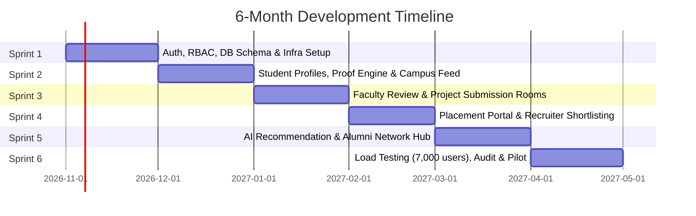

# KIET Campus Talent & Career Development Platform
## Comprehensive Master Plan & Roadmap

---

## 📌 Executive Summary

* **Project Scope:** Dedicated Campus Talent, Visibility, and Career Development Platform for **KIET Group of Institutions** (~7,000 students, faculty, deans, placement cell, and alumni).
* **Core Philosophy:** Moving from "Resume claims" to **"Proof of Work & Verifiable Growth"**. Giving equal importance to top rankers and 1st/2nd year beginners.
* **Immediate Milestone:** **25 October 2026 — Dean Meeting & Pilot Approval**.
* **Development Timeline:** **November 2026 – April 2027 (6 Months)**.
* **Team Size:** 4 Members (Lead Backend & DevOps: Arpit Prajapati).

---

## 🎯 Phase 1: 10-Day Dean Pitch Battle Plan (15 Oct – 25 Oct 2026)

Goal: Build an airtight, institutional-grade proposal and architecture blueprint before meeting the Dean.

| Day | Date | Focus Area | Key Deliverable | Status |
| :--- | :--- | :--- | :--- | :--- |
| **Day 1** | **15 Oct** | **KIET Problem Discovery** | Document KIET-specific gaps in Superset/ERP, unverified resumes, and junior visibility. | 🔄 In Progress |
| **Day 2** | **16 Oct** | **Competitive Benchmarking** | Comparative analysis & Superset architecture breakdown ([superset_placement_engine.md](file:///c:/Users/arpit/New%20folder%20%286%29/Only_jobs/superset_placement_engine.md)). | ✅ Ready |
| **Day 3** | **17 Oct** | **Student Experience & Growth** | Profiles & nightly sync ([student_profile_architecture.md](file:///c:/Users/arpit/New%20folder%20%286%29/Only_jobs/student_profile_architecture.md)) + Campus feed engine ([campus_feed_architecture.md](file:///c:/Users/arpit/New%20folder%20%286%29/Only_jobs/campus_feed_architecture.md)). | ✅ Ready |
| **Day 4** | **18 Oct** | **Faculty & Dean Workflows** | Class project rooms ([class_project_rooms_architecture.md](file:///c:/Users/arpit/New%20folder%20%286%29/Only_jobs/class_project_rooms_architecture.md)), exams engine ([exam_and_mock_test_engine.md](file:///c:/Users/arpit/New%20folder%20%286%29/Only_jobs/exam_and_mock_test_engine.md)), mentor support ([helper_mentor_support_engine.md](file:///c:/Users/arpit/New%20folder%20%286%29/Only_jobs/helper_mentor_support_engine.md)) & talent extraction ([learning_and_certification_engine.md](file:///c:/Users/arpit/New%20folder%20%286%29/Only_jobs/learning_and_certification_engine.md)). | ✅ Ready |
| **Day 5** | **19 Oct** | **Placement Cell & Recruiter Engine** | Placement drive workflows & eligibility engine ([superset_placement_engine.md](file:///c:/Users/arpit/New%20folder%20%286%29/Only_jobs/superset_placement_engine.md)) + Vetted talent export ([learning_and_certification_engine.md](file:///c:/Users/arpit/New%20folder%20%286%29/Only_jobs/learning_and_certification_engine.md)) + Alumni directory ([alumni_directory_architecture.md](file:///c:/Users/arpit/New%20folder%20%286%29/Only_jobs/alumni_directory_architecture.md)). | ✅ Ready |
| **Day 6** | **20 Oct** | **AI Feasibility & Ethical Guardrails** | Explainable skill scoring, project plagiarism/similarity checks, and realistic AI boundaries. | ⏳ Pending |
| **Day 7** | **21 Oct** | **Backend Architecture & DB Schema** | Complete High-Level Design Document ([system_design_hdd.md](file:///c:/Users/arpit/New%20folder%20%286%29/Only_jobs/plan/system_design_hdd.md)): C4 architecture, RBAC, ER diagrams, API design, security & infra. | ✅ Ready |
| **Day 8** | **22 Oct** | **6-Month Execution Plan & Budget** | Capacity estimation & infrastructure costs included in HDD ([system_design_hdd.md](file:///c:/Users/arpit/New%20folder%20%286%29/Only_jobs/plan/system_design_hdd.md)). Sprint allocation pending. | 🔄 Partial |
| **Day 9** | **23 Oct** | **Proposal Document & Pitch Deck** | Formal 10-Slide Dean Pitch Deck & 1-page Pilot Executive Summary. | ⏳ Pending |
| **Day 10**| **24 Oct** | **Rehearsal & Objection Handling** | Mock Q&A: Faculty workload, data privacy, student adoption, and server costs. | ⏳ Pending |
| **D-Day** | **25 Oct** | **Dean Meeting** | Presentation of Proposal & Request for 100-student Controlled Pilot (CSE/IT). | 🎯 Target |

---

## 📦 5 Key Deliverables for the Dean Meeting (25 Oct)

1. **Problem & Opportunity Briefing:** Data-backed explanation of why 70% of student efforts go unnoticed by recruiters and how KIET's placement tier can elevate.
2. **Product Requirement Document (PRD):** Clearly defined role-based scopes (Student, Faculty, Placement Officer, Dean).
3. **Engineering & Security Architecture:** Realistic technical blueprint proving data security, college email authentication (`@kiet.edu`), and scalability.
4. **Interactive Prototype / Visual Flows:** Clean visual walkthrough of the profile, project rooms, and dean discovery dashboard.
5. **Controlled Pilot Proposal:** Zero-risk proposition requesting approval for a single department/batch (100–150 students) before campus-wide rollout.

---

## 🛠️ Phase 2: 6-Month Engineering Roadmap (Nov 2026 – Apr 2027)

### Monthly Breakdown

* **Month 1 (Nov 2026) — Core Foundation & Infrastructure**
  * PostgreSQL schema design with strict role-based access control (RBAC).
  * Node.js/Express modular monolith backend setup with JWT & KIET email SSO integration.
  * CI/CD pipelines, Docker containerization, and AWS staging setup.

* **Month 2 (Dec 2026) — Student Growth & Proof of Work Engine**
  * Student Profile: GitHub integration (repos, commit quality), LeetCode stats, top 6 verified projects.
  * Campus Feed: Achievements and peer recognition (anti-spam rate limited to max 3 posts/day).
  * Skill Badging & Evidence-based recognition.

* **Month 3 (Jan 2027) — Faculty & Academic Verification Modules**
  * Class Project Rooms: Batch project submission and 1-click teacher review/approvals.
  * Faculty dashboard for academic records endorsement and project mentoring.
  * Dean high-level analytics (batch performance, active domains, tech stack distribution).

* **Month 4 (Feb 2027) — Placement Portal & Talent Discovery**
  * Training & Placement (T&P) drive management and eligibility filtering.
  * Recruiter talent discovery filters (e.g., "Students with verified Next.js + Docker projects + >300 LeetCode").
  * Export verified candidate dossiers in PDF/Excel for placement drives.

* **Month 5 (Mar 2027) — AI Service & Alumni Integration**
  * Python/FastAPI microservice for project similarity/plagiarism detection and skill gap analysis.
  * Alumni directory and 1-on-1 career guidance connect.
  * Student career roadmaps tailored to current industry demand.

* **Month 6 (Apr 2027) — Hardening, Optimization & Pilot Launch**
  * Stress and load testing for 7,000 concurrent user surges during placement announcements.
  * Security auditing (SQL injection, XSS, rate limiting, data privacy).
  * Rollout of the 100-student pilot in KIET CSE/IT department.

---

## 👥 Team Responsibilities Matrix (4-Member Squad)

| Role | Primary Responsibilities | Deliverables |
| :--- | :--- | :--- |
| **Backend & DevOps Lead** *(You)* | Architecture, APIs, Database, Caching, Infra, Security | Modular Monolith (Node.js/Express), PostgreSQL DB, Redis/BullMQ, Docker, AWS Setup, CI/CD |
| **Frontend Lead** | Client Application, Performance, Responsive UI | Next.js App Router, Responsive Mobile/Desktop UI, Dashboard state management |
| **AI & Data Specialist** | Python Service, Analytics, External APIs | FastAPI microservice, GitHub/LeetCode scraping/APIs, Plagiarism/Similarity checks |
| **UI/UX & Product Lead** | Wireframes, User Flows, QA, College Coordination | Figma designs, Dean presentation deck, User testing with KIET students & faculty |

---

## 🏛️ Dean Objection Handling & De-risking Strategy

| Common Dean Objection | Our Strategic Answer |
| :--- | :--- |
| *"We already use Superset / CollPoll for placements."* | **"Superset is an application form repository, not a talent builder.** Our platform builds the student's proof-of-work from 1st year to 4th year so that by the time Superset drives open, KIET students stand out with verified work rather than empty resumes." |
| *"Faculty are already overloaded with work."* | **"Zero extra burden.** We designed 1-click batch project approvals with automated GitHub code inspection, actually saving teachers hours of manual evaluation during lab submissions." |
| *"What if students upload inappropriate content on the feed?"* | **"Strict institutional controls:** KIET email authentication only, 3-posts-per-day limit, profanity filters, and mandatory faculty moderation flags." |
| *"What will this cost the college?"* | **"Zero financial risk.** The development is 100% student-driven. Pilot phase runs on free-tier / minimal sponsorship infrastructure before any institutional commitment." |

---
*Last updated: 14 October 2026 — Ready for Day 1 Execution.*
