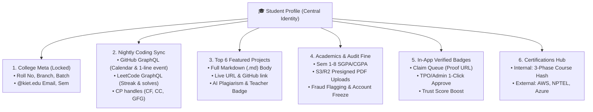
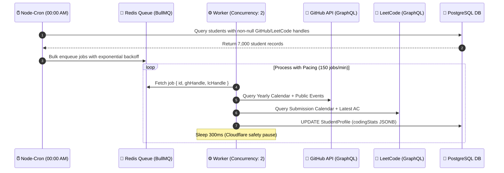

# Student Profile System: Architecture, Data Models & Sync Engine Blueprint

---

## 📌 Executive Summary

The **Student Profile** is the core backbone of the entire **KIET Campus Platform**. 
It powers the Training & Placement Office (TPO) filtering engine, feeds the AI talent discovery algorithm, provides recruiters with verified proof of work, and establishes peer benchmark visibility across 7,000+ students.

To guarantee zero fraud, sub-10ms profile loads, and zero third-party API rate-limiting blocks, this module is partitioned into **6 robust sub-modules** backed by an asynchronous queue sync engine.

---

## 🏗️ The 6 Core Sub-Modules



---

## 🔒 1. Basic Info & Verified College Meta (Admin-Locked)

To prevent falsification of Roll Numbers, Branches, or Academic batches:

| Field | Managed By | Permissions | Description |
| :--- | :--- | :--- | :--- |
| **Full Name** | College Admin / TPO | Read-Only | Official college records |
| **Roll Number / PRN** | College Admin / TPO | Read-Only | University registration ID |
| **Official Email** | College SSO | Read-Only | Must be domain `@kiet.edu` |
| **Department / Branch**| College Admin / TPO | Read-Only | E.g., `CSE`, `IT`, `CS-AI`, `ECE` |
| **Current Sem & Batch**| College Admin / TPO | Read-Only | E.g., Sem `5`, Batch `2023–2027` |
| **Bio & Avatar** | Student | Read/Write | Custom self-introduction and photo |
| **Social Handles** | Student | Read/Write | LinkedIn URL, X (Twitter) URL |
| **Coding Handles** | Student | Read/Write | GitHub, LeetCode, Codeforces, CodeChef |

---

## ⚡ 2. GitHub & LeetCode Activity Engine (Zero Live API Hits)

### ⚠️ The Problem with Live API Calls
Making live external API calls on every profile page visit fails at scale:
1. **GitHub Rate Limit:** 60 unauthenticated requests/hr (or 5,000/hr with token). 7,000 active students will instantly exhaust tokens.
2. **LeetCode Cloudflare Shield:** Triggers HTTP 429 / IP bans when hit concurrently.
3. **High Latency:** External round-trips add 1.5s – 4.0s of screen loading lag.

### 💡 Production Architecture: DB Caching + Nightly BullMQ Sync
* Profiles read cached stats from PostgreSQL `StudentProfile.codingStats` JSONB in **< 10ms**.
* A background BullMQ queue triggers every night at **00:00 AM**, processing students sequentially with controlled pacing.

### ❓ Why NOT MCP (Model Context Protocol) for Stats Fetching?
* **MCP is for LLM-to-tool orchestration**, not high-throughput backend data aggregation.
* MCP introduces heavy token/compute costs and 2–5 second agentic latency per user.
* *Where MCP actually belongs:* In Phase 5 AI service for **code AST inspection & deep plagiarism analysis**, not basic streak counters.

---

## 🌙 3. Nightly Sync Engine Architecture (BullMQ + Redis)



---

## 📑 4. Academics, Presigned PDFs & The "Trust + Penalty" Model

Rather than creating administrative bottlenecks where TPO manually verifies thousands of marksheets upfront:

1. **Self-Declaration:** Students self-enter SGPA/CGPA and backlogs for Semesters 1 to 8.
2. **Direct-to-S3 Presigned URLs:** Marksheet PDFs upload directly from browser to AWS S3 / Cloudflare R2 bucket (`GET /api/v1/academics/upload-url?sem=X`). Server memory remains completely unaffected.
3. **Audit & Penalty Engine:**
   * TPO performs spot audits or checks shortlisted candidates before submitting names to recruiters.
   * If fraudulent data is discovered, TPO triggers `FLAGGED_FRAUD` in 1 click.
   * **Penalty Action:** Account immediately freezes (`isAccountFrozen: true`), fine is levied (`pendingFine: 500`), and Dean's disciplinary notice is generated.

---

## 🛠️ 5. Top 6 Featured Projects (Markdown Engine)

* **Maximum 6 Pinned Projects:** Prevents profile clutter and forces quality curation.
* **Full Markdown Body (`@db.Text`):** Allows students to document architecture diagrams, installation guides, API routes, and demo GIFs just like a GitHub README.
* **XSS Sanitization:** Rendered on frontend using `react-markdown` with `rehype-sanitize` to prevent script injection.
* **Verification States:** `UNVERIFIED` $\rightarrow$ `AI_ANALYZED` $\rightarrow$ `TEACHER_APPROVED`.

---

## 🎖️ 6. Badges & Certifications Hub

* **In-App Badge Request Queue:** Students request badges ("200+ LeetCode", "Hackathon Winner") with proof URLs. Admins review in a centralized queue (no messy Google Sheets).
* **Internal Certifications:** Generated automatically upon completing KIET platform 3-phase skill assessments with cryptographic hash verification.
* **External Certifications:** AWS, Coursera, NPTEL credentials stored with issuing authority and proof URLs.

---

## 🗄️ Consolidated Production Prisma Schema

```prisma
// datasource and generator config
datasource db {
  provider = "postgresql"
  url      = env("DATABASE_URL")
}

generator client {
  provider = "prisma-client-js"
}

model StudentProfile {
  id               String          @id @default(uuid())
  userId           String          @unique
  user             User            @relation(fields: [userId], references: [id], onDelete: Cascade)
  tenantId         String          @default("kiet-main") // Multi-tenant ready

  // College-Locked Academic Meta
  rollNumber       String          @unique
  branch           String          // E.g., "CSE", "IT", "CS-AI"
  currentSemester  Int             // 1 to 8
  batchYear        String          // E.g., "2023-2027"

  // Editable Social & Dev Handles
  avatarUrl        String?
  bio              String?         @db.VarChar(300)
  linkedinUrl      String?
  xUrl             String?
  githubHandle     String?
  leetcodeHandle   String?
  codeforcesHandle String?
  codechefHandle   String?
  gfgHandle        String?

  // Nightly Cached Coding Statistics (JSONB)
  /* Structure:
     {
       "github": { "totalContributions": 482, "latestActivity": "Committed to repo...", "graphWeeks": [...] },
       "leetcode": { "latestActivity": "Solved 'Trapping Rain Water'...", "submissionCalendar": {...} }
     }
  */
  codingStats      Json?
  lastStatsSync    DateTime?

  // Trust, Audit & Penalty Enforcement
  isAccountFrozen  Boolean         @default(false)
  pendingFine      Float           @default(0.0)
  fraudRemarks     String?

  // Relations
  academics        AcademicSemester[]
  projects         Project[]
  certifications   Certification[]
  badges           StudentBadge[]

  createdAt        DateTime        @default(now())
  updatedAt        DateTime        @updatedAt

  @@index([tenantId, branch, currentSemester])
  @@index([rollNumber])
}

enum AuditStatus {
  SELF_DECLARED
  VERIFIED
  FLAGGED_FRAUD
}

model AcademicSemester {
  id               String          @id @default(uuid())
  studentProfileId String
  studentProfile   StudentProfile  @relation(fields: [studentProfileId], references: [id], onDelete: Cascade)

  semesterNumber   Int             // 1 to 8
  sgpa             Float           // E.g., 8.42
  cgpaCumulative   Float           // E.g., 8.10
  activeBacklogs   Int             @default(0)
  deadBacklogs     Int             @default(0)
  resultPdfUrl     String          // Direct S3/R2 CDN link

  // Audit Tracking
  auditStatus      AuditStatus     @default(SELF_DECLARED)
  auditedBy        String?         // Faculty or TPO User ID
  teacherReview    String?         // Optional faculty comments

  createdAt        DateTime        @default(now())
  updatedAt        DateTime        @updatedAt

  @@unique([studentProfileId, semesterNumber])
}

model Project {
  id                String         @id @default(uuid())
  studentProfileId  String
  studentProfile    StudentProfile @relation(fields: [studentProfileId], references: [id], onDelete: Cascade)

  title             String         @db.VarChar(120)
  shortTagline      String         @db.VarChar(200)
  markdownContent   String         @db.Text // Full GitHub README style content
  githubRepoUrl     String?
  liveDemoUrl       String?
  techStack         String[]       // ["Next.js", "Docker", "PostgreSQL"]

  // Verification & AI Quality Flags
  aiPlagScore       Float?         // 0 to 100 (Filled by Python AI analyzer)
  isTeacherApproved Boolean        @default(false)
  teacherRemarks    String?

  createdAt         DateTime       @default(now())
  updatedAt         DateTime       @updatedAt

  @@index([studentProfileId])
}

model Badge {
  id          String         @id @default(uuid())
  title       String         // E.g., "200+ LeetCode Solved", "Hackathon Winner"
  iconUrl     String
  category    String         // "DSA", "DEV", "OPEN_SOURCE", "COMPETITIVE"
  description String?
  requests    StudentBadge[]
}

enum BadgeStatus {
  PENDING
  APPROVED
  REJECTED
}

model StudentBadge {
  id               String         @id @default(uuid())
  studentProfileId String
  studentProfile   StudentProfile @relation(fields: [studentProfileId], references: [id], onDelete: Cascade)
  badgeId          String
  badge            Badge          @relation(fields: [badgeId], references: [id])

  status           BadgeStatus    @default(PENDING)
  proofUrl         String         // Live contest URL, Drive link, or credential
  rejectionReason  String?
  verifiedBy       String?        // Reviewer User ID
  verifiedAt       DateTime?

  @@unique([studentProfileId, badgeId])
}

model Certification {
  id                 String         @id @default(uuid())
  studentProfileId   String
  studentProfile     StudentProfile @relation(fields: [studentProfileId], references: [id], onDelete: Cascade)

  title              String         // E.g., "AWS Certified Solutions Architect"
  issuingOrg         String         // E.g., "AWS", "Coursera", "Campus Internal"
  isInternalCourse   Boolean        @default(false) // True if earned via 3-phase platform test
  certificateHash    String?        @unique // For in-app auto-verification
  credentialUrl      String?
  certificateFileUrl String?
  issueDate          DateTime

  createdAt          DateTime       @default(now())
}
```

---

## 💻 Backend Services Code Implementation

### 1. GitHub Service (`src/services/github.service.js`)
Fetches the 1-year contribution calendar via GraphQL and the single latest commit via Public Events REST API.

```javascript
import axios from 'axios';

export async function getGitHubSummary(username, githubToken) {
  try {
    // 1. Fetch 1-Year Contribution Calendar via GraphQL
    const gqlQuery = {
      query: `
        query($username: String!) {
          user(login: $username) {
            contributionsCollection {
              contributionCalendar {
                totalContributions
                weeks {
                  contributionDays {
                    date
                    contributionCount
                    color
                  }
                }
              }
            }
          }
        }
      `,
      variables: { username }
    };

    const gqlRes = await axios.post('https://api.github.com/graphql', gqlQuery, {
      headers: {
        Authorization: `bearer ${githubToken}`,
        'User-Agent': 'KIET-Campus-Talent-Platform'
      },
      timeout: 8000
    });

    const calendar = gqlRes.data?.data?.user?.contributionsCollection?.contributionCalendar;

    // 2. Fetch Latest 1-Line Activity via REST Events API
    const eventsRes = await axios.get(
      `https://api.github.com/users/${username}/events/public?per_page=10`,
      {
        headers: {
          Authorization: `bearer ${githubToken}`,
          'User-Agent': 'KIET-Campus-Talent-Platform'
        },
        timeout: 5000
      }
    );

    let latestActivity = "No recent public commits";
    const pushEvent = eventsRes.data?.find(event => event.type === 'PushEvent');

    if (pushEvent && pushEvent.payload?.commits?.length > 0) {
      const commitMsg = pushEvent.payload.commits[0].message.split('\n')[0];
      const repoName = pushEvent.repo.name;
      latestActivity = `Committed to ${repoName}: "${commitMsg}"`;
    } else if (eventsRes.data?.[0]) {
      const ev = eventsRes.data[0];
      latestActivity = `${ev.type.replace('Event', '')} on ${ev.repo.name}`;
    }

    return {
      totalContributions: calendar?.totalContributions || 0,
      graphWeeks: calendar?.weeks || [],
      latestActivity
    };
  } catch (error) {
    console.error(`GitHub fetch error for ${username}:`, error.message);
    return null;
  }
}
```

---

### 2. LeetCode Service (`src/services/leetcode.service.js`)
Uses LeetCode's public GraphQL endpoint without authentication to fetch yearly streaks and the latest accepted solve.

```javascript
import axios from 'axios';

export async function getLeetCodeSummary(username) {
  try {
    const query = `
      query userProfileData($username: String!) {
        matchedUser(username: $username) {
          userCalendar {
            submissionCalendar
          }
        }
        recentAcSubmissionList(username: $username, limit: 1) {
          title
          timestamp
        }
      }
    `;

    const response = await axios.post(
      'https://leetcode.com/graphql',
      { query, variables: { username } },
      {
        headers: {
          'Content-Type': 'application/json',
          'User-Agent': 'Mozilla/5.0 (Windows NT 10.0; Win64; x64)'
        },
        timeout: 8000
      }
    );

    const data = response.data?.data;
    if (!data?.matchedUser) return null;

    const rawCalendar = data.matchedUser.userCalendar?.submissionCalendar;
    const submissionCalendar = rawCalendar ? JSON.parse(rawCalendar) : {};

    let latestActivity = "No recent submissions";
    const recentSub = data.recentAcSubmissionList?.[0];

    if (recentSub) {
      const date = new Date(Number(recentSub.timestamp) * 1000).toLocaleDateString('en-IN', {
        month: 'short',
        day: 'numeric'
      });
      latestActivity = `Solved "${recentSub.title}" on ${date}`;
    }

    return {
      submissionCalendar,
      latestActivity
    };
  } catch (error) {
    console.error(`LeetCode fetch error for ${username}:`, error.message);
    return null;
  }
}
```

---

### 3. Nightly BullMQ Sync Worker (`src/workers/codingSync.worker.js`)

```javascript
import cron from 'node-cron';
import { Queue, Worker } from 'bullmq';
import { prisma } from '../lib/prisma.js';
import { getGitHubSummary } from '../services/github.service.js';
import { getLeetCodeSummary } from '../services/leetcode.service.js';

const connection = { host: process.env.REDIS_HOST || 'localhost', port: 6379 };
const syncQueue = new Queue('nightly-coding-sync', { connection });

// 1. Scheduler: Runs every night at 00:00 AM
cron.schedule('0 0 * * *', async () => {
  console.log('[Sync Engine] Starting nightly student profile sync...');

  const profiles = await prisma.studentProfile.findMany({
    where: {
      isAccountFrozen: false,
      OR: [
        { githubHandle: { not: null } },
        { leetcodeHandle: { not: null } }
      ]
    },
    select: { id: true, githubHandle: true, leetcodeHandle: true }
  });

  const jobs = profiles.map(profile => ({
    name: 'sync-student-stats',
    data: profile,
    opts: { attempts: 2, backoff: { type: 'exponential', delay: 4000 } }
  }));

  await syncQueue.addBulk(jobs);
  console.log(`[Sync Engine] Successfully enqueued ${jobs.length} profiles.`);
});

// 2. Controlled Worker: Concurrency 2 with 300ms pacing pause
export const syncWorker = new Worker(
  'nightly-coding-sync',
  async (job) => {
    const { id, githubHandle, leetcodeHandle } = job.data;
    const updatePayload = {};

    if (githubHandle) {
      const ghData = await getGitHubSummary(githubHandle, process.env.GITHUB_PAT);
      if (ghData) updatePayload.github = ghData;
    }

    if (leetcodeHandle) {
      const lcData = await getLeetCodeSummary(leetcodeHandle);
      if (lcData) updatePayload.leetcode = lcData;
    }

    if (Object.keys(updatePayload).length > 0) {
      await prisma.studentProfile.update({
        where: { id },
        data: {
          codingStats: updatePayload,
          lastStatsSync: new Date()
        }
      });
    }

    // Pacing delay to guarantee zero IP throttling
    await new Promise(res => setTimeout(res, 300));
  },
  { connection, concurrency: 2 }
);
```

---

### 4. TPO Academic Audit & Penalty Controller (`src/controllers/audit.controller.js`)

```javascript
import { prisma } from '../lib/prisma.js';

export async function auditAcademicRecord(req, res) {
  const { semesterId, isFraud, fineAmount = 500, remarks } = req.body;
  const auditorId = req.user.id;

  try {
    if (isFraud) {
      const semester = await prisma.academicSemester.update({
        where: { id: semesterId },
        data: {
          auditStatus: 'FLAGGED_FRAUD',
          auditedBy: auditorId
        },
        include: { studentProfile: true }
      });

      // Freeze profile and impose fine
      await prisma.studentProfile.update({
        where: { id: semester.studentProfileId },
        data: {
          isAccountFrozen: true,
          pendingFine: { increment: fineAmount },
          fraudRemarks: remarks || 'Fake academic marks detected during verification.'
        }
      });

      return res.json({
        success: true,
        message: 'Student flagged for fraud. Profile frozen and disciplinary fine imposed.'
      });
    }

    await prisma.academicSemester.update({
      where: { id: semesterId },
      data: {
        auditStatus: 'VERIFIED',
        auditedBy: auditorId
      }
    });

    return res.json({ success: true, message: 'Academic marks successfully verified.' });
  } catch (error) {
    return res.status(500).json({ error: error.message });
  }
}
```

---

## 🎨 Frontend Contract & UI Preview

### Clean JSON Response (`GET /api/v1/students/:rollNo`)
```json
{
  "rollNumber": "2100290100045",
  "name": "Arpit Prajapati",
  "branch": "CSE",
  "currentSemester": 7,
  "cgpa": 8.42,
  "isAccountFrozen": false,
  "codingStats": {
    "github": {
      "totalContributions": 482,
      "latestActivity": "Committed to arpit/kubepay: \"feat: add ingress manifest\"",
      "graphWeeks": [ /* ...weeks data for react-activity-calendar... */ ]
    },
    "leetcode": {
      "latestActivity": "Solved \"Trapping Rain Water\" on Oct 14",
      "submissionCalendar": {
        "1704067200": 3,
        "1704153600": 5
      }
    }
  }
}
```

### Visual Dashboard Mockup
```
┌────────────────────────────────────────────────────────────────────────┐
│ 👤 Arpit Prajapati • CSE • Sem 7 • CGPA: 8.42 (Verified)                │
│ Roll No: 2100290100045 | Status: Active ✅                             │
├────────────────────────────────────────────────────────────────────────┤
│ 🟢 GitHub Activity (Last 1 Year — 482 Contributions)                   │
│ [░░▒▒▓▓██░░▒▒▓▓██░░▒▒▓▓██░░▒▒▓▓██░░▒▒▓▓██░░▒▒▓▓██░░▒▒▓▓██░░▒▒▓▓██░░]   │
│ Latest: Committed to arpit/kubepay: "feat: add ingress manifest"       │
├────────────────────────────────────────────────────────────────────────┤
│ 🟠 LeetCode Submissions (Streak & Daily Solves)                        │
│ [░░▒▒▓▓██░░▒▒▓▓██░░▒▒▓▓██░░▒▒▓▓██░░▒▒▓▓██░░▒▒▓▓██░░▒▒▓▓██░░▒▒▓▓██░░]   │
│ Latest: Solved "Trapping Rain Water" on Oct 14                         │
├────────────────────────────────────────────────────────────────────────┤
│ 📂 Featured Projects (Top 6 Pinned)                                    │
│ • KubePay — Microservices Payment Gateway (Teacher Approved ✅)        │
│ • DevPulse — Distributed Real-Time Monitoring (AI Analyzed ⚡)          │
└────────────────────────────────────────────────────────────────────────┘
```

---
*Generated: 15 October 2026 — Student Profile Architecture Specification.*
