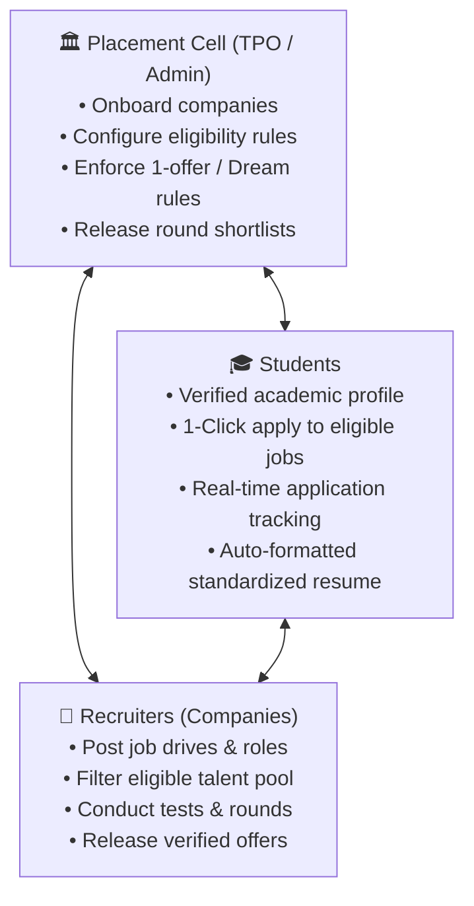
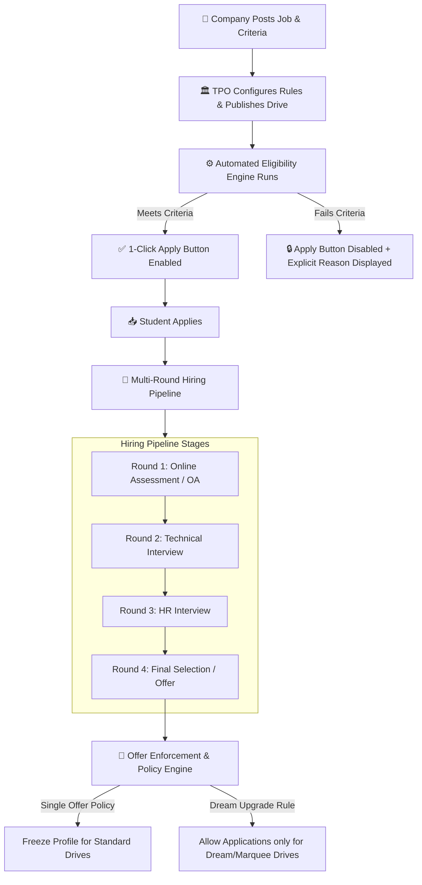

# Superset Placement Engine: Architecture, Workflow & Implementation Blueprint

---

## 📌 Executive Summary

**Superset** is an end-to-end **Campus Placement Automation & ATS (Applicant Tracking System)**. 
Traditionally, college placement cells (TPOs) handle recruitment manually using Google Sheets, WhatsApp groups, and notice boards, which causes data errors, student disputes, and placement policy violations. Superset automates and digitizes this entire lifecycle.

In our **KIET Campus Platform**, we are not only adopting the core strengths of Superset (automated eligibility and multi-round pipeline tracking) but also upgrading it by integrating **Verifiable Proof of Work (GitHub, LeetCode, Badges, and Project Verification)**.

---

## 👥 1. The Three-Party Stakeholder Model



* **Students:** Access a verified dashboard with locked academic marks, active/dead backlogs, and standardized resume generation. Eligible drives show an active "Apply" button; ineligible drives clearly show why they are locked.
* **Placement Cell (TPO / College Admin):** Publishes drives, sets branch/CGPA criteria, manages round shortlists, and enforces college placement policies.
* **Recruiters (Companies):** Receives verified candidate databases, defines assessment stages, shortlists applicants, and rolls out job offers.

---

## 🔄 2. End-to-End Placement Workflow (Step-by-Step)



### Step 1: Verified Master Student Database (Anti-Fraud)
* Students cannot fake CGPA, 10th/12th percentages, or backlog counts.
* Academic records are synced with and locked by College Administration.
* Standardized, audit-compliant PDF resumes are generated directly by the system.

### Step 2: Strict Rule-Based Eligibility Engine
When a drive is created (e.g., TCS, Amazon, Infosys), the TPO sets strict rules:
* **Eligible branches:** CSE, IT, CS-AI, etc.
* **Academic cutoffs:** CGPA ≥ 7.5, 10th/12th ≥ 60%, Max education gap ≤ 1 year.
* **Backlogs:** 0 active backlogs.

> **Transparency Layer:**
> * If a student is eligible $\rightarrow$ **"Apply"** button is active.
> * If ineligible $\rightarrow$ button is disabled with an explicit tooltip/banner:  
>   *(e.g., "Ineligible: Minimum CGPA required is 7.5 (Your CGPA: 7.1)").*  
>   This eliminates student disputes and saves hundreds of hours for the TPO.

### Step 3: Multi-Round Selection Pipeline
Each drive moves through structured sequential stages:
$$\text{Online Assessment (OA)} \longrightarrow \text{Group Discussion} \longrightarrow \text{Technical Interview} \longrightarrow \text{HR Interview} \longrightarrow \text{Final Offer}$$
* TPOs/Recruiters upload round-wise shortlists via CSV or direct dashboard selection.
* Unselected candidates automatically move to `REJECTED` status with clear audit trails.

### Step 4: Institutional Placement Policies (Offer Enforcement Engine)
Colleges enforce strict hiring codes to ensure equitable placement across the batch:
1. **1-Student 1-Job Policy:** Once an offer is secured, the candidate’s profile is automatically frozen for remaining regular drives.
2. **Dream / Marquee Upgrade Rule:** A student with a 4 LPA offer can only unlock applications for drives offering $\ge 8\text{ LPA}$ (Dream Category), preventing offer hoarding while allowing career growth.

---

## 💻 3. Backend Implementation Blueprint (Our System)

### A. Database Schema (`Prisma` / `PostgreSQL`)

```prisma
enum ApplicationStatus {
  APPLIED
  OA_SHORTLISTED
  INTERVIEW_SCHEDULED
  HR_ROUND
  OFFERED
  REJECTED
  WITHDRAWN
}

model JobDrive {
  id              String             @id @default(uuid())
  companyName     String             // e.g., "Amazon", "TCS"
  jobRole         String             // e.g., "SDE-1", "Graduate Engineer Trainee"
  ctcLpa          Float              // e.g., 12.5
  isDreamCompany  Boolean            @default(false)
  driveDate       DateTime
  deadline        DateTime
  
  // JSONB rule engine allows 100% dynamic eligibility rules per drive
  eligibilityRules Json
  /* Example JSON Structure:
    {
      "minCgpa": 7.5,
      "allowedBranches": ["CSE", "IT", "CS-AI"],
      "maxBacklogs": 0,
      "maxGapYears": 1,
      "minVerifiedBadges": 3,
      "requiredSkills": ["Node.js", "PostgreSQL"]
    }
  */

  applications    JobApplication[]
  createdAt       DateTime           @default(now())
  updatedAt       DateTime           @updatedAt

  @@index([deadline])
}

model JobApplication {
  id          String            @id @default(uuid())
  jobDriveId  String
  userId      String            // Student ID
  status      ApplicationStatus @default(APPLIED)
  notes       String?
  appliedAt   DateTime          @default(now())
  updatedAt   DateTime          @updatedAt

  jobDrive    JobDrive          @relation(fields: [jobDriveId], references: [id], onDelete: Cascade)

  // Prevent duplicate applications by the same student for the same drive
  @@unique([jobDriveId, userId])
  @@index([userId, status])
}
```

---

### B. Eligibility Checking Engine (`Node.js`)

```javascript
/**
 * Evaluates student profile against drive criteria.
 * Combines traditional academic rules with Proof-of-Work checks.
 */
function evaluateJobEligibility(student, driveRules) {
  // 1. CGPA Check
  if (student.cgpa < driveRules.minCgpa) {
    return {
      eligible: false,
      reason: `CGPA requirement not met (Required: ${driveRules.minCgpa}, Current: ${student.cgpa})`
    };
  }

  // 2. Branch Eligibility
  if (!driveRules.allowedBranches.includes(student.branch)) {
    return {
      eligible: false,
      reason: `Branch ${student.branch} is not eligible for this drive`
    };
  }

  // 3. Backlog Constraint
  if (student.activeBacklogs > driveRules.maxBacklogs) {
    return {
      eligible: false,
      reason: `Active backlogs exceed limit (Allowed: ${driveRules.maxBacklogs}, You have: ${student.activeBacklogs})`
    };
  }

  // 4. Education Gap Limit
  if (student.educationGapYears > driveRules.maxGapYears) {
    return {
      eligible: false,
      reason: `Education gap exceeds maximum allowed (${driveRules.maxGapYears} year/s)`
    };
  }

  // 5. Offer Policy Enforcement (1-Student 1-Job / Dream Rule)
  if (student.currentOfferCtc) {
    const isDreamDrive = driveRules.isDreamCompany || driveRules.ctcLpa >= (student.currentOfferCtc * 1.5);
    if (!isDreamDrive) {
      return {
        eligible: false,
        reason: `Offer Policy: You already hold an offer of ${student.currentOfferCtc} LPA. You can only apply to Dream drives (>= ${student.currentOfferCtc * 1.5} LPA).`
      };
    }
  }

  // 6. Custom Innovation: Proof of Work / Verified Badges Requirement
  if (driveRules.minVerifiedBadges && student.verifiedBadgesCount < driveRules.minVerifiedBadges) {
    return {
      eligible: false,
      reason: `Requires at least ${driveRules.minVerifiedBadges} verified skill badges (You have: ${student.verifiedBadgesCount})`
    };
  }

  return { eligible: true, reason: "Eligible to apply" };
}
```

---

## 🚀 4. How Our KIET Platform Beats Vanilla Superset

| Feature | Standard Superset | Our KIET Platform (Superset + Proof of Work) |
| :--- | :--- | :--- |
| **Primary Metric** | CGPA, Marks, & Claims | **CGPA + Verified Code & Project Proof** |
| **Resume Authenticity** | Standard PDF (Self-claimed projects) | **Code-inspected Projects + LeetCode Stats + Teacher Sign-off** |
| **Target Audience** | Final year students during placement season | **1st to 4th year continuous talent pipeline** |
| **Recruiter Experience** | Filter by Marks only | **Filter by Marks + Specific Tech Stacks + Real GitHub Repos** |
| **Student Motivation** | Pure anxiety & last-minute preparation | **Gamified badges, peer leaderboards, and continuous skill roadmaps** |

---

## 🎯 5. Takeaways for the 25 Oct Dean Meeting

When Dean asks: *"Superset already automates placement, why do we need this?"*

> **Winning Pitch Line:**  
> *"Sir, Superset manages the **paperwork of recruitment**, but it does not improve the **quality of our candidates**. Our platform ensures that by the time Superset drives open, KIET students don't just have high marks—they have verified code, live projects, and proven problem-solving track records that top-tier recruiters actually hire."*

---
*Generated: 15 October 2026 — Placement Engine Architecture Specification.*
