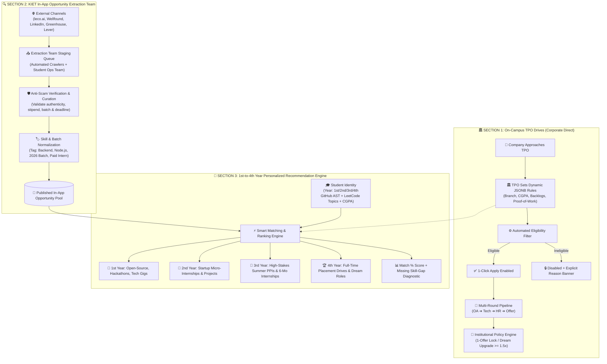
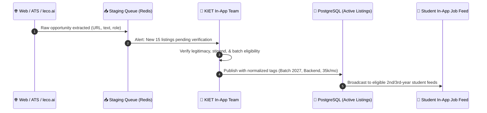

# Superset Placement Engine: Architecture, Workflow & Implementation Blueprint
> **The 3 Pillars of Campus Hiring & Opportunity Discovery for KIET Group of Institutions**

---

## 📌 Executive Summary

Traditional campus placement portals (e.g., vanilla Superset, Google Sheets, WhatsApp groups) suffer from critical limitations:
1. **TPO-Only Narrow Focus:** They only activate in the 7th/8th semester for 4th-year final placements, completely ignoring 1st, 2nd, and 3rd-year students.
2. **Campus-Only Siphon:** When on-campus recruitment slows down due to market cycles, students have zero assistance and are left to scramble across unvetted job boards.
3. **One-Size-Fits-All Inefficiency:** Students receive flooded notifications for roles they are either unqualified for or uninterested in.

In our **KIET Campus Platform (`Only_Jobs`)**, the **Placement Engine** is engineered as a **Triple-Engine Opportunity Ecosystem**:

```
┌─────────────────────────────────────────────────────────────────────────────────────────┐
│                           SUPERSET PLACEMENT & OPPORTUNITY ENGINE                       │
├────────────────────────────┬────────────────────────────┬───────────────────────────────┤
│  SECTION 1: ON-CAMPUS TPO  │  SECTION 2: IN-APP TEAM    │  SECTION 3: 1st–4th YEAR      │
│  CORPORATE DRIVES          │  OPPORTUNITY EXTRACTION    │  RECOMMENDATION ENGINE        │
├────────────────────────────┼────────────────────────────┼───────────────────────────────┤
│ • Official college drives  │ • In-app student/admin team│ • Academic-year tailored matching│
│ • Dynamic JSONB criteria   │ • Curates off-campus jobs  │   (1st: GSoC/Exploration      │
│ • Multi-round pipeline     │   (leco.ai, LinkedIn, etc.)│    2nd: Startup internships   │
│ • 1-Student 1-Job policy   │ • Anti-scam verification   │    3rd: Summer/6-month PPI    │
│ • Dream upgrade locks      │ • Standardized tags/skills │    4th: Full-time FTE drives) │
│ • Anti-fraud mark audits   │ • Direct 1-click apply     │ • Skill-gap alerts & Match %  │
└────────────────────────────┴────────────────────────────┴───────────────────────────────┘
```

---

## 🏗️ Master Architectural Flow



---

## 🏛️ Section 1: On-Campus TPO Placement Engine

The core operational system for the **Training & Placement Office (TPO)**, replacing spreadsheets with an automated, policy-enforced ATS.

### 1. Dynamic JSONB Eligibility Rules
Drives don't use hardcoded schema limits. Every drive defines rich JSONB criteria:
```json
{
  "minCgpa": 7.5,
  "allowedBranches": ["CSE", "IT", "CS-AI"],
  "maxActiveBacklogs": 0,
  "maxHistoricBacklogs": 1,
  "minTenthPercentage": 70.0,
  "minTwelfthPercentage": 70.0,
  "maxEducationGapYears": 1,
  "eligibleBatches": [2026],
  "minVerifiedBadges": 2,
  "requiredCodingThreshold": {
    "minLeetCodeSolved": 150,
    "minGitHubCommits": 100
  }
}
```

### 2. Multi-Round Hiring Pipeline
Each drive transitions through structured, auditable stages:
$$\text{Applied} \longrightarrow \text{OA Shortlisted} \longrightarrow \text{Technical Round 1} \longrightarrow \text{Technical Round 2} \longrightarrow \text{HR Round} \longrightarrow \text{Offered} / \text{Rejected}$$
* **Bulk Shortlist Processing:** TPOs upload CSVs or select candidates with 1-click.
* **Instant Transparency:** Ineligible students see exactly why they cannot apply (e.g., *"Requires CGPA $\ge$ 7.5, current CGPA: 7.2"*), completely eliminating physical TPO disputes.

### 3. Institutional Policy & Offer Enforcement
Colleges enforce strict equity policies to prevent offer hoarding:
1. **1-Student 1-Job Rule:** Once a student accepts an offer, their profile is frozen for other regular drives.
2. **Dream / Super-Dream Upgrade Rule:**
   - A student placed at 4.5 LPA is eligible **only** for "Dream Drives" ($\ge 8$ LPA or $\ge 1.75\times$ current offer).
   - A student placed at 12 LPA is eligible **only** for "Super Dream / Marquee Drives" ($\ge 20$ LPA).
   - If selected for a Dream drive, their previous lower-tier offer is released to the next waitlisted student.

---

## 🔍 Section 2: KIET In-App Opportunity Extraction Team

To ensure students are not solely dependent on the college TPO, the platform incorporates a dedicated **In-App Opportunity Extraction Engine** operated by the **Student Placement Ops Committee + Automated Ingestors**.

### 1. Ingestion Channels
* **AI & Modern Platforms:** Curated extraction from `leco.ai`, Wellfound (AngelList), and Y-Combinator WorkAtAStartup.
* **Direct ATS Feeds:** Legitimate public feeds from **Greenhouse, Lever, and Ashby** used by high-growth product startups.
* **Verified Off-Campus Drives:** National hiring challenges (TCS NQT, Cognizant GenC, Infosys InfyTQ, Amazon WOW, Google Girl Hackathon).

### 2. Human-in-the-Loop Curation & Anti-Scam Guard
Before any external job reaches students, it undergoes an institutional verification pipeline:
* **Scam Filter:** Eliminates pay-to-work schemes, fake consultancy calls, and unverified training programs.
* **Authenticity Check:** Verifies corporate domains, LinkedIn company profiles, and official recruitment mailboxes.
* **Normalization:** Translates raw job postings into uniform fields:
  - Exact Role & Work Mode (Remote / Hybrid / On-site Delhi-NCR).
  - Monthly Stipend (Internship) or Annual CTC (FTE).
  - Target Graduation Batches (e.g., 2026, 2027, 2028).
  - Direct Application URLs or Referral Links.



---

## 🎯 Section 3: 1st to 4th-Year Personalized Recommendation Engine

Unlike vanilla Superset, which is useless for 1st, 2nd, and 3rd-year students, **Only_Jobs guides students throughout their 4-year lifecycle**:

```
YEAR 1 (Sem 1–2)         YEAR 2 (Sem 3–4)         YEAR 3 (Sem 5–6)         YEAR 4 (Sem 7–8)
┌──────────────────┐     ┌──────────────────┐     ┌──────────────────┐     ┌──────────────────┐
│ 🌱 FOUNDATIONS   │     │ 🚀 ACCELERATION  │     │ 💼 PRE-PLACEMENT │     │ 🏆 CAREER LAUNCH │
│ • Open Source    │     │ • Startup Gigs   │     │ • High-Stakes PPI│     │ • On-Campus TPO  │
│ • GSoC / Hackers │     │ • Micro-Interns  │     │ • 6-Month Interns│     │ • Dream Drives   │
│ • Campus Gigs    │     │ • Junior Frontend│     │ • Corporate Tests│     │ • Off-Campus FTE │
│ • DSA Milestones │     │ • Verified Badges│     │ • Skill-Gap Alerts│    │ • Marquee Offers │
└──────────────────┘     └──────────────────┘     └──────────────────┘     └──────────────────┘
```

### 1. Year-Wise Opportunity Curation

| Academic Year | Focus Opportunities | How Only_Jobs Matches Them |
| :--- | :--- | :--- |
| **1st Year (Fresher)** | Open-Source programs (GSoC, MLH, Outreachy), beginner hackathons, college technical society internships, competitive programming tracks. | Matches by GitHub onboarding milestones, beginner DSA streaks, and fundamental language tags (C++, Python). |
| **2nd Year (Sophomore)** | Winter/Summer micro-internships, early startup roles, frontend/backend internships, open-source contributor badges. | Evaluates student's top 3 GitHub project tech stacks (React, Node.js) and verified lab project room scores. |
| **3rd Year (Pre-Final)** | **Critical Summer Internships & 6-Month Pre-Placement Internships (PPIs)** (e.g., Amazon, Microsoft, high-growth startups). | High-precision vector matching against LeetCode topic depth (DP, Graphs, Trees) and system design projects. |
| **4th Year (Final Year)** | **Full-Time On-Campus Placement Drives (TPO)** + high-tier off-campus fresher roles (FTE). | Strict policy-guided matching, dream company opportunities, and recruiter talent extraction dossiers. |

### 2. Smart Match % & Skill-Gap Diagnostic
For every job card (on-campus or curated), the engine calculates:
* **Profile Match Percentage:** E.g., `88% Match`.
* **Skill-Gap Breakdown:**
  - ✅ Matched: `Node.js`, `PostgreSQL`, `REST APIs`, `CGPA > 7.5`
  - ❌ Missing: `Docker`, `Redis`
* **Direct Action:** *"Complete Phase 2 of Backend Roadmap to unlock 100% eligibility."*

---

## 💻 Database Schema Architecture (`Prisma` / `PostgreSQL`)

The database unifies **On-Campus TPO Drives**, **In-App Team Curated Jobs**, and **Student Applications** into a clean, relational schema:

```prisma
enum OpportunityType {
  ON_CAMPUS_TPO         // Section 1: Official college drive
  IN_APP_CURATED        // Section 2: External job extracted by in-app team
  OPEN_SOURCE_PROGRAM   // Section 3: GSoC, MLH, Hackathons for 1st/2nd years
}

enum OpportunityCategory {
  INTERNSHIP_SUMMER     // 2-month summer internship (3rd years)
  INTERNSHIP_SEMESTER   // 6-month pre-placement internship (7th/8th sem)
  MICRO_INTERNSHIP      // Part-time / project gig (1st/2nd years)
  FULL_TIME_FTE         // Full-time corporate placement (4th years)
}

enum ApplicationStatus {
  APPLIED
  OA_SHORTLISTED
  INTERVIEW_SCHEDULED
  HR_ROUND
  OFFERED
  REJECTED
  WITHDRAWN
}

model JobOpportunity {
  id                  String               @id @default(uuid())
  tenantId            String               @default("kiet-main")
  type                OpportunityType      @default(ON_CAMPUS_TPO)
  category            OpportunityCategory  @default(FULL_TIME_FTE)
  
  // Basic Details
  companyName         String               // e.g. "Amazon", "Cred", "Google Summer of Code"
  jobRole             String               // e.g. "Backend Intern", "SDE-1"
  location            String               // e.g. "Delhi-NCR", "Bengaluru", "Remote"
  ctcLpa              Float?               // For FTE (e.g. 14.5 LPA)
  stipendMonthly      Float?               // For Internships (e.g. 45,000 INR/mo)
  isDreamCompany      Boolean              @default(false)
  
  // Application URLs
  externalApplyUrl    String?              // Populated for IN_APP_CURATED jobs
  driveDate           DateTime?
  deadline            DateTime
  
  // Dynamic Rule Engine for Section 1 (On-Campus TPO)
  eligibilityRules    Json?
  /* JSONB Structure:
    {
      "minCgpa": 7.5,
      "allowedBranches": ["CSE", "IT", "CS-AI"],
      "maxBacklogs": 0,
      "eligibleBatches": [2026, 2027],
      "minVerifiedBadges": 2
    }
  */

  // Section 2 & 3: Metadata for In-App Extraction & Year-Based Matching
  targetYears         Int[]                // [1, 2] for 1st/2nd yr gigs; [3] for summer interns; [4] for FTE
  targetSkills        String[]             // ["Node.js", "PostgreSQL", "Docker"]
  curatedByUserId     String?              // In-App Team member ID who verified the post
  isVerifiedByTeam    Boolean              @default(false)

  // Section 3: Semantic Match Vector (AI Embeddings)
  opportunityVector   Unsupported("vector(384)")?

  applications        JobApplication[]
  createdAt           DateTime             @default(now())
  updatedAt           DateTime             @updatedAt

  @@index([type, category])
  @@index([deadline])
  @@index([isVerifiedByTeam])
}

model JobApplication {
  id                  String               @id @default(uuid())
  jobOpportunityId    String
  userId              String               // Student ID
  status              ApplicationStatus    @default(APPLIED)
  roundIndex          Int                  @default(1)
  appliedAt           DateTime             @default(now())
  updatedAt           DateTime             @updatedAt

  opportunity         JobOpportunity       @relation(fields: [jobOpportunityId], references: [id], onDelete: Cascade)

  @@unique([jobOpportunityId, userId])
  @@index([userId, status])
}
```

---

## 🚀 How the Triple-Engine Model Wins the Dean Pitch

When the Dean asks: *"Superset already handles our placement drives, why do we need this?"*

| Dimension | Vanilla Superset | Our KIET Platform (`Only_Jobs`) |
| :--- | :--- | :--- |
| **Scope** | 4th-year placements only | **1st to 4th-year end-to-end career growth** |
| **Off-Campus Support** | Zero (goes silent during slowdowns) | **Dedicated in-app team curating verified off-campus roles** |
| **Candidate Quality** | Evaluates self-declared PDF resumes | **Evaluates verified GitHub code, LeetCode stats, and lab badges** |
| **Personalization** | Spam notifications to whole batch | **AI-powered match score + targeted skill gap alerts** |
| **Student Readiness** | Frantic preparation in 7th semester | **Continuous milestone roadmaps starting from 1st year** |

> **Winning Pitch Statement:**  
> *"Superset is just a filing cabinet for 4th-year placement drives. Our platform is an active 4-year talent engine that curates opportunities, proves student competence with real code, and ensures our placement records thrive in any market condition."*

---
*Maintained by Arpit Prajapati & The KIET Campus Engineering Team. Last updated: October 2026.*
