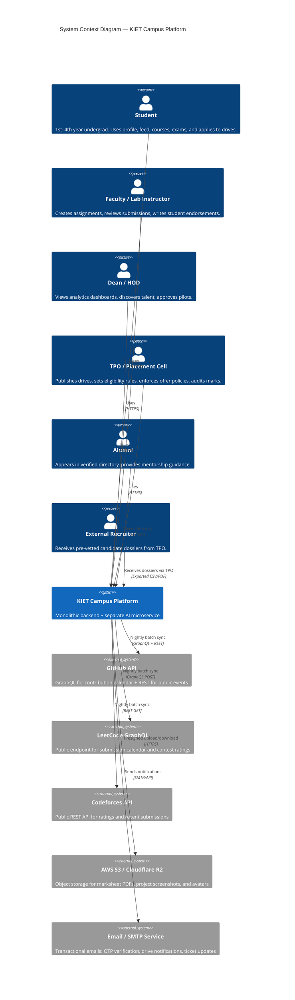
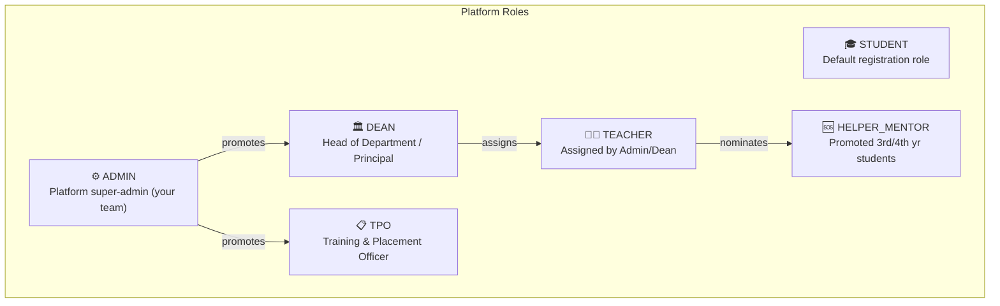
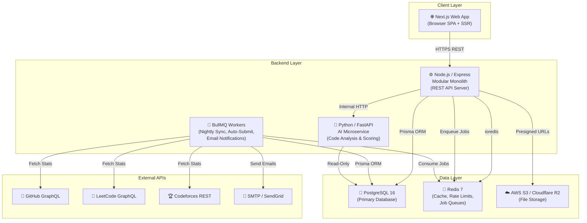
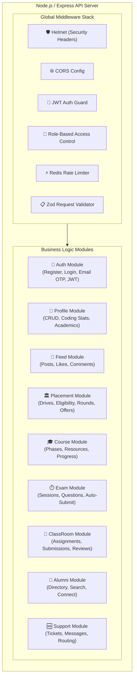
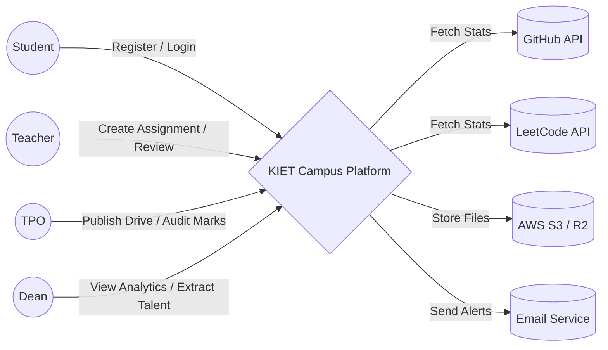
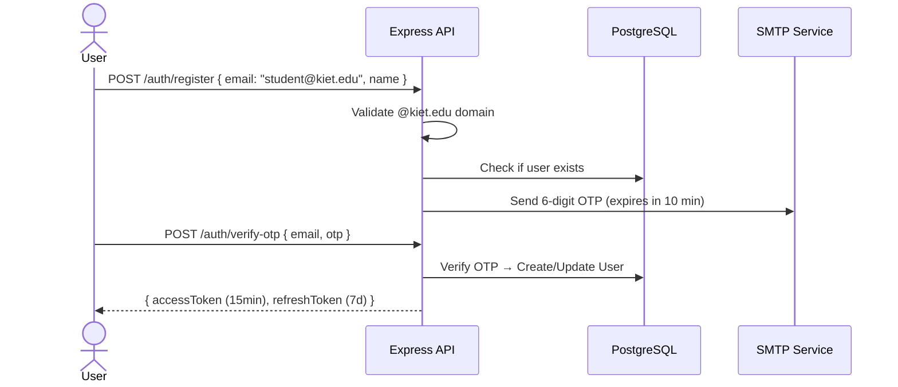
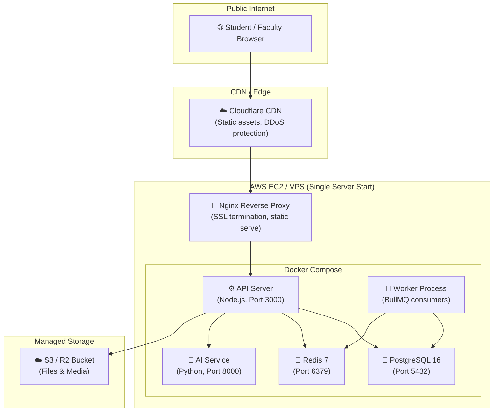

   # High-Level Design Document (HDD)
## KIET Campus Talent & Career Development Platform

---

## 📖 Table of Contents

1. [System Context & Boundaries](#1-system-context--boundaries)
2. [Functional Requirements Summary](#2-functional-requirements-summary)
3. [Non-Functional Requirements (NFRs)](#3-non-functional-requirements-nfrs)
4. [User Roles & Access Matrix (RBAC)](#4-user-roles--access-matrix-rbac)
5. [System Architecture — Level 0 (Context Diagram)](#5-system-architecture--level-0-context-diagram)
6. [System Architecture — Level 1 (Container Diagram)](#6-system-architecture--level-1-container-diagram)
7. [System Architecture — Level 2 (Component Diagram)](#7-system-architecture--level-2-component-diagram)
8. [Data Flow Diagrams (DFDs)](#8-data-flow-diagrams-dfds)
9. [Database Design — ER Overview](#9-database-design--er-overview)
10. [API Layer Design](#10-api-layer-design)
11. [Caching & Queue Strategy](#11-caching--queue-strategy)
12. [Security Architecture](#12-security-architecture)
13. [Infrastructure & Deployment Architecture](#13-infrastructure--deployment-architecture)
14. [Capacity Estimation & Sizing](#14-capacity-estimation--sizing)
15. [Failure Modes & Resilience](#15-failure-modes--resilience)

---

## 1. System Context & Boundaries

### 1.1 What Is This System?

A **single-institution campus platform** for KIET Group of Institutions that replaces fragmented placement workflows (WhatsApp groups, Google Sheets, Superset forms, manual resume collection) with a unified, proof-based talent ecosystem.

### 1.2 What This System IS

* A verified student profile and proof-of-work aggregator.
* A triple-pillar placement and career discovery engine (On-Campus TPO Drives, In-App Curated Opportunities, and 1st-to-4th-Year Recommendations).
* A structured skill roadmap with gatekept certifications.
* A campus social feed with institutional controls.
* A faculty project verification and grading portal.
* A mentor/helper ticket-based support system.

### 1.3 What This System IS NOT

* It is **not** a general-purpose social network (no DMs, no stories, no reels).
* It is **not** a multi-tenant SaaS product (built exclusively for KIET, architecture allows future extension).
* It is **not** an LMS that hosts video lectures (it curates external resources and tests comprehension).
* It is **not** an uncurated generic job scraper (all external opportunities are strictly curated and verified by the in-app operations team for quality, batch eligibility, and anti-scam protection).

### 1.4 System Boundary Diagram



---

## 2. Functional Requirements Summary

### 2.1 Module Inventory

| # | Module | Primary Users | Core Capability |
|:--|:-------|:-------------|:----------------|
| M1 | **Auth & RBAC** | All | `@kiet.edu` SSO, JWT sessions, role-based route guards |
| M2 | **Student Profile** | Student, TPO, Dean | Admin-locked meta, coding stats (GitHub/LC/CF), academics with audit trail |
| M3 | **Campus Feed** | Student, Teacher, Dean | Achievement posts (3/day Redis limit), cursor pagination, role-based card styling |
| M4 | **Placement Engine (Triple-Pillar)** | TPO, Student, In-App Team, Recruiter | (1) On-Campus TPO Drives & Policy Engine, (2) In-App Off-Campus Curation (leco.ai/ATS), (3) 1st-4th Yr Vector Recommendations |
| M5 | **Learning Engine** | Student, Mentor | 3-phase course roadmaps, resource tracking, phase-gatekept progression |
| M6 | **Exam Engine** | Student, Teacher | Server-timed MCQ tests, delayed BullMQ auto-submit, anti-cheat telemetry |
| M7 | **Class Project Rooms** | Student, Teacher | Zero-text submission rooms, Zod-validated payloads, 1-click faculty review |
| M8 | **Alumni Directory** | Student, Alumni | Auto-graduation transition, package privacy toggle, multi-filter search |
| M9 | **Mentor Support** | Student, Helper/TA | Structured doubt tickets, auto-routing to least-busy helper, star ratings |
| M10 | **AI Service** | Internal | Project plagiarism detection, code AST similarity, skill gap recommendations |

### 2.2 Cross-Cutting Concerns

| Concern | Implementation |
|:--------|:--------------|
| **Rate Limiting** | Redis atomic counters (feed: 3 posts/day, API: token bucket) |
| **File Uploads** | S3/R2 presigned URLs — zero server memory impact |
| **Notifications** | BullMQ delayed jobs for email alerts on drive openings, submission reviews, ticket replies |
| **Audit Trails** | `createdAt`, `updatedAt`, `auditedBy` on all mutable academic records |
| **Soft Deletes** | Posts and submissions use status flags rather than `DELETE` operations |

---

## 3. Non-Functional Requirements (NFRs)

| Attribute | Target | Rationale |
|:----------|:-------|:----------|
| **Concurrent Users** | 500–800 peak (during placement drive announcements) | 7,000 total students, ~10% simultaneous active |
| **API Response Time (p95)** | < 200ms for cached reads, < 500ms for DB writes | Profile loads, feed scrolls must feel instant |
| **Nightly Sync Duration** | < 60 minutes for 7,000 coding profiles | Window: 00:00–01:00 AM when traffic is near-zero |
| **Availability** | 99.5% uptime (allows ~3.6 hours downtime/month) | Acceptable for internal campus tool; no SLA with external clients |
| **Data Durability** | PostgreSQL WAL + daily automated backups to S3 | Academic records and placement data are irreplaceable |
| **Security** | OWASP Top 10 compliance, JWT rotation, Helmet.js headers | Handles PII (marks, emails, phone numbers) |
| **Scalability Ceiling** | 15,000 students without architecture change | Covers KIET growth + potential sister institution onboarding |

---

## 4. User Roles & Access Matrix (RBAC)

### 4.1 Role Definitions



### 4.2 Permission Matrix

| Resource / Action | STUDENT | HELPER | TEACHER | TPO | DEAN | ADMIN |
|:------------------|:-------:|:------:|:-------:|:---:|:----:|:-----:|
| View own profile | ✅ | ✅ | ✅ | ✅ | ✅ | ✅ |
| Edit own bio/handles | ✅ | ✅ | — | — | — | ✅ |
| Edit locked academic meta | ❌ | ❌ | ❌ | ✅ | ✅ | ✅ |
| Create feed post | ✅ | ✅ | ✅ | ✅ | ✅ | ✅ |
| Flag/hide any post | ❌ | ❌ | ✅ | ✅ | ✅ | ✅ |
| Create class room | ❌ | ❌ | ✅ | ❌ | ✅ | ✅ |
| Submit project to room | ✅ | ✅ | ❌ | ❌ | ❌ | ❌ |
| Review/grade submission | ❌ | ❌ | ✅ | ❌ | ✅ | ✅ |
| Create placement drive | ❌ | ❌ | ❌ | ✅ | ✅ | ✅ |
| Apply to drive | ✅ | ✅ | ❌ | ❌ | ❌ | ❌ |
| Manage drive rounds | ❌ | ❌ | ❌ | ✅ | ✅ | ✅ |
| Audit/flag academic fraud | ❌ | ❌ | ❌ | ✅ | ✅ | ✅ |
| Freeze student account | ❌ | ❌ | ❌ | ✅ | ✅ | ✅ |
| Create course & phases | ❌ | ❌ | ✅ | ❌ | ✅ | ✅ |
| Take phase exam | ✅ | ✅ | ❌ | ❌ | ❌ | ❌ |
| Resolve support tickets | ❌ | ✅ | ✅ | ❌ | ❌ | ✅ |
| Extract talent CSV | ❌ | ❌ | ❌ | ✅ | ✅ | ✅ |
| View all analytics | ❌ | ❌ | Dept only | ✅ | ✅ | ✅ |

---

## 5. System Architecture — Level 0 (Context Diagram)

The highest abstraction: the platform as a single black box interacting with its actors and external systems.

```
                    ┌─────────────────────────────────────────┐
                    │         EXTERNAL SYSTEMS                │
                    │  GitHub API • LeetCode • Codeforces     │
                    │  AWS S3/R2 • SMTP • @kiet.edu SSO       │
                    └──────────────────┬──────────────────────┘
                                       │
           ┌───────────┐    ┌──────────▼──────────┐    ┌───────────┐
           │ Students   │───▶│                      │◀───│ Faculty   │
           │ (7,000)    │    │   KIET CAMPUS        │    │ Teachers  │
           └───────────┘    │   PLATFORM            │    └───────────┘
                            │                      │
           ┌───────────┐    │   • Auth & RBAC      │    ┌───────────┐
           │ TPO /      │───▶│   • Profile Engine   │◀───│ Dean /    │
           │ Placement  │    │   • Feed & Social    │    │ HOD       │
           └───────────┘    │   • Placement ATS     │    └───────────┘
                            │   • Learning Engine   │
           ┌───────────┐    │   • Exam Engine       │    ┌───────────┐
           │ Alumni     │───▶│   • Project Rooms    │◀───│ Mentors / │
           │ Network    │    │   • Support Tickets   │    │ Helpers   │
           └───────────┘    │   • AI Microservice   │    └───────────┘
                            └──────────────────────┘
```

---

## 6. System Architecture — Level 1 (Container Diagram)

Breaking the black box into deployable containers:



### Container Responsibilities

| Container | Technology | Responsibility | Scaling Strategy |
|:----------|:-----------|:---------------|:-----------------|
| **Web App** | Next.js 14 (App Router) | UI rendering, client-side routing, auth state | CDN + Vercel/static |
| **API Server** | Node.js 20 + Express 5 | All REST endpoints, middleware, business logic | Horizontal (PM2 cluster / Docker replicas) |
| **AI Microservice** | Python 3.12 + FastAPI | Code plagiarism AST analysis, similarity scoring | Single instance, scale on demand |
| **BullMQ Workers** | Node.js 20 + BullMQ | Nightly coding sync, exam auto-submit, email dispatch | Separate process, concurrency-tuned |
| **PostgreSQL** | PostgreSQL 16 | Persistent structured data, ACID transactions | Vertical (RDS), read replicas if needed |
| **Redis** | Redis 7 | Rate limit counters, BullMQ queues, session cache | Single node (7K users don't need cluster) |
| **S3 / R2** | AWS S3 or Cloudflare R2 | PDFs, project screenshots, avatars, certificates | Managed, auto-scaling |

---

## 7. System Architecture — Level 2 (Component Diagram)

Zooming into the **API Server** container — the modular monolith:



### Module → File Structure (Project Layout)

```
src/
├── config/
│   ├── database.js          # Prisma client singleton
│   ├── redis.js             # ioredis connection
│   ├── s3.js                # S3/R2 client + presigned URL helper
│   └── env.js               # Environment variable validation (Zod)
│
├── middlewares/
│   ├── auth.middleware.js          # JWT verification
│   ├── rbac.middleware.js          # Role permission checker
│   ├── rateLimiter.middleware.js   # Redis atomic counter guards
│   └── validate.middleware.js      # Zod schema validation wrapper
│
├── modules/
│   ├── auth/
│   │   ├── auth.routes.js
│   │   ├── auth.controller.js
│   │   ├── auth.service.js
│   │   └── auth.validation.js
│   │
│   ├── profile/
│   │   ├── profile.routes.js
│   │   ├── profile.controller.js
│   │   ├── profile.service.js
│   │   └── profile.validation.js
│   │
│   ├── feed/
│   │   ├── feed.routes.js
│   │   ├── feed.controller.js
│   │   └── feed.validation.js
│   │
│   ├── placement/
│   │   ├── placement.routes.js
│   │   ├── placement.controller.js
│   │   ├── eligibility.engine.js    # JSONB rule evaluator
│   │   └── placement.validation.js
│   │
│   ├── course/
│   │   ├── course.routes.js
│   │   ├── course.controller.js
│   │   ├── phaseAccess.guard.js     # Prerequisite gatekeeper
│   │   └── course.validation.js
│   │
│   ├── exam/
│   │   ├── exam.routes.js
│   │   ├── exam.controller.js
│   │   ├── examGrading.service.js   # Auto-evaluation logic
│   │   └── exam.validation.js
│   │
│   ├── classroom/
│   │   ├── classroom.routes.js
│   │   ├── classroom.controller.js
│   │   ├── submission.controller.js
│   │   └── classroom.validation.js  # Zero-text Zod guard
│   │
│   ├── alumni/
│   │   ├── alumni.routes.js
│   │   ├── alumni.controller.js
│   │   └── alumni.validation.js
│   │
│   └── support/
│       ├── support.routes.js
│       ├── support.controller.js
│       ├── helperRouter.service.js  # Least-busy assignment logic
│       └── support.validation.js
│
├── services/
│   ├── github.service.js       # GitHub GraphQL + REST
│   ├── leetcode.service.js     # LeetCode GraphQL
│   ├── codeforces.service.js   # Codeforces REST
│   ├── email.service.js        # Transactional email dispatcher
│   └── upload.service.js       # S3 presigned URL generator
│
├── workers/
│   ├── codingSync.worker.js    # Nightly 00:00 AM profile sync
│   ├── examAutoSubmit.worker.js # Delayed exam auto-grading
│   └── emailNotify.worker.js   # Async notification dispatch
│
├── prisma/
│   ├── schema.prisma           # Complete unified schema
│   ├── seed.js                 # Dev seed data
│   └── migrations/             # Prisma migration files
│
├── app.js                      # Express app setup + middleware mounting
└── server.js                   # HTTP server entry point
```

---

## 8. Data Flow Diagrams (DFDs)

### 8.1 DFD Level 0 — Entire System



### 8.2 DFD Level 1 — Key Internal Flows

```mermaid
flowchart TD
    subgraph Authentication ["1. Auth Flow"]
        direction LR
        A1[Student enters @kiet.edu email] --> A2[Server sends OTP]
        A2 --> A3[OTP verified → JWT issued]
        A3 --> A4[Role assigned: STUDENT]
    end

    subgraph ProfileSync ["2. Nightly Coding Sync"]
        direction LR
        B1[Cron triggers at 00:00] --> B2[Enqueue 7K jobs to Redis]
        B2 --> B3[Worker fetches GitHub/LC/CF per student]
        B3 --> B4[Update codingStats JSONB in PostgreSQL]
    end

    subgraph PlacementFlow ["3. Placement Drive"]
        direction LR
        C1[TPO creates drive with JSONB rules] --> C2[Eligibility engine evaluates all students]
        C2 --> C3[Eligible students see Apply button]
        C3 --> C4[Multi-round pipeline tracking]
        C4 --> C5[Offer policy enforcement]
    end

    subgraph ExamFlow ["4. Timed Exam"]
        direction LR
        D1[Student clicks Start Exam] --> D2[Server records expiresAt + enqueues auto-submit]
        D2 --> D3[Student answers MCQs]
        D3 --> D4{Manual submit OR timer expires?}
        D4 -->|Manual| D5[Grade + update status]
        D4 -->|Timer| D6[BullMQ worker grades last answers]
    end
```



---

## 9. Database Design — ER Overview

### 9.1 Entity Relationship Diagram (Core Entities)

```mermaid
erDiagram
    User ||--o| StudentProfile : "has"
    User ||--o{ Post : "authors"
    User ||--o{ ExamSession : "takes"
    User ||--o{ ProjectSubmission : "submits"
    User ||--o{ SupportTicket : "raises"
    User ||--o{ ClassEnrollment : "enrolled in"

    StudentProfile ||--o{ AcademicSemester : "has semesters"
    StudentProfile ||--o{ Project : "showcases"
    StudentProfile ||--o{ Certification : "earns"
    StudentProfile ||--o{ StudentBadge : "claims"
    StudentProfile ||--o| AlumniDirectory : "graduates to"

    Post ||--o{ PostLike : "receives"
    Post ||--o{ PostComment : "has"

    Course ||--o{ CoursePhase : "contains"
    CoursePhase ||--o{ PhaseResource : "has resources"
    CoursePhase ||--o{ UserPhaseProgress : "tracks"

    Exam ||--o{ ExamQuestion : "contains"
    Exam ||--o{ ExamSession : "spawns"
    ExamSession ||--o{ StudentExamAnswer : "records"

    ClassRoom ||--o{ ClassEnrollment : "has students"
    ClassRoom ||--o{ ClassAssignment : "has assignments"
    ClassAssignment ||--o{ ProjectSubmission : "receives"

    JobDrive ||--o{ JobApplication : "receives"

    Badge ||--o{ StudentBadge : "assigned via"
    SupportTicket ||--o{ TicketMessage : "has thread"
```



### 9.2 Core Table Summary

| Entity | Primary Key | Critical Indexes | Row Estimate (Year 1) |
|:-------|:-----------|:-----------------|:----------------------|
| `User` | `uuid` | `email (unique)`, `role`, `tenantId` | ~8,000 (students + faculty + admin) |
| `StudentProfile` | `uuid` | `[tenantId, branch, semester]`, `rollNumber` | ~7,000 |
| `Post` | `uuid` | `[tenantId, createdAt DESC]` | ~50,000 (3/day avg × 180 days × subset) |
| `JobDrive` | `uuid` | `[tenantId, deadline]` | ~200 drives/year |
| `JobApplication` | `uuid` | `[jobDriveId, userId] UNIQUE` | ~15,000 |
| `ExamSession` | `uuid` | `[userId, status]` | ~20,000 |
| `ProjectSubmission` | `uuid` | `[assignmentId, status]` | ~10,000 |
| `AcademicSemester` | `uuid` | `[studentProfileId, semesterNumber] UNIQUE` | ~40,000 (7K × avg 5.5 sems) |
| `SupportTicket` | `uuid` | `[tenantId, status]`, `[helperId, status]` | ~5,000 |

---

## 10. API Layer Design

### 10.1 Route Namespace Convention

```
Base URL: /api/v1

/api/v1/auth/*              →  Auth Module (register, login, verify-otp, refresh)
/api/v1/profile/*            →  Student Profile Module (CRUD, coding stats, academics)
/api/v1/feed/*               →  Campus Feed Module (posts, likes, comments)
/api/v1/placement/*          →  Placement Engine (drives, applications, rounds)
/api/v1/courses/*            →  Learning Engine (courses, phases, resources, progress)
/api/v1/exams/*              →  Exam Engine (start, submit, auto-submit, cheating events)
/api/v1/classrooms/*         →  Class Project Rooms (rooms, assignments, submissions, reviews)
/api/v1/alumni/*             →  Alumni Directory (search, filters, connect)
/api/v1/support/*            →  Mentor Support (tickets, messages, resolve)
/api/v1/admin/*              →  Admin Operations (user management, audit, system health)
```

### 10.2 Request → Response Lifecycle

```
Client Request
    │
    ▼
[ Helmet Security Headers ]
    │
    ▼
[ CORS Policy Check ]
    │
    ▼
[ JWT Auth Guard ] ── Invalid Token ──▶ 401 Unauthorized
    │
    ▼
[ RBAC Permission Check ] ── Insufficient Role ──▶ 403 Forbidden
    │
    ▼
[ Redis Rate Limiter ] ── Quota Exceeded ──▶ 429 Too Many Requests
    │
    ▼
[ Zod Schema Validation ] ── Invalid Payload ──▶ 400 Bad Request
    │
    ▼
[ Controller → Service → Prisma ]
    │
    ▼
[ 200/201 Success Response (JSON) ]
```

---

## 11. Caching & Queue Strategy

### 11.1 Redis Usage Map

| Redis Key Pattern | Purpose | TTL |
|:-----------------|:--------|:----|
| `session:{userId}` | JWT session metadata (optional stateful layer) | 7 days |
| `ratelimit:posts:{tenantId}:{userId}:{date}` | Feed daily post counter (max 3) | Midnight auto-expire |
| `ratelimit:api:{ip}` | Global API rate limiting (token bucket) | 60 seconds |
| `exam:session:{sessionId}` | Active exam window metadata | `durationMinutes + 30s` |
| `cache:profile:{userId}` | Frequently accessed profile snapshot | 5 minutes |

### 11.2 BullMQ Queue Map

| Queue Name | Producer | Consumer | Trigger | Concurrency |
|:-----------|:---------|:---------|:--------|:------------|
| `nightly-coding-sync` | Cron (00:00 AM) | `codingSync.worker.js` | Nightly batch of 7K jobs | 2 |
| `exam-auto-submit` | Exam start controller | `examAutoSubmit.worker.js` | Delayed job (duration + 30s) | 3 |
| `email-notifications` | Various controllers | `emailNotify.worker.js` | On drive creation, ticket reply, review completion | 5 |

---

## 12. Security Architecture

### 12.1 Authentication Flow



### 12.2 Security Controls Checklist

| Layer | Control | Implementation |
|:------|:--------|:---------------|
| **Transport** | HTTPS only, HSTS headers | Nginx reverse proxy + Let's Encrypt |
| **Headers** | XSS, CSP, clickjacking protection | `helmet` npm package |
| **Auth** | JWT RS256 with short-lived access tokens | 15 min access, 7 day refresh |
| **Email** | Domain-restricted registration | Regex: `/^[a-zA-Z0-9.]+@kiet\.edu$/` |
| **Input** | Schema validation on every route | `zod` strict parsing + `.strict()` |
| **SQL Injection** | Parameterized queries via ORM | Prisma Client (no raw SQL unless audited) |
| **XSS** | Markdown sanitization | `rehype-sanitize` on frontend rendering |
| **File Upload** | Size limits, MIME validation | 10 MB max, image/* and application/pdf only |
| **Rate Limiting** | Per-user and per-IP throttling | Redis counters + `express-rate-limit` |
| **Secrets** | Environment variables, never in code | `.env` + Docker secrets in production |
| **Audit** | Academic data tamper tracking | `auditStatus`, `auditedBy`, `fraudRemarks` fields |

---

## 13. Infrastructure & Deployment Architecture

### 13.1 Deployment Topology



### 13.2 Docker Compose Overview

```yaml
# docker-compose.yml (Production)
services:
  api:
    build: ./backend
    ports: ["3000:3000"]
    depends_on: [postgres, redis]
    env_file: .env
    restart: always

  worker:
    build: ./backend
    command: node src/workers/index.js
    depends_on: [postgres, redis]
    env_file: .env
    restart: always

  ai-service:
    build: ./ai-service
    ports: ["8000:8000"]
    env_file: .env
    restart: always

  postgres:
    image: postgres:16-alpine
    volumes: ["pg_data:/var/lib/postgresql/data"]
    environment:
      POSTGRES_DB: kiet_campus
      POSTGRES_USER: ${DB_USER}
      POSTGRES_PASSWORD: ${DB_PASSWORD}
    restart: always

  redis:
    image: redis:7-alpine
    volumes: ["redis_data:/data"]
    restart: always

volumes:
  pg_data:
  redis_data:
```

---

## 14. Capacity Estimation & Sizing

### 14.1 Storage Estimates (Year 1)

| Data Category | Calculation | Estimated Size |
|:-------------|:------------|:---------------|
| **PostgreSQL structured data** | ~8K users × 50 tables × avg 2KB/row | ~1–2 GB |
| **Marksheet PDFs** | 7,000 students × avg 5 sems × 500 KB | ~17.5 GB |
| **Project screenshots** | 10,000 submissions × 3 images × 500 KB | ~15 GB |
| **Feed media** | 50,000 posts × 30% with images × 1 MB | ~15 GB |
| **Total S3/R2 storage** | | **~50 GB** (Year 1) |

### 14.2 Compute Estimates

| Resource | Specification | Monthly Cost (Approx.) |
|:---------|:-------------|:----------------------|
| **EC2 / VPS** | t3.medium (2 vCPU, 4 GB RAM) | ₹2,500–3,500 |
| **PostgreSQL** | Included in same server (Docker) | — |
| **Redis** | Included in same server (Docker) | — |
| **S3 / R2 Storage** | 50 GB + transfer | ₹200–500 |
| **Domain + SSL** | kiet-campus.in (example) | ₹500/year |
| **Total (Pilot Phase)** | | **₹3,000–4,500/month** |

---

## 15. Failure Modes & Resilience

| Failure Scenario | Impact | Mitigation |
|:----------------|:-------|:-----------|
| **PostgreSQL crashes** | All reads/writes fail | Docker auto-restart + daily S3 backups + WAL archiving |
| **Redis crashes** | Rate limits disabled, queues paused | Docker auto-restart. Rate limits fail-open (allow traffic, log warning) |
| **Nightly sync worker fails mid-batch** | Some students have stale coding stats | BullMQ `attempts: 2` with exponential backoff. Failed jobs logged for manual retry. |
| **GitHub/LeetCode API is down** | Nightly sync skips affected students | Per-job error isolation. `lastStatsSync` timestamp shows staleness on UI. |
| **S3 bucket unreachable** | File uploads/downloads fail | Presigned URLs have 15-min expiry. Frontend shows retry prompt. |
| **Exam auto-submit worker delayed** | Student's exam graded a few seconds late | 30-second grace period already built into BullMQ delay. Acceptable tolerance. |
| **Server OOM (Out of Memory)** | API or worker crash | Docker memory limits + PM2 auto-restart. Presigned uploads prevent server-side file buffering. |

---

*Document Version: 1.0 — Generated 15 October 2026*
*Next Step: Detailed Low-Level Design (LLD) per module with sequence diagrams, API contracts, and schema migrations.*
